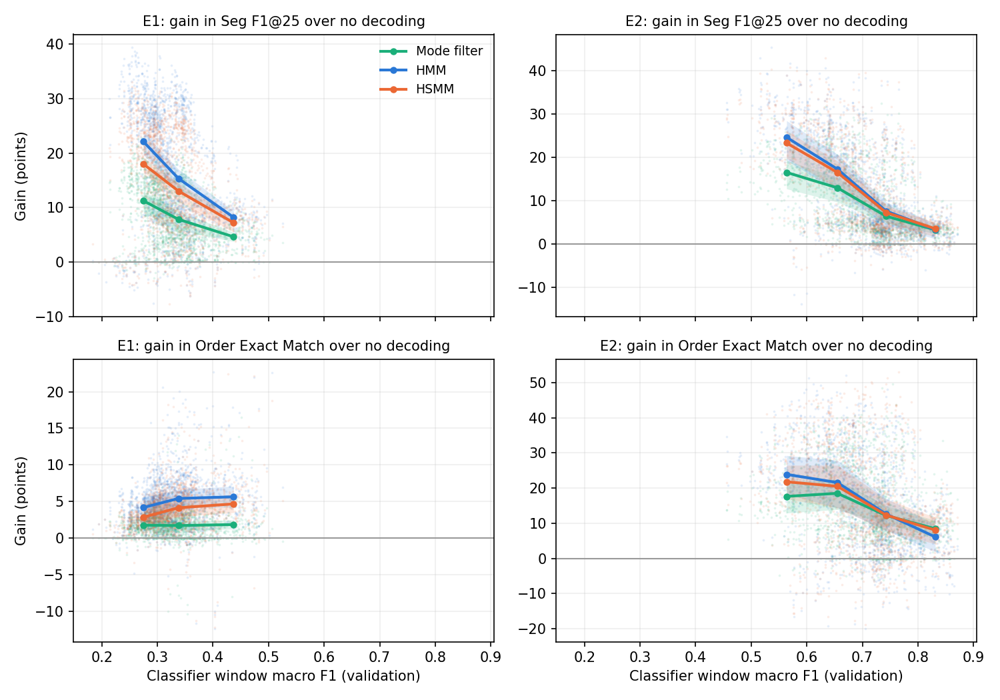

# Stage D2: decoder gain versus classifier quality (panel S)

Generated 2026-11-23 18:09:47. Test set: `test_wild` only. 3216 replicates, 956 configurations (1710 E1, 1506 E2). Replicates without a validation window macro F1: 0.

Decoders: none, mode, HMM, HSMM on a reduced grid (d2_run.py), selected per configuration on validation. x axis: the classifier's window macro F1 on the validation streams (`outputs/thesis/index/runs.csv`). Per replicate, metrics are participant means (10 test participants, equal weight). Bin intervals: 95 % bootstrap over participants of the per-participant gain averaged over the bin's replicates (sessions are not resampled within participants).

## E1: gain over no decoding per bin of classifier quality

### Seg F1@25

| Val window macro F1 | configs | reps | none (level) | mode | HMM | HSMM | HMM hurts (% reps) |
|---|---|---|---|---|---|---|---|
| (-0.001, 0.2] | 2 | 2 | 41.5 | -0.0 [-0.2, +0.1] | -0.9 [-5.1, +1.7] | +1.6 [+0.4, +2.6] | 50 |
| (0.2, 0.3] | 310 | 564 | 30.9 | +11.2 [+9.0, +13.0] | +22.1 [+19.6, +23.9] | +18.0 [+16.6, +19.1] | 7 |
| (0.3, 0.4] | 466 | 951 | 40.9 | +7.8 [+5.8, +9.3] | +15.3 [+13.0, +17.0] | +13.0 [+11.1, +14.5] | 3 |
| (0.4, 0.5] | 156 | 190 | 51.4 | +4.6 [+3.7, +5.4] | +8.2 [+6.7, +9.3] | +7.2 [+5.5, +8.4] | 4 |
| (0.5, 0.6] | 3 | 3 | 55.6 | +2.8 [+2.2, +3.4] | +7.6 [+6.6, +8.9] | +7.3 [+6.1, +8.6] | 0 |

### Order Exact Match

| Val window macro F1 | configs | reps | none (level) | mode | HMM | HSMM | HMM hurts (% reps) |
|---|---|---|---|---|---|---|---|
| (-0.001, 0.2] | 2 | 2 | 1.1 | +0.0 [+0.0, +0.0] | +1.6 [+0.5, +3.0] | +1.3 [+0.5, +2.1] | 0 |
| (0.2, 0.3] | 310 | 564 | 1.2 | +1.8 [+1.1, +2.4] | +4.2 [+2.6, +5.6] | +2.9 [+1.7, +4.0] | 2 |
| (0.3, 0.4] | 466 | 951 | 3.5 | +1.7 [+1.1, +2.3] | +5.4 [+4.1, +6.7] | +4.1 [+2.9, +5.3] | 3 |
| (0.4, 0.5] | 156 | 190 | 7.4 | +1.8 [+1.2, +2.5] | +5.6 [+4.2, +7.1] | +4.7 [+3.5, +5.9] | 5 |
| (0.5, 0.6] | 3 | 3 | 10.3 | +0.3 [-1.0, +1.5] | +10.0 [+5.7, +16.0] | +8.2 [+4.2, +14.3] | 0 |

### G3-rule spec

| Val window macro F1 | configs | reps | none (level) | mode | HMM | HSMM | HMM hurts (% reps) |
|---|---|---|---|---|---|---|---|
| (-0.001, 0.2] | 2 | 2 | 20.7 | +0.0 [+0.0, +0.0] | +4.3 [+1.8, +7.5] | +4.3 [+1.8, +7.1] | 0 |
| (0.2, 0.3] | 310 | 564 | 10.0 | +9.2 [+6.8, +11.6] | +13.2 [+10.5, +15.9] | +10.2 [+8.2, +12.4] | 0 |
| (0.3, 0.4] | 466 | 951 | 20.7 | +6.5 [+5.3, +7.7] | +13.6 [+12.6, +14.7] | +11.1 [+10.3, +12.0] | 0 |
| (0.4, 0.5] | 156 | 190 | 33.4 | +5.9 [+5.5, +6.4] | +15.6 [+14.6, +16.5] | +13.0 [+12.1, +13.9] | 0 |
| (0.5, 0.6] | 3 | 3 | 48.1 | +5.0 [+2.4, +7.4] | +17.6 [+15.5, +19.8] | +17.1 [+14.8, +20.2] | 0 |

Best decoder per bin (participant-mean seg F1@25 level): (-0.001, 0.2]: HSMM; (0.2, 0.3]: HMM; (0.3, 0.4]: HMM; (0.4, 0.5]: HMM; (0.5, 0.6]: HMM

Spearman correlation of the gain in seg F1@25 with classifier quality: Mode filter -0.37, HMM -0.42, HSMM -0.39

False G3-rule events per hour on test_external (median over replicates): None 183.1, Mode filter 87.7, HMM 50.7, HSMM 83.0; HMM score at ≤ 1 FA/h: 0.65

HMM score (≤ 1 FA/h on calibration), mean over replicates: sens 24.5, spec 96.5; G3 rule: sens 93.5, spec 32.3.

## E2: gain over no decoding per bin of classifier quality

### Seg F1@25

| Val window macro F1 | configs | reps | none (level) | mode | HMM | HSMM | HMM hurts (% reps) |
|---|---|---|---|---|---|---|---|
| (0.4, 0.5] | 6 | 10 | 42.0 | +14.9 [+11.6, +17.9] | +30.5 [+23.4, +35.8] | +28.1 [+24.0, +31.6] | 0 |
| (0.5, 0.6] | 86 | 174 | 52.8 | +16.5 [+12.7, +19.3] | +24.6 [+19.3, +28.5] | +23.3 [+19.8, +26.1] | 3 |
| (0.6, 0.7] | 274 | 514 | 65.6 | +13.0 [+9.7, +15.4] | +17.3 [+12.1, +20.7] | +16.5 [+12.8, +19.2] | 3 |
| (0.7, 0.8] | 301 | 642 | 78.5 | +6.4 [+4.7, +7.7] | +7.6 [+4.4, +9.7] | +7.3 [+5.0, +9.0] | 10 |
| (0.8, 0.9] | 109 | 166 | 85.0 | +3.3 [+2.4, +4.1] | +3.3 [+1.2, +4.8] | +3.5 [+1.6, +4.8] | 11 |

### Order Exact Match

| Val window macro F1 | configs | reps | none (level) | mode | HMM | HSMM | HMM hurts (% reps) |
|---|---|---|---|---|---|---|---|
| (0.4, 0.5] | 6 | 10 | 6.4 | +14.4 [+11.3, +17.4] | +27.2 [+19.5, +33.8] | +23.0 [+16.5, +28.5] | 0 |
| (0.5, 0.6] | 86 | 174 | 12.5 | +17.6 [+12.9, +21.8] | +23.9 [+18.3, +29.3] | +21.8 [+16.9, +26.5] | 7 |
| (0.6, 0.7] | 274 | 514 | 23.2 | +18.5 [+13.9, +22.4] | +21.6 [+14.3, +27.9] | +20.5 [+14.5, +26.5] | 9 |
| (0.7, 0.8] | 301 | 642 | 40.0 | +12.2 [+9.7, +15.0] | +12.6 [+8.0, +17.1] | +12.3 [+7.9, +16.8] | 14 |
| (0.8, 0.9] | 109 | 166 | 52.0 | +8.5 [+6.2, +10.8] | +6.1 [+1.9, +9.7] | +8.1 [+4.1, +11.7] | 17 |

### G3-rule spec

| Val window macro F1 | configs | reps | none (level) | mode | HMM | HSMM | HMM hurts (% reps) |
|---|---|---|---|---|---|---|---|
| (0.4, 0.5] | 6 | 10 | 43.3 | +38.2 [+31.7, +45.7] | +43.7 [+37.4, +51.4] | +34.6 [+27.9, +41.1] | 0 |
| (0.5, 0.6] | 86 | 174 | 46.5 | +35.7 [+31.2, +40.7] | +40.6 [+33.5, +49.8] | +33.4 [+26.3, +42.8] | 3 |
| (0.6, 0.7] | 274 | 514 | 59.1 | +28.9 [+23.9, +34.7] | +30.7 [+24.4, +39.3] | +25.9 [+19.8, +34.3] | 4 |
| (0.7, 0.8] | 301 | 642 | 79.9 | +12.8 [+9.4, +17.1] | +12.7 [+8.7, +18.2] | +10.1 [+6.1, +15.3] | 12 |
| (0.8, 0.9] | 109 | 166 | 90.7 | +5.2 [+2.6, +8.5] | +4.4 [+1.7, +7.9] | +3.3 [+0.6, +6.7] | 15 |

Best decoder per bin (participant-mean seg F1@25 level): (0.4, 0.5]: HMM; (0.5, 0.6]: HMM; (0.6, 0.7]: HMM; (0.7, 0.8]: HMM; (0.8, 0.9]: HSMM

Spearman correlation of the gain in seg F1@25 with classifier quality: Mode filter -0.58, HMM -0.62, HSMM -0.60

False G3-rule events per hour on test_external (median over replicates): None 11.8, Mode filter 3.4, HMM 3.3, HSMM 5.1; HMM score at ≤ 1 FA/h: 1.12

HMM score (≤ 1 FA/h on calibration), mean over replicates: sens 93.1, spec 94.8; G3 rule: sens 92.9, spec 91.2.

## Selected grid points (per configuration, on validation)

- HMM: st: 0.8 44 %, 0.95 56 %; md: 0.3 46 %, 0.7 54 %; t: 1 18 %, 2 11 %, 4 71 %
- HSMM: md: 0.3 56 %, 0.7 44 %; t: 1 13 %, 2 12 %, 4 75 %
- Mode filter: w: 0.5 10 %, 2 1 %, 3 41 %, 4 34 %, 6 14 %

Grid-edge choices (temperature 4 or mode width 6 s) mean the optimum may lie outside the reduced grid.

## Check: reduced grid (D2) versus full grid (D1) on the panel-F replicates

| Decoder | replicates | D1 seg F1@25 | D2 seg F1@25 | mean D2 − D1 | max abs |
|---|---|---|---|---|---|
| HMM | 90 | 74.6 | 74.6 | +0.05 | 2.07 |
| HSMM | 90 | 74.2 | 74.3 | +0.11 | 1.87 |
| None | 90 | 64.5 | 64.5 | -0.00 | 0.00 |

`none` must agree exactly (same rule, same data); HMM/HSMM differ by the grid reduction (D2 decodes only the configuration's own overlap).

## Data check

Sets read by any stage so far: external_calibration.npz, test_external.npz, test_wild.npz, val.npz (allowlist: val, test_wild, external_calibration, test_external).
