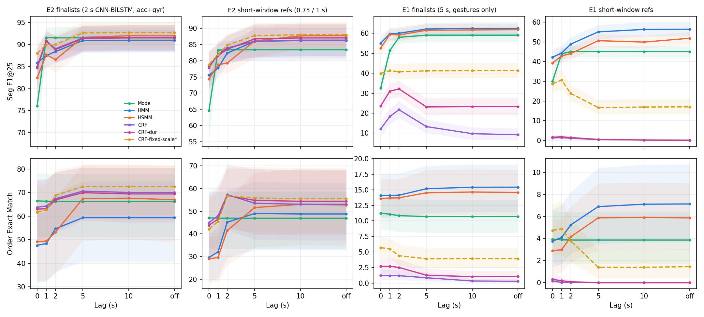

# Stage D3: online (fixed-lag) decoding on panel F

Generated 2026-11-23 18:09:50. Test set: `test_wild`. 90 replicates. Decoder parameters as selected in D1 on validation (not re-tuned per lag). Lag = seconds between a frame and the moment its label is committed; record latency = lag + the classifier look-ahead (half a window + one stride). `inf` = offline; for HSMM the offline D1 decoder also has the relabel pass (`inf_relabel`), which needs the whole path and is not applied online. * CRF-fixed-scale is post hoc (D1b).

## E2 finalists (2 s CNN-BiLSTM, acc+gyr)

3 configurations, 27 replicates; classifier look-ahead 1.50–1.50 s.

### Seg F1@25

| Decoder | lag 0 s | lag 1 s | lag 2 s | lag 5 s | lag 10 s | offline | offline (D1) |
|---|---|---|---|---|---|---|---|
| Mode | 76.1 [68.2, 83.5] | 91.6 [89.0, 93.8] | 91.5 [88.6, 94.0] | 91.5 [88.6, 94.0] | 91.5 [88.6, 94.0] | 91.5 [88.6, 94.0] | 91.5 |
| HMM | 85.9 [83.1, 88.4] | 87.5 [85.0, 89.7] | 88.4 [85.7, 90.6] | 90.9 [88.2, 93.3] | 91.0 [88.2, 93.3] | 91.0 [88.2, 93.3] | 91.0 |
| HSMM | 82.5 [76.2, 87.1] | 87.7 [85.1, 90.0] | 86.6 [83.6, 89.2] | 91.6 [88.7, 94.2] | 92.0 [89.1, 94.4] | 92.0 [89.1, 94.4] | 92.0 |
| CRF | 84.7 [80.0, 89.1] | 90.8 [88.4, 93.1] | 89.0 [86.1, 92.0] | 91.5 [88.5, 94.4] | 91.6 [88.5, 94.5] | 91.6 [88.5, 94.5] | 91.6 |
| CRF-dur | 85.0 [80.7, 89.3] | 90.8 [88.3, 93.1] | 88.9 [85.9, 91.8] | 91.4 [88.4, 94.3] | 91.5 [88.5, 94.4] | 91.5 [88.5, 94.4] | 91.5 |
| CRF-fixed-scale* | 88.0 [85.3, 90.8] | 90.0 [87.4, 92.3] | 90.0 [87.3, 92.5] | 92.7 [89.9, 95.0] | 92.7 [89.9, 95.1] | 92.7 [89.9, 95.1] | 92.7 |

### Order Exact Match

| Decoder | lag 0 s | lag 1 s | lag 2 s | lag 5 s | lag 10 s | offline | offline (D1) |
|---|---|---|---|---|---|---|---|
| Mode | 66.5 [51.3, 78.2] | 66.3 [51.3, 78.0] | 66.2 [51.1, 77.9] | 66.2 [51.1, 77.9] | 66.2 [51.1, 77.9] | 66.2 [51.1, 77.9] | 66.2 |
| HMM | 47.6 [31.8, 60.9] | 48.4 [32.2, 61.9] | 54.7 [36.4, 69.5] | 59.4 [40.7, 74.7] | 59.4 [40.7, 74.7] | 59.4 [40.7, 74.7] | 59.4 |
| HSMM | 49.2 [32.5, 62.9] | 49.4 [32.6, 63.3] | 53.2 [35.3, 67.7] | 67.5 [49.5, 82.0] | 67.6 [50.1, 81.8] | 67.0 [49.0, 81.4] | 67.0 |
| CRF | 63.7 [49.9, 75.5] | 64.3 [50.5, 75.7] | 67.4 [53.8, 78.6] | 70.6 [59.1, 80.8] | 70.0 [58.4, 80.5] | 70.0 [58.4, 80.5] | 70.0 |
| CRF-dur | 63.0 [48.6, 75.1] | 63.1 [48.7, 75.3] | 66.9 [53.0, 78.6] | 70.0 [58.1, 80.6] | 69.4 [57.3, 80.3] | 69.4 [57.3, 80.3] | 69.4 |
| CRF-fixed-scale* | 61.6 [47.7, 73.2] | 62.7 [49.0, 73.6] | 68.9 [55.7, 79.5] | 72.5 [60.7, 81.8] | 72.5 [60.7, 81.7] | 72.5 [60.7, 81.7] | 72.5 |

### G3-rule sens

| Decoder | lag 0 s | lag 1 s | lag 2 s | lag 5 s | lag 10 s | offline | offline (D1) |
|---|---|---|---|---|---|---|---|
| Mode | 98.3 [96.1, 99.8] | 98.3 [96.1, 99.8] | 98.3 [96.1, 99.8] | 98.3 [96.1, 99.8] | 98.3 [96.1, 99.8] | 98.3 [96.1, 99.8] | 98.3 |
| HMM | 99.4 [98.2, 100.0] | 99.4 [98.2, 100.0] | 99.4 [98.1, 100.0] | 99.3 [97.9, 100.0] | 99.3 [97.9, 100.0] | 99.3 [97.9, 100.0] | 99.3 |
| HSMM | 99.5 [98.3, 100.0] | 99.5 [98.3, 100.0] | 99.5 [98.3, 100.0] | 98.8 [97.1, 100.0] | 98.7 [97.0, 100.0] | 98.9 [97.4, 100.0] | 98.9 |
| CRF | 96.3 [92.3, 99.6] | 96.3 [92.3, 99.6] | 95.8 [91.6, 99.2] | 91.4 [84.0, 98.1] | 91.0 [83.2, 98.1] | 91.0 [83.2, 98.1] | 91.0 |
| CRF-dur | 96.4 [92.3, 99.6] | 96.4 [92.3, 99.6] | 96.3 [92.1, 99.6] | 91.9 [84.9, 98.1] | 91.5 [84.1, 98.1] | 91.5 [84.1, 98.1] | 91.5 |
| CRF-fixed-scale* | 96.5 [92.9, 99.4] | 96.5 [92.9, 99.4] | 96.1 [92.1, 99.3] | 94.4 [89.0, 98.8] | 94.4 [89.0, 98.8] | 94.4 [89.0, 98.8] | 94.4 |

### G3-rule spec

| Decoder | lag 0 s | lag 1 s | lag 2 s | lag 5 s | lag 10 s | offline | offline (D1) |
|---|---|---|---|---|---|---|---|
| Mode | 98.5 [96.0, 99.7] | 98.4 [95.9, 99.7] | 98.4 [95.9, 99.7] | 98.4 [95.9, 99.7] | 98.4 [95.9, 99.7] | 98.4 [95.9, 99.7] | 98.4 |
| HMM | 94.3 [89.9, 97.8] | 94.6 [90.0, 98.0] | 96.0 [92.7, 98.5] | 97.3 [94.4, 99.2] | 97.4 [94.4, 99.2] | 97.4 [94.4, 99.2] | 97.4 |
| HSMM | 92.6 [87.5, 96.7] | 93.4 [88.3, 97.4] | 95.7 [92.2, 98.4] | 98.3 [95.5, 99.7] | 98.1 [95.3, 99.7] | 98.0 [95.2, 99.6] | 98.0 |
| CRF | 98.9 [96.5, 99.9] | 98.9 [96.5, 99.9] | 99.0 [96.6, 100.0] | 99.4 [97.5, 100.0] | 99.4 [97.6, 100.0] | 99.4 [97.6, 100.0] | 99.4 |
| CRF-dur | 98.8 [96.3, 99.9] | 98.8 [96.3, 99.9] | 98.9 [96.3, 100.0] | 99.4 [97.5, 100.0] | 99.4 [97.5, 100.0] | 99.4 [97.5, 100.0] | 99.4 |
| CRF-fixed-scale* | 97.8 [95.1, 99.6] | 97.9 [95.1, 99.6] | 98.5 [96.0, 99.8] | 98.9 [96.4, 99.9] | 98.9 [96.4, 99.9] | 98.9 [96.4, 99.9] | 98.9 |

Seg F1@25 lost against the decoder's own offline result (points): Mode 0 s -15.5, 1 s +0.0, 2 s +0.0, 5 s +0.0, 10 s +0.0; HMM 0 s -5.1, 1 s -3.5, 2 s -2.6, 5 s -0.1, 10 s -0.0; HSMM 0 s -9.5, 1 s -4.3, 2 s -5.4, 5 s -0.3, 10 s +0.0; CRF 0 s -6.9, 1 s -0.7, 2 s -2.5, 5 s -0.1, 10 s +0.0; CRF-dur 0 s -6.5, 1 s -0.7, 2 s -2.7, 5 s -0.1, 10 s +0.0; CRF-fixed-scale* 0 s -4.7, 1 s -2.7, 2 s -2.7, 5 s -0.1, 10 s +0.0

G3-rule false events per hour on test_external (mean over replicates): Mode 0: 1.12, 1: 1.14, 2: 1.15, 5: 1.15, 10: 1.15, inf: 1.15; HMM 0: 2.79, 1: 2.77, 2: 2.70, 5: 1.91, 10: 1.87, inf: 1.87; HSMM 0: 2.92, 1: 2.74, 2: 2.58, 5: 1.27, 10: 1.41, inf: 1.42; CRF 0: 0.62, 1: 0.61, 2: 0.57, 5: 0.34, 10: 0.33, inf: 0.33; CRF-dur 0: 0.62, 1: 0.62, 2: 0.58, 5: 0.33, 10: 0.32, inf: 0.32; CRF-fixed-scale* 0: 0.89, 1: 0.88, 2: 0.82, 5: 0.56, 10: 0.56, inf: 0.56

## E2 short-window refs (0.75 / 1 s)

2 configurations, 18 replicates; classifier look-ahead 0.56–1.00 s.

### Seg F1@25

| Decoder | lag 0 s | lag 1 s | lag 2 s | lag 5 s | lag 10 s | offline | offline (D1) |
|---|---|---|---|---|---|---|---|
| Mode | 64.6 [55.4, 73.5] | 83.3 [80.7, 86.0] | 83.4 [80.8, 86.1] | 83.4 [80.8, 86.1] | 83.4 [80.8, 86.1] | 83.4 [80.8, 86.1] | 83.4 |
| HMM | 75.5 [71.4, 79.3] | 77.7 [75.0, 80.6] | 82.4 [78.9, 85.6] | 86.0 [81.2, 89.9] | 86.2 [81.4, 90.2] | 86.2 [81.4, 90.2] | 86.2 |
| HSMM | 74.3 [68.1, 79.0] | 78.8 [76.2, 81.2] | 79.3 [76.1, 82.7] | 86.1 [80.8, 90.3] | 87.7 [83.9, 91.0] | 87.7 [84.1, 91.0] | 87.7 |
| CRF | 77.9 [71.5, 82.9] | 82.0 [77.8, 85.8] | 84.0 [79.9, 88.0] | 86.0 [79.9, 91.1] | 86.4 [80.1, 91.5] | 86.4 [80.1, 91.5] | 86.4 |
| CRF-dur | 78.4 [72.9, 82.8] | 81.6 [77.8, 85.1] | 83.6 [79.3, 87.6] | 86.7 [81.3, 91.2] | 87.0 [81.5, 91.5] | 87.1 [81.5, 91.6] | 87.1 |
| CRF-fixed-scale* | 78.8 [73.8, 82.8] | 81.9 [78.8, 84.9] | 84.8 [81.6, 88.2] | 87.8 [83.2, 91.6] | 88.0 [83.4, 91.9] | 88.0 [83.4, 91.9] | 88.0 |

### Order Exact Match

| Decoder | lag 0 s | lag 1 s | lag 2 s | lag 5 s | lag 10 s | offline | offline (D1) |
|---|---|---|---|---|---|---|---|
| Mode | 47.1 [33.7, 58.6] | 46.9 [33.5, 58.6] | 46.9 [33.4, 58.5] | 46.9 [33.4, 58.5] | 46.9 [33.4, 58.5] | 46.9 [33.4, 58.5] | 46.9 |
| HMM | 29.6 [19.0, 39.7] | 32.1 [20.6, 42.6] | 45.2 [29.5, 59.3] | 49.0 [33.0, 62.9] | 48.8 [32.7, 62.6] | 48.8 [32.7, 62.6] | 48.8 |
| HSMM | 29.0 [18.5, 38.9] | 29.6 [18.9, 39.5] | 41.5 [26.4, 54.9] | 51.6 [34.0, 67.0] | 53.0 [35.0, 68.7] | 52.7 [34.8, 68.3] | 52.8 |
| CRF | 45.0 [30.3, 58.0] | 48.0 [32.7, 61.3] | 57.3 [41.8, 70.6] | 53.5 [37.4, 68.5] | 53.0 [37.2, 68.0] | 53.0 [37.2, 68.0] | 53.0 |
| CRF-dur | 43.8 [29.6, 56.8] | 46.5 [31.8, 59.7] | 56.8 [43.2, 68.9] | 54.8 [39.8, 68.6] | 54.3 [39.4, 68.2] | 54.3 [39.4, 68.2] | 54.3 |
| CRF-fixed-scale* | 42.1 [28.2, 55.0] | 45.5 [31.1, 58.4] | 56.7 [41.8, 69.6] | 55.8 [40.7, 69.5] | 55.5 [40.6, 69.1] | 55.5 [40.6, 69.1] | 55.5 |

### G3-rule sens

| Decoder | lag 0 s | lag 1 s | lag 2 s | lag 5 s | lag 10 s | offline | offline (D1) |
|---|---|---|---|---|---|---|---|
| Mode | 93.6 [86.2, 99.5] | 93.6 [86.2, 99.5] | 93.6 [86.2, 99.5] | 93.6 [86.2, 99.5] | 93.6 [86.2, 99.5] | 93.6 [86.2, 99.5] | 93.6 |
| HMM | 99.7 [98.7, 100.0] | 99.7 [98.7, 100.0] | 98.7 [97.2, 99.9] | 95.7 [90.0, 99.6] | 95.7 [90.0, 99.6] | 95.7 [90.0, 99.6] | 95.7 |
| HSMM | 99.7 [98.7, 100.0] | 99.7 [98.7, 100.0] | 99.1 [97.7, 100.0] | 96.1 [91.5, 99.6] | 95.5 [89.9, 99.5] | 95.7 [90.1, 99.6] | 95.7 |
| CRF | 95.8 [91.1, 99.5] | 95.7 [91.0, 99.4] | 93.6 [86.6, 99.1] | 86.7 [74.5, 97.2] | 86.5 [74.4, 96.9] | 86.5 [74.4, 96.9] | 86.5 |
| CRF-dur | 95.9 [91.2, 99.5] | 95.9 [91.2, 99.5] | 94.6 [89.2, 99.3] | 87.9 [76.6, 97.5] | 87.7 [76.6, 97.3] | 87.7 [76.6, 97.3] | 87.7 |
| CRF-fixed-scale* | 97.7 [94.7, 99.6] | 97.6 [94.6, 99.6] | 94.9 [89.8, 99.2] | 91.1 [82.6, 97.9] | 91.1 [82.5, 97.9] | 91.1 [82.5, 97.9] | 91.1 |

### G3-rule spec

| Decoder | lag 0 s | lag 1 s | lag 2 s | lag 5 s | lag 10 s | offline | offline (D1) |
|---|---|---|---|---|---|---|---|
| Mode | 92.5 [85.5, 97.6] | 92.4 [85.5, 97.6] | 92.3 [85.3, 97.6] | 92.3 [85.3, 97.6] | 92.3 [85.3, 97.6] | 92.3 [85.3, 97.6] | 92.3 |
| HMM | 79.1 [68.4, 87.9] | 81.6 [71.6, 89.5] | 91.9 [86.6, 96.7] | 93.8 [89.0, 97.6] | 94.0 [89.2, 97.8] | 94.0 [89.2, 97.8] | 94.0 |
| HSMM | 73.2 [60.8, 84.0] | 75.6 [63.4, 86.2] | 90.6 [85.1, 95.2] | 95.2 [90.6, 98.4] | 93.8 [89.0, 97.8] | 93.9 [89.0, 97.7] | 93.9 |
| CRF | 91.0 [84.2, 96.3] | 93.1 [86.6, 97.7] | 97.7 [94.9, 99.5] | 98.5 [96.6, 99.8] | 98.6 [96.7, 99.9] | 98.6 [96.7, 99.9] | 98.6 |
| CRF-dur | 90.7 [83.7, 96.0] | 92.8 [86.2, 97.3] | 97.1 [94.1, 99.3] | 97.6 [95.1, 99.6] | 97.7 [95.2, 99.7] | 97.7 [95.2, 99.7] | 97.7 |
| CRF-fixed-scale* | 87.4 [78.6, 94.1] | 90.0 [81.4, 96.0] | 96.1 [92.7, 98.9] | 96.9 [93.8, 99.3] | 96.9 [93.8, 99.3] | 96.9 [93.8, 99.3] | 96.9 |

Seg F1@25 lost against the decoder's own offline result (points): Mode 0 s -18.8, 1 s -0.1, 2 s +0.0, 5 s +0.0, 10 s +0.0; HMM 0 s -10.7, 1 s -8.5, 2 s -3.9, 5 s -0.3, 10 s -0.0; HSMM 0 s -13.4, 1 s -9.0, 2 s -8.4, 5 s -1.6, 10 s -0.0; CRF 0 s -8.5, 1 s -4.3, 2 s -2.4, 5 s -0.3, 10 s -0.0; CRF-dur 0 s -8.6, 1 s -5.4, 2 s -3.5, 5 s -0.3, 10 s -0.0; CRF-fixed-scale* 0 s -9.2, 1 s -6.1, 2 s -3.2, 5 s -0.3, 10 s -0.0

G3-rule false events per hour on test_external (mean over replicates): Mode 0: 1.07, 1: 1.09, 2: 1.09, 5: 1.09, 10: 1.09, inf: 1.09; HMM 0: 3.50, 1: 3.22, 2: 2.01, 5: 0.99, 10: 0.86, inf: 0.86; HSMM 0: 6.23, 1: 5.63, 2: 3.34, 5: 1.24, 10: 1.61, inf: 1.49; CRF 0: 0.97, 1: 0.84, 2: 0.48, 5: 0.20, 10: 0.18, inf: 0.18; CRF-dur 0: 0.91, 1: 0.79, 2: 0.49, 5: 0.21, 10: 0.20, inf: 0.20; CRF-fixed-scale* 0: 1.28, 1: 1.18, 2: 0.65, 5: 0.28, 10: 0.25, inf: 0.25

## E1 finalists (5 s, gestures only)

3 configurations, 27 replicates; classifier look-ahead 3.74–3.74 s.

### Seg F1@25

| Decoder | lag 0 s | lag 1 s | lag 2 s | lag 5 s | lag 10 s | offline | offline (D1) |
|---|---|---|---|---|---|---|---|
| Mode | 32.6 [28.5, 37.5] | 51.4 [48.1, 55.1] | 58.0 [54.8, 61.2] | 59.1 [55.8, 62.3] | 59.1 [55.8, 62.3] | 59.1 [55.8, 62.3] | 59.1 |
| HMM | 55.0 [51.7, 58.6] | 59.7 [56.7, 62.7] | 60.0 [56.9, 63.1] | 62.1 [59.0, 65.2] | 62.5 [59.3, 65.6] | 62.5 [59.3, 65.6] | 62.5 |
| HSMM | 52.6 [49.1, 56.6] | 59.4 [56.3, 62.5] | 59.2 [56.0, 62.4] | 61.5 [58.3, 64.7] | 61.7 [58.5, 64.7] | 61.8 [58.7, 64.9] | 61.9 |
| CRF | 12.1 [8.3, 15.9] | 18.3 [14.4, 22.3] | 21.7 [17.5, 26.0] | 13.2 [10.0, 16.7] | 9.7 [6.7, 12.9] | 9.2 [6.3, 12.3] | 9.2 |
| CRF-dur | 23.6 [19.5, 27.5] | 31.0 [27.1, 35.0] | 32.1 [28.2, 36.2] | 23.1 [18.9, 27.5] | 23.2 [19.0, 27.6] | 23.3 [19.0, 27.7] | 23.3 |
| CRF-fixed-scale* | 39.9 [36.6, 43.6] | 41.3 [37.8, 45.1] | 40.7 [37.0, 44.6] | 41.2 [37.5, 45.2] | 41.3 [37.6, 45.3] | 41.3 [37.6, 45.3] | 41.3 |

### Order Exact Match

| Decoder | lag 0 s | lag 1 s | lag 2 s | lag 5 s | lag 10 s | offline | offline (D1) |
|---|---|---|---|---|---|---|---|
| Mode | 11.3 [8.6, 14.0] | 11.1 [8.5, 13.8] | 10.8 [8.2, 13.6] | 10.7 [8.1, 13.4] | 10.7 [8.1, 13.4] | 10.7 [8.1, 13.4] | 10.7 |
| HMM | 14.1 [10.5, 17.7] | 14.1 [10.5, 17.6] | 14.1 [10.5, 17.6] | 15.2 [11.3, 18.8] | 15.4 [11.4, 19.1] | 15.4 [11.5, 19.1] | 15.4 |
| HSMM | 13.6 [10.7, 16.7] | 13.7 [10.8, 16.8] | 13.7 [10.8, 16.7] | 14.5 [10.9, 18.2] | 14.7 [11.0, 18.3] | 14.6 [10.9, 18.2] | 14.7 |
| CRF | 1.2 [0.5, 2.2] | 1.2 [0.5, 2.2] | 1.2 [0.5, 2.2] | 0.8 [0.3, 1.7] | 0.3 [0.1, 0.7] | 0.3 [0.1, 0.7] | 0.3 |
| CRF-dur | 2.7 [1.5, 4.1] | 2.7 [1.5, 4.1] | 2.5 [1.4, 3.8] | 1.3 [0.5, 2.3] | 1.0 [0.4, 1.9] | 1.1 [0.4, 1.9] | 1.1 |
| CRF-fixed-scale* | 5.7 [4.2, 7.5] | 5.5 [4.0, 7.2] | 4.4 [2.8, 6.2] | 3.9 [2.4, 5.6] | 3.9 [2.4, 5.6] | 3.9 [2.4, 5.6] | 3.9 |

### G3-rule sens

| Decoder | lag 0 s | lag 1 s | lag 2 s | lag 5 s | lag 10 s | offline | offline (D1) |
|---|---|---|---|---|---|---|---|
| Mode | 89.6 [83.5, 94.4] | 91.2 [85.0, 95.8] | 91.3 [85.2, 95.9] | 91.3 [85.2, 95.9] | 91.3 [85.2, 95.9] | 91.3 [85.2, 95.9] | 91.3 |
| HMM | 93.0 [88.8, 96.2] | 93.0 [88.8, 96.2] | 92.4 [88.2, 95.8] | 90.9 [85.8, 94.8] | 90.9 [85.8, 94.7] | 90.9 [85.8, 94.7] | 90.9 |
| HSMM | 93.7 [89.8, 96.6] | 93.7 [89.8, 96.6] | 93.3 [89.3, 96.4] | 90.0 [84.9, 93.8] | 89.4 [84.3, 93.4] | 89.7 [84.7, 93.6] | 89.7 |
| CRF | 13.7 [8.5, 19.5] | 13.5 [8.4, 19.3] | 13.4 [8.3, 19.2] | 11.4 [6.9, 17.0] | 4.4 [2.3, 7.5] | 3.6 [1.8, 6.4] | 3.6 |
| CRF-dur | 25.9 [18.5, 33.8] | 25.8 [18.4, 33.8] | 25.3 [18.0, 33.2] | 18.5 [12.7, 25.6] | 13.4 [9.0, 19.7] | 12.8 [8.4, 19.0] | 12.8 |
| CRF-fixed-scale* | 52.8 [45.8, 60.0] | 52.8 [45.7, 60.0] | 48.8 [41.8, 56.2] | 45.4 [38.8, 52.3] | 45.2 [38.7, 52.1] | 45.2 [38.7, 52.1] | 45.2 |

### G3-rule spec

| Decoder | lag 0 s | lag 1 s | lag 2 s | lag 5 s | lag 10 s | offline | offline (D1) |
|---|---|---|---|---|---|---|---|
| Mode | 54.3 [45.1, 63.0] | 53.6 [44.4, 62.5] | 52.6 [43.7, 61.4] | 52.2 [43.4, 61.0] | 52.2 [43.4, 61.0] | 52.2 [43.4, 61.0] | 52.2 |
| HMM | 54.4 [45.3, 63.1] | 54.5 [45.3, 63.2] | 55.5 [46.5, 64.1] | 58.7 [50.1, 66.6] | 59.1 [50.7, 66.9] | 59.2 [50.8, 67.0] | 59.2 |
| HSMM | 51.9 [43.0, 60.7] | 52.2 [43.3, 60.9] | 53.7 [44.8, 62.2] | 58.8 [50.1, 67.0] | 58.5 [50.2, 66.5] | 58.5 [50.0, 66.6] | 58.6 |
| CRF | 95.9 [93.3, 97.8] | 96.1 [93.5, 98.0] | 96.3 [93.8, 98.1] | 97.2 [95.3, 98.7] | 98.1 [96.5, 99.2] | 98.7 [97.4, 99.5] | 98.7 |
| CRF-dur | 93.8 [90.4, 96.3] | 94.0 [91.0, 96.4] | 94.3 [91.2, 96.6] | 95.9 [93.5, 97.7] | 97.0 [94.9, 98.5] | 97.2 [95.1, 98.7] | 97.2 |
| CRF-fixed-scale* | 85.6 [80.7, 90.0] | 85.7 [80.7, 90.0] | 86.9 [82.3, 91.0] | 88.6 [84.4, 92.4] | 88.7 [84.6, 92.4] | 88.7 [84.6, 92.4] | 88.7 |

Seg F1@25 lost against the decoder's own offline result (points): Mode 0 s -26.5, 1 s -7.7, 2 s -1.1, 5 s +0.0, 10 s +0.0; HMM 0 s -7.5, 1 s -2.8, 2 s -2.5, 5 s -0.4, 10 s -0.0; HSMM 0 s -9.3, 1 s -2.5, 2 s -2.7, 5 s -0.4, 10 s -0.2; CRF 0 s +2.9, 1 s +9.1, 2 s +12.5, 5 s +4.1, 10 s +0.5; CRF-dur 0 s +0.3, 1 s +7.7, 2 s +8.9, 5 s -0.2, 10 s -0.0; CRF-fixed-scale* 0 s -1.4, 1 s -0.0, 2 s -0.6, 5 s -0.1, 10 s -0.0

G3-rule false events per hour on test_external (mean over replicates): Mode 0: 32.90, 1: 33.19, 2: 33.33, 5: 33.35, 10: 33.35, inf: 33.35; HMM 0: 31.47, 1: 31.62, 2: 30.88, 5: 26.54, 10: 25.56, inf: 25.47; HSMM 0: 34.84, 1: 34.59, 2: 34.50, 5: 28.67, 10: 29.17, inf: 28.27; CRF 0: 1.49, 1: 1.36, 2: 1.31, 5: 1.14, 10: 0.73, inf: 0.41; CRF-dur 0: 2.58, 1: 2.51, 2: 2.45, 5: 1.92, 10: 1.26, inf: 1.07; CRF-fixed-scale* 0: 7.49, 1: 7.52, 2: 6.91, 5: 5.63, 10: 5.44, inf: 5.43

## E1 short-window refs

2 configurations, 18 replicates; classifier look-ahead 0.56–1.00 s.

### Seg F1@25

| Decoder | lag 0 s | lag 1 s | lag 2 s | lag 5 s | lag 10 s | offline | offline (D1) |
|---|---|---|---|---|---|---|---|
| Mode | 30.0 [25.5, 34.8] | 44.0 [41.0, 47.0] | 45.0 [42.1, 47.9] | 45.0 [42.1, 47.9] | 45.0 [42.1, 47.9] | 45.0 [42.1, 47.9] | 45.0 |
| HMM | 42.2 [38.6, 45.8] | 44.3 [40.7, 48.1] | 48.8 [45.3, 52.4] | 55.0 [51.4, 58.6] | 56.3 [52.7, 59.8] | 56.4 [52.8, 60.0] | 56.4 |
| HSMM | 39.2 [36.3, 42.4] | 42.9 [39.6, 46.5] | 44.0 [41.0, 47.3] | 50.6 [47.4, 53.9] | 49.9 [46.7, 53.3] | 51.8 [48.7, 55.1] | 52.2 |
| CRF | 1.3 [0.7, 2.0] | 1.4 [0.8, 2.2] | 1.1 [0.6, 1.7] | 0.5 [0.2, 0.8] | 0.2 [0.1, 0.4] | 0.1 [0.0, 0.2] | 0.1 |
| CRF-dur | 1.7 [0.9, 2.6] | 1.9 [1.1, 2.8] | 1.5 [0.8, 2.3] | 0.5 [0.2, 0.9] | 0.3 [0.1, 0.4] | 0.1 [0.0, 0.2] | 0.1 |
| CRF-fixed-scale* | 28.7 [24.2, 34.1] | 30.6 [25.9, 36.0] | 23.8 [20.3, 28.0] | 16.7 [13.2, 20.8] | 16.9 [13.4, 21.2] | 17.0 [13.5, 21.3] | 17.0 |

### Order Exact Match

| Decoder | lag 0 s | lag 1 s | lag 2 s | lag 5 s | lag 10 s | offline | offline (D1) |
|---|---|---|---|---|---|---|---|
| Mode | 3.9 [1.8, 6.5] | 3.9 [1.7, 6.4] | 3.9 [1.7, 6.4] | 3.9 [1.7, 6.4] | 3.9 [1.7, 6.4] | 3.9 [1.7, 6.4] | 3.9 |
| HMM | 3.8 [1.4, 6.6] | 4.1 [1.7, 7.1] | 5.2 [2.6, 8.2] | 6.9 [3.5, 10.4] | 7.1 [3.7, 10.7] | 7.1 [3.7, 10.7] | 7.1 |
| HSMM | 2.9 [0.8, 5.7] | 3.0 [0.9, 5.7] | 4.2 [1.9, 6.9] | 5.9 [2.9, 9.0] | 5.9 [2.9, 9.1] | 5.9 [3.0, 9.0] | 5.8 |
| CRF | 0.2 [0.0, 0.6] | 0.0 [0.0, 0.1] | 0.0 [0.0, 0.1] | 0.0 [0.0, 0.0] | 0.0 [0.0, 0.0] | 0.0 [0.0, 0.0] | 0.0 |
| CRF-dur | 0.3 [0.0, 1.0] | 0.2 [0.0, 0.5] | 0.1 [0.0, 0.2] | 0.0 [0.0, 0.0] | 0.0 [0.0, 0.0] | 0.0 [0.0, 0.0] | 0.0 |
| CRF-fixed-scale* | 4.7 [2.5, 7.1] | 4.9 [2.5, 7.4] | 3.8 [1.9, 5.9] | 1.4 [0.4, 2.9] | 1.4 [0.4, 2.9] | 1.5 [0.4, 3.1] | 1.5 |

### G3-rule sens

| Decoder | lag 0 s | lag 1 s | lag 2 s | lag 5 s | lag 10 s | offline | offline (D1) |
|---|---|---|---|---|---|---|---|
| Mode | 98.5 [97.1, 99.6] | 98.5 [97.1, 99.6] | 98.6 [97.2, 99.6] | 98.6 [97.2, 99.6] | 98.6 [97.2, 99.6] | 98.6 [97.2, 99.6] | 98.6 |
| HMM | 99.5 [98.3, 100.0] | 99.6 [98.8, 100.0] | 99.4 [98.4, 100.0] | 98.8 [96.8, 99.9] | 98.7 [96.7, 99.8] | 98.7 [96.6, 99.8] | 98.7 |
| HSMM | 99.7 [98.9, 100.0] | 99.7 [98.9, 100.0] | 99.6 [98.8, 100.0] | 99.2 [97.6, 99.9] | 99.1 [97.6, 99.9] | 99.2 [97.6, 99.9] | 99.2 |
| CRF | 16.7 [12.0, 21.3] | 6.2 [3.5, 9.2] | 5.6 [3.1, 8.2] | 4.8 [2.7, 7.3] | 4.3 [2.3, 6.6] | 3.4 [1.8, 5.2] | 3.4 |
| CRF-dur | 20.0 [14.3, 25.8] | 11.4 [6.9, 16.1] | 7.1 [4.1, 10.6] | 5.1 [2.9, 7.6] | 4.5 [2.6, 6.7] | 3.7 [2.1, 5.6] | 3.7 |
| CRF-fixed-scale* | 13.7 [9.6, 17.7] | 8.2 [4.9, 11.6] | 7.7 [4.6, 11.2] | 7.2 [4.2, 10.3] | 6.5 [3.8, 9.5] | 6.2 [3.7, 9.1] | 6.2 |

### G3-rule spec

| Decoder | lag 0 s | lag 1 s | lag 2 s | lag 5 s | lag 10 s | offline | offline (D1) |
|---|---|---|---|---|---|---|---|
| Mode | 16.0 [8.8, 24.3] | 15.9 [8.8, 24.1] | 15.8 [8.8, 24.0] | 15.8 [8.8, 24.0] | 15.8 [8.8, 24.0] | 15.8 [8.8, 24.0] | 15.8 |
| HMM | 14.0 [7.3, 22.4] | 14.6 [7.9, 23.1] | 17.3 [10.1, 25.9] | 20.3 [12.5, 29.2] | 21.1 [13.2, 30.2] | 21.1 [13.2, 30.2] | 21.1 |
| HSMM | 9.6 [3.7, 17.3] | 10.2 [4.3, 17.8] | 14.3 [7.6, 22.4] | 18.3 [11.1, 26.6] | 18.7 [11.6, 27.0] | 18.3 [11.4, 26.8] | 18.3 |
| CRF | 84.8 [76.9, 91.2] | 93.6 [89.3, 96.9] | 94.7 [90.7, 97.7] | 95.0 [91.4, 97.7] | 95.8 [92.8, 98.0] | 96.8 [94.3, 98.8] | 96.8 |
| CRF-dur | 81.3 [71.5, 89.4] | 89.8 [84.0, 94.5] | 94.0 [89.5, 97.4] | 95.8 [92.8, 98.2] | 96.6 [94.0, 98.5] | 97.1 [94.7, 98.8] | 97.1 |
| CRF-fixed-scale* | 88.0 [81.8, 93.2] | 91.2 [86.2, 95.3] | 91.7 [86.8, 95.8] | 92.4 [87.8, 96.2] | 92.7 [88.3, 96.4] | 93.2 [89.0, 96.7] | 93.2 |

Seg F1@25 lost against the decoder's own offline result (points): Mode 0 s -15.1, 1 s -1.0, 2 s +0.0, 5 s +0.0, 10 s +0.0; HMM 0 s -14.2, 1 s -12.1, 2 s -7.6, 5 s -1.4, 10 s -0.1; HSMM 0 s -13.0, 1 s -9.3, 2 s -8.2, 5 s -1.7, 10 s -2.4; CRF 0 s +1.3, 1 s +1.4, 2 s +1.1, 5 s +0.4, 10 s +0.2; CRF-dur 0 s +1.5, 1 s +1.7, 2 s +1.3, 5 s +0.4, 10 s +0.1; CRF-fixed-scale* 0 s +11.7, 1 s +13.6, 2 s +6.8, 5 s -0.4, 10 s -0.1

G3-rule false events per hour on test_external (mean over replicates): Mode 0: 102.34, 1: 103.03, 2: 103.37, 5: 103.37, 10: 103.37, inf: 103.37; HMM 0: 123.13, 1: 123.32, 2: 98.95, 5: 68.69, 10: 64.00, inf: 63.21; HSMM 0: 144.87, 1: 143.74, 2: 130.70, 5: 103.58, 10: 123.19, inf: 102.29; CRF 0: 5.15, 1: 2.82, 2: 2.55, 5: 2.10, 10: 1.75, inf: 0.86; CRF-dur 0: 6.22, 1: 4.47, 2: 3.14, 5: 2.39, 10: 2.09, inf: 1.38; CRF-fixed-scale* 0: 8.77, 1: 7.91, 2: 7.14, 5: 5.64, 10: 4.59, inf: 3.94

## Data check

Sets read by any stage so far: external_calibration.npz, test_external.npz, test_wild.npz, val.npz (allowlist: val, test_wild, external_calibration, test_external).
