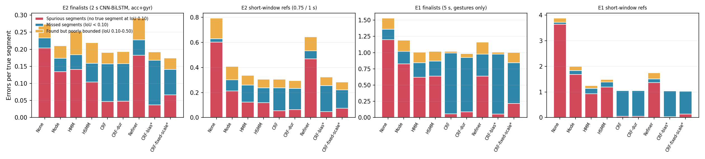
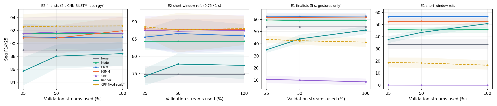

# Stage D5: analyses A1-A6

Generated 2026-11-23 18:14:33. Test set: `test_wild` only. `*` = post-hoc variant (D1b). Participant-level throughout (10 test participants).

## A1. Main comparison (panel F, offline)

Mean [95 % cluster-bootstrap CI]; full tables with differences and Holm-adjusted p values in reports/D1/REPORT.md.

### Seg F1@25

| Decoder | E2 finalists (2 s CNN-BiLSTM, acc+gyr) | E2 short-window refs (0.75 / 1 s) | E1 finalists (5 s, gestures only) | E1 short-window refs |
|---|---|---|---|---|
| None | 89.0 [86.1, 91.4] | 74.8 [72.1, 77.5] | 53.8 [50.8, 56.7] | 33.7 [30.1, 38.5] |
| Mode | 91.5 [88.6, 94.0] | 83.4 [80.7, 86.0] | 59.1 [55.7, 62.3] | 45.0 [42.2, 47.9] |
| HMM | 91.0 [88.2, 93.3] | 86.2 [81.2, 90.2] | 62.5 [59.2, 65.5] | 56.4 [52.8, 60.0] |
| HSMM | 92.0 [89.0, 94.5] | 87.7 [84.0, 91.0] | 61.9 [58.7, 64.9] | 52.2 [49.1, 55.6] |
| CRF | 91.6 [88.4, 94.4] | 86.4 [80.1, 91.3] | 9.2 [6.3, 12.3] | 0.1 [0.0, 0.2] |
| CRF-dur | 91.5 [88.4, 94.4] | 87.1 [81.4, 91.5] | 23.3 [19.1, 27.7] | 0.1 [0.0, 0.2] |
| Refiner | 88.4 [86.0, 90.7] | 76.4 [72.6, 80.0] | 51.2 [47.6, 54.8] | 48.6 [45.4, 52.0] |
| CRF-bias* | 90.8 [87.9, 93.7] | 84.4 [76.7, 90.5] | 11.3 [8.1, 14.6] | 0.3 [0.1, 0.5] |
| CRF-fixed-scale* | 92.7 [89.9, 95.0] | 88.0 [83.4, 91.8] | 41.3 [37.6, 45.3] | 17.0 [13.3, 21.2] |

### Order Exact Match

| Decoder | E2 finalists (2 s CNN-BiLSTM, acc+gyr) | E2 short-window refs (0.75 / 1 s) | E1 finalists (5 s, gestures only) | E1 short-window refs |
|---|---|---|---|---|
| None | 57.5 [42.5, 69.9] | 26.8 [16.0, 37.4] | 9.0 [6.7, 11.6] | 1.2 [0.2, 2.6] |
| Mode | 66.2 [51.5, 77.8] | 46.9 [33.7, 58.3] | 10.7 [8.1, 13.3] | 3.9 [1.7, 6.4] |
| HMM | 59.4 [40.6, 75.1] | 48.8 [32.6, 62.5] | 15.4 [11.5, 19.1] | 7.1 [3.7, 10.9] |
| HSMM | 67.0 [49.0, 81.7] | 52.8 [34.7, 68.2] | 14.7 [10.9, 18.2] | 5.8 [2.9, 9.1] |
| CRF | 70.0 [58.3, 80.5] | 53.0 [36.9, 67.6] | 0.3 [0.1, 0.6] | 0.0 [0.0, 0.0] |
| CRF-dur | 69.4 [57.1, 80.3] | 54.3 [39.3, 67.7] | 1.1 [0.4, 1.9] | 0.0 [0.0, 0.0] |
| Refiner | 67.2 [56.7, 75.4] | 54.1 [43.3, 63.4] | 28.4 [23.2, 33.8] | 26.4 [21.5, 31.1] |
| CRF-bias* | 65.4 [54.0, 76.4] | 50.2 [34.3, 64.9] | 0.1 [0.0, 0.4] | 0.0 [0.0, 0.0] |
| CRF-fixed-scale* | 72.5 [60.8, 81.6] | 55.5 [40.5, 68.7] | 3.9 [2.4, 5.6] | 1.5 [0.4, 3.1] |

## A6. Intake decisions (panel F)

| Decoder | Decision | E2 finalists (2 s CNN-BiLSTM, acc+gyr) | E2 short-window refs (0.75 / 1 s) | E1 finalists (5 s, gestures only) | E1 short-window refs |
|---|---|---|---|---|---|
| None | G3 rule | 99.1 / 95.6 | 99.8 / 67.3 | 95.4 / 45.2 | 100.0 / 5.4 |
| Mode | G3 rule | 98.3 / 98.4 | 93.6 / 92.3 | 91.3 / 52.2 | 98.6 / 15.8 |
| HMM | G3 rule | 99.3 / 97.4 | 95.7 / 94.0 | 90.9 / 59.2 | 98.7 / 21.1 |
| HMM | Score ≤1 FA/h | 99.1 / 97.5 | 98.2 / 94.5 | 48.1 / 95.7 | 12.9 / 97.4 |
| HSMM | G3 rule | 98.9 / 98.0 | 95.7 / 93.9 | 89.7 / 58.6 | 99.2 / 18.3 |
| CRF | G3 rule | 91.0 / 99.4 | 86.5 / 98.6 | 3.6 / 98.7 | 3.4 / 96.8 |
| CRF | Score ≤1 FA/h | 98.7 / 93.1 | 98.8 / 91.9 | 26.5 / 95.9 | 1.7 / 97.3 |
| CRF-dur | G3 rule | 91.5 / 99.4 | 87.7 / 97.7 | 12.8 / 97.2 | 3.7 / 97.1 |
| CRF-dur | Score ≤1 FA/h | 98.9 / 91.7 | 98.8 / 91.9 | 24.5 / 95.9 | 2.4 / 96.6 |
| Refiner | G3 rule | 98.5 / 96.5 | 96.8 / 93.7 | 81.7 / 84.8 | 94.3 / 69.0 |
| CRF-bias* | G3 rule | 84.1 / 99.6 | 79.5 / 98.9 | 4.5 / 98.3 | 1.1 / 99.0 |
| CRF-bias* | Score ≤1 FA/h | 98.3 / 91.7 | 98.2 / 89.4 | 31.0 / 95.4 | 2.3 / 98.0 |
| CRF-fixed-scale* | G3 rule | 94.4 / 98.9 | 91.1 / 96.9 | 45.2 / 88.7 | 6.2 / 93.2 |
| CRF-fixed-scale* | Score ≤1 FA/h | 98.8 / 93.6 | 98.0 / 91.0 | 34.8 / 94.7 | 3.7 / 95.8 |

Cells: sensitivity / specificity (%).

## A2. Gain over no decoding versus classifier quality (panel S)

Seg F1@25 gain (points) per bin of validation window macro F1; details and figure in reports/D2/REPORT.md.

| Regime | Val window macro F1 | reps | none | Mode | HMM | HSMM |
|---|---|---|---|---|---|---|
| E1 | (-0.001, 0.2] | 2 | 41.5 | -0.0 | -0.9 | +1.6 |
| E1 | (0.2, 0.3] | 564 | 30.9 | +11.2 | +22.1 | +18.0 |
| E1 | (0.3, 0.4] | 951 | 40.9 | +7.8 | +15.3 | +13.0 |
| E1 | (0.4, 0.5] | 190 | 51.4 | +4.6 | +8.2 | +7.2 |
| E1 | (0.5, 0.6] | 3 | 55.6 | +2.8 | +7.6 | +7.3 |
| E2 | (0.4, 0.5] | 10 | 42.0 | +14.9 | +30.5 | +28.1 |
| E2 | (0.5, 0.6] | 174 | 52.8 | +16.5 | +24.6 | +23.3 |
| E2 | (0.6, 0.7] | 514 | 65.6 | +13.0 | +17.3 | +16.5 |
| E2 | (0.7, 0.8] | 642 | 78.5 | +6.4 | +7.6 | +7.3 |
| E2 | (0.8, 0.9] | 166 | 85.0 | +3.3 | +3.3 | +3.5 |

## A3. Which errors does each decoder fix? (panel F)

Per true segment, pooled over a participant's sessions. Spurious = predicted segments that overlap no true segment of their class at IoU ≥ 0.10; missed = true segments with no such prediction; poorly bounded = found at IoU 0.10 but not at 0.50.

### E2 finalists (2 s CNN-BiLSTM, acc+gyr)

| Decoder | Spurious segments (no true segment at IoU 0.10) | Missed segments (IoU < 0.10) | Found but poorly bounded (IoU 0.10-0.50) | Predicted / true segments | Order errors (1 - Order Exact Match) | Normalized order edit distance |
|---|---|---|---|---|---|---|
| None | 20.4 | 2.9 | 4.1 | 1.17 | 42.5 | 17.3 |
| Mode | 13.5 | 3.9 | 3.7 | 1.10 | 33.8 | 12.6 |
| HMM | 14.1 | 4.3 | 6.9 | 1.10 | 40.6 | 15.0 |
| HSMM | 10.4 | 5.5 | 6.0 | 1.05 | 33.0 | 11.6 |
| CRF | 4.7 | 11.1 | 3.4 | 0.94 | 30.0 | 10.0 |
| CRF-dur | 4.8 | 11.1 | 3.5 | 0.94 | 30.6 | 10.1 |
| Refiner | 18.2 | 4.5 | 6.4 | 1.14 | 32.8 | 13.8 |
| CRF-bias* | 3.7 | 13.0 | 2.5 | 0.91 | 34.6 | 11.9 |
| CRF-fixed-scale* | 6.7 | 7.4 | 3.3 | 0.99 | 27.5 | 9.4 |

### E2 short-window refs (0.75 / 1 s)

| Decoder | Spurious segments (no true segment at IoU 0.10) | Missed segments (IoU < 0.10) | Found but poorly bounded (IoU 0.10-0.50) | Predicted / true segments | Order errors (1 - Order Exact Match) | Normalized order edit distance |
|---|---|---|---|---|---|---|
| None | 60.3 | 2.5 | 16.6 | 1.58 | 73.2 | 47.8 |
| Mode | 21.2 | 9.0 | 10.6 | 1.12 | 53.1 | 22.2 |
| HMM | 12.4 | 13.6 | 7.6 | 0.99 | 51.2 | 18.9 |
| HSMM | 11.8 | 11.8 | 6.9 | 1.00 | 47.2 | 17.4 |
| CRF | 5.5 | 18.1 | 6.9 | 0.87 | 47.0 | 16.7 |
| CRF-dur | 6.4 | 16.8 | 6.4 | 0.90 | 45.7 | 16.0 |
| Refiner | 46.9 | 6.5 | 11.0 | 1.40 | 45.9 | 29.0 |
| CRF-bias* | 4.8 | 20.6 | 6.9 | 0.84 | 49.8 | 18.9 |
| CRF-fixed-scale* | 7.4 | 14.7 | 6.2 | 0.93 | 44.5 | 15.0 |

### E1 finalists (5 s, gestures only)

| Decoder | Spurious segments (no true segment at IoU 0.10) | Missed segments (IoU < 0.10) | Found but poorly bounded (IoU 0.10-0.50) | Predicted / true segments | Order errors (1 - Order Exact Match) | Normalized order edit distance |
|---|---|---|---|---|---|---|
| None | 119.9 | 15.8 | 17.4 | 2.04 | 91.0 | 94.6 |
| Mode | 82.5 | 19.7 | 16.9 | 1.63 | 89.3 | 75.0 |
| HMM | 61.9 | 22.7 | 16.0 | 1.39 | 84.6 | 59.9 |
| HSMM | 63.9 | 23.2 | 15.0 | 1.41 | 85.3 | 61.4 |
| CRF | 5.6 | 94.0 | 2.5 | 0.12 | 99.7 | 90.2 |
| CRF-dur | 8.9 | 83.8 | 5.9 | 0.25 | 98.9 | 79.8 |
| Refiner | 63.7 | 34.2 | 18.4 | 1.30 | 71.6 | 41.1 |
| CRF-bias* | 5.3 | 92.5 | 2.9 | 0.13 | 99.9 | 89.4 |
| CRF-fixed-scale* | 21.9 | 62.4 | 15.8 | 0.60 | 96.1 | 60.5 |

### E1 short-window refs

| Decoder | Spurious segments (no true segment at IoU 0.10) | Missed segments (IoU < 0.10) | Found but poorly bounded (IoU 0.10-0.50) | Predicted / true segments | Order errors (1 - Order Exact Match) | Normalized order edit distance |
|---|---|---|---|---|---|---|
| None | 364.3 | 7.4 | 16.5 | 4.57 | 98.8 | 329.5 |
| Mode | 167.9 | 15.9 | 16.4 | 2.52 | 96.1 | 155.3 |
| HMM | 92.7 | 20.9 | 10.6 | 1.72 | 92.9 | 89.9 |
| HSMM | 119.2 | 19.6 | 9.9 | 2.00 | 94.2 | 112.7 |
| CRF | 4.9 | 99.8 | 0.2 | 0.05 | 100.0 | 96.1 |
| CRF-dur | 5.4 | 99.8 | 0.1 | 0.06 | 100.0 | 96.1 |
| Refiner | 136.5 | 14.8 | 23.2 | 2.22 | 73.6 | 72.7 |
| CRF-bias* | 4.0 | 99.7 | 0.3 | 0.04 | 100.0 | 96.8 |
| CRF-fixed-scale* | 14.0 | 88.5 | 0.9 | 0.25 | 98.5 | 83.2 |

Spurious, missed and poorly bounded are in % of true segments; Predicted / true segments is a ratio.

## A4. How much validation data does each decoder need? (panel F)

Each replicate keeps 25, 50 or 100 % of its validation streams (nested subsets); every parameter, including the duration models, is learned or tuned on the subset (a4_tuning_data.py). HMM/HSMM/mode use the D2 reduced grid. Seg F1@25 [95 % CI over participants].

### E2 finalists (2 s CNN-BiLSTM, acc+gyr) (validation streams: 25 % = 38, 50 % = 76, 100 % = 152)

| Decoder | 25 % | 50 % | 100 % | 25 % − 100 % |
|---|---|---|---|---|
| None | 89.0 [86.6, 91.0] | 89.0 [86.6, 91.0] | 89.0 [86.5, 91.0] | +0.0 |
| Mode | 91.5 [89.0, 93.6] | 91.5 [89.0, 93.6] | 91.5 [89.0, 93.6] | +0.0 |
| HMM | 91.0 [88.6, 93.0] | 90.9 [88.6, 92.9] | 91.0 [88.6, 92.9] | +0.0 |
| HSMM | 90.9 [88.5, 92.9] | 90.8 [88.5, 92.8] | 92.0 [89.3, 94.2] | -1.1 |
| CRF | 91.5 [88.9, 94.0] | 91.8 [89.2, 94.2] | 91.6 [88.8, 94.2] | -0.0 |
| Refiner | 85.7 [83.5, 87.9] | 88.0 [86.1, 89.9] | 88.4 [86.5, 90.2] | -2.7 |
| CRF-fixed-scale* | 92.6 [90.3, 94.6] | 92.7 [90.2, 94.7] | 92.7 [90.3, 94.7] | -0.1 |

### E2 short-window refs (0.75 / 1 s) (validation streams: 25 % = 38, 50 % = 76, 100 % = 152)

| Decoder | 25 % | 50 % | 100 % | 25 % − 100 % |
|---|---|---|---|---|
| None | 74.8 [72.3, 77.2] | 74.8 [72.3, 77.2] | 74.8 [72.4, 77.3] | +0.0 |
| Mode | 84.4 [82.0, 86.5] | 84.4 [82.0, 86.5] | 84.4 [82.0, 86.5] | +0.0 |
| HMM | 85.6 [82.6, 87.9] | 86.6 [80.8, 91.0] | 85.9 [81.3, 89.3] | -0.4 |
| HSMM | 87.9 [84.7, 90.9] | 87.8 [84.3, 90.8] | 87.8 [84.3, 90.8] | +0.2 |
| CRF | 87.6 [82.5, 91.6] | 87.3 [81.2, 91.9] | 87.5 [81.8, 91.9] | +0.1 |
| Refiner | 74.2 [71.6, 76.6] | 77.7 [74.5, 80.8] | 77.4 [73.4, 80.5] | -3.1 |
| CRF-fixed-scale* | 88.5 [85.5, 91.0] | 87.6 [81.2, 92.6] | 88.0 [83.3, 91.7] | +0.5 |

### E1 finalists (5 s, gestures only) (validation streams: 25 % = 38, 50 % = 76, 100 % = 152)

| Decoder | 25 % | 50 % | 100 % | 25 % − 100 % |
|---|---|---|---|---|
| None | 53.8 [51.4, 56.3] | 53.8 [51.3, 56.2] | 53.8 [51.3, 56.2] | +0.0 |
| Mode | 59.5 [56.6, 62.4] | 59.1 [56.1, 61.9] | 59.1 [56.2, 61.9] | +0.5 |
| HMM | 62.6 [59.8, 65.2] | 62.6 [59.8, 65.2] | 62.7 [59.9, 65.4] | -0.1 |
| HSMM | 61.7 [59.1, 64.1] | 61.7 [59.1, 64.1] | 61.9 [59.3, 64.5] | -0.2 |
| CRF | 10.7 [7.6, 13.7] | 10.0 [7.1, 12.9] | 8.6 [5.8, 11.4] | +2.1 |
| Refiner | 35.0 [32.6, 37.4] | 44.0 [40.5, 47.5] | 51.2 [48.0, 54.4] | -16.2 |
| CRF-fixed-scale* | 43.6 [41.0, 46.3] | 42.4 [39.0, 45.7] | 41.3 [37.6, 45.0] | +2.3 |

### E1 short-window refs (validation streams: 25 % = 38, 50 % = 76, 100 % = 152)

| Decoder | 25 % | 50 % | 100 % | 25 % − 100 % |
|---|---|---|---|---|
| None | 33.7 [30.1, 38.3] | 33.7 [30.2, 38.3] | 33.7 [30.1, 38.2] | +0.0 |
| Mode | 46.0 [43.3, 48.3] | 45.6 [42.8, 48.1] | 46.0 [43.3, 48.3] | +0.0 |
| HMM | 56.6 [53.3, 59.7] | 56.6 [53.3, 59.6] | 56.7 [53.3, 59.7] | -0.1 |
| HSMM | 52.6 [49.7, 55.3] | 52.8 [49.8, 55.5] | 52.7 [49.8, 55.5] | -0.2 |
| CRF | 0.1 [0.0, 0.2] | 0.1 [0.0, 0.2] | 0.1 [0.0, 0.2] | +0.0 |
| Refiner | 37.8 [34.9, 40.5] | 43.6 [40.8, 46.2] | 50.9 [47.8, 53.6] | -13.1 |
| CRF-fixed-scale* | 18.7 [14.8, 22.9] | 18.3 [14.3, 22.9] | 16.5 [13.0, 20.6] | +2.1 |

## A5. Online decoding (panel F)

Seg F1@25 by lag; full tables in reports/D3/REPORT.md. Smallest lag within 1 point of the decoder's own offline result, and the best decoder at each lag.

| Group | Mode | HMM | HSMM | CRF | CRF-fixed-scale* | Best at 0 / 1 / 2 / 5 s |
|---|---|---|---|---|---|---|
| E2 finalists (2 s CNN-BiLSTM, acc+gyr) | 1 s | 5 s | 5 s | 1 s | 5 s | CRF-fixed-scale* 88.0 / Mode 91.6 / Mode 91.5 / CRF-fixed-scale* 92.7 |
| E2 short-window refs (0.75 / 1 s) | 1 s | 5 s | 10 s | 5 s | 5 s | CRF-fixed-scale* 78.8 / Mode 83.3 / CRF-fixed-scale* 84.8 / CRF-fixed-scale* 87.8 |
| E1 finalists (5 s, gestures only) | 5 s | 5 s | 5 s | 0 s | 1 s | HMM 55.0 / HMM 59.7 / HMM 60.0 / HMM 62.1 |
| E1 short-window refs | 2 s | 10 s | > 10 s | 0 s | 0 s | HMM 42.2 / HMM 44.3 / HMM 48.8 / HMM 55.0 |

## Data check

Sets read by any stage: external_calibration.npz, test_external.npz, test_wild.npz, val.npz (allowlist: val, test_wild, external_calibration, test_external).
