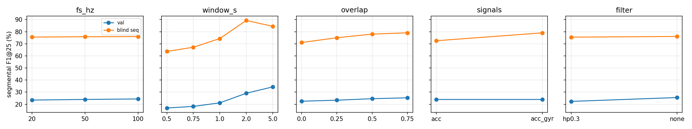

# E1 — Gesture classifier trained on annotated gestures only

Mean ± std over replicates, in %, except events per hour. Selection uses `val` only (mean val.timeline.seg_f1_25); every other column is blind.

## Stage A — signal configuration (CNN-BiLSTM, default hyperparameters, seed 0)

### fs_hz

| fs_hz | val segF1@25 | val win F1 | seq win F1 | seq win acc | seq G3 recall | seq segF1@25 | seq Order EM | wild win F1 | wild segF1@25 | ext gestures/h | n |
|---|---|---|---|---|---|---|---|---|---|---|---|
| 20 | 23.5 ± 8.5 | 31.1 ± 5.8 | 76.5 ± 8.2 | 77.7 ± 7.8 | 76.8 ± 10.5 | 75.6 ± 12.3 | 33.5 ± 25.4 | 34.3 ± 6.1 | 28.9 ± 11.0 | 813.7 ± 394.9 | 240 |
| 50 | 24.0 ± 8.3 | 31.3 ± 5.0 | 76.4 ± 7.8 | 77.6 ± 7.2 | 77.8 ± 10.4 | 75.8 ± 12.1 | 33.2 ± 25.0 | 35.1 ± 5.6 | 29.7 ± 11.1 | 794.6 ± 404.0 | 240 |
| 100 | 24.4 ± 7.9 | 31.8 ± 5.1 | 75.5 ± 8.1 | 76.8 ± 7.1 | 78.3 ± 9.5 | 76.0 ± 12.3 | 34.6 ± 24.4 | 36.2 ± 5.7 | 30.9 ± 10.9 | 742.4 ± 385.8 | 240 |

### window_s

| window_s | val segF1@25 | val win F1 | seq win F1 | seq win acc | seq G3 recall | seq segF1@25 | seq Order EM | wild win F1 | wild segF1@25 | ext gestures/h | n |
|---|---|---|---|---|---|---|---|---|---|---|---|
| 0.5 | 16.9 ± 3.4 | 27.0 ± 2.8 | 67.3 ± 3.5 | 69.3 ± 3.6 | 66.6 ± 7.8 | 63.7 ± 8.0 | 14.0 ± 10.8 | 29.4 ± 1.8 | 20.0 ± 3.8 | 1149.8 ± 260.3 | 144 |
| 0.75 | 18.2 ± 3.6 | 28.9 ± 2.9 | 70.7 ± 4.9 | 72.5 ± 4.2 | 72.1 ± 6.8 | 67.1 ± 9.0 | 16.6 ± 12.1 | 31.3 ± 1.9 | 21.4 ± 4.2 | 1081.2 ± 273.7 | 144 |
| 1.0 | 21.2 ± 3.7 | 30.1 ± 3.1 | 74.0 ± 4.0 | 75.4 ± 3.7 | 75.7 ± 6.5 | 74.3 ± 7.0 | 24.4 ± 14.1 | 32.9 ± 2.0 | 25.0 ± 4.2 | 902.6 ± 197.2 | 144 |
| 2.0 | 29.1 ± 3.9 | 33.7 ± 4.2 | 83.3 ± 3.0 | 83.8 ± 2.9 | 86.4 ± 4.0 | 89.3 ± 3.7 | 59.5 ± 12.1 | 38.0 ± 2.5 | 35.4 ± 3.5 | 547.8 ± 84.3 | 144 |
| 5.0 | 34.4 ± 7.7 | 37.2 ± 5.6 | 85.4 ± 3.6 | 85.9 ± 3.7 | 87.5 ± 4.3 | 84.5 ± 7.4 | 54.2 ± 25.3 | 44.2 ± 3.4 | 47.4 ± 4.1 | 236.4 ± 44.7 | 144 |

### overlap

| overlap | val segF1@25 | val win F1 | seq win F1 | seq win acc | seq G3 recall | seq segF1@25 | seq Order EM | wild win F1 | wild segF1@25 | ext gestures/h | n |
|---|---|---|---|---|---|---|---|---|---|---|---|
| 0.0 | 22.5 ± 8.5 | 31.3 ± 5.4 | 76.5 ± 8.3 | 78.0 ± 7.8 | 78.1 ± 10.8 | 71.1 ± 12.3 | 21.8 ± 19.4 | 35.2 ± 5.9 | 28.2 ± 11.0 | 845.0 ± 476.1 | 180 |
| 0.25 | 23.4 ± 7.4 | 31.4 ± 5.3 | 75.8 ± 7.6 | 77.1 ± 7.0 | 77.2 ± 9.5 | 75.0 ± 10.1 | 31.3 ± 18.7 | 35.1 ± 5.8 | 28.9 ± 9.8 | 795.0 ± 360.8 | 180 |
| 0.5 | 24.6 ± 8.1 | 31.4 ± 5.4 | 76.3 ± 8.2 | 77.5 ± 7.5 | 77.7 ± 10.1 | 78.0 ± 11.4 | 39.2 ± 24.6 | 35.2 ± 5.8 | 30.8 ± 11.0 | 751.6 ± 363.0 | 180 |
| 0.75 | 25.3 ± 8.6 | 31.4 ± 5.3 | 76.0 ± 8.0 | 77.0 ± 7.2 | 77.6 ± 10.1 | 79.1 ± 13.3 | 42.8 ± 30.0 | 35.2 ± 5.9 | 31.6 ± 12.0 | 742.7 ± 365.1 | 180 |

### signals

| signals | val segF1@25 | val win F1 | seq win F1 | seq win acc | seq G3 recall | seq segF1@25 | seq Order EM | wild win F1 | wild segF1@25 | ext gestures/h | n |
|---|---|---|---|---|---|---|---|---|---|---|---|
| acc | 23.9 ± 8.1 | 30.7 ± 5.2 | 73.4 ± 8.4 | 75.2 ± 7.6 | 73.9 ± 10.9 | 72.5 ± 12.7 | 30.0 ± 23.5 | 34.7 ± 6.2 | 29.8 ± 11.3 | 766.6 ± 395.1 | 360 |
| acc_gyr | 24.0 ± 8.3 | 32.1 ± 5.4 | 78.9 ± 6.7 | 79.5 ± 6.4 | 81.4 ± 7.7 | 79.0 ± 10.8 | 37.5 ± 25.7 | 35.6 ± 5.5 | 29.9 ± 10.8 | 800.6 ± 395.9 | 360 |

### filter

| filter | val segF1@25 | val win F1 | seq win F1 | seq win acc | seq G3 recall | seq segF1@25 | seq Order EM | wild win F1 | wild segF1@25 | ext gestures/h | n |
|---|---|---|---|---|---|---|---|---|---|---|---|
| hp0.3 | 22.4 ± 8.0 | 30.2 ± 4.9 | 75.4 ± 7.5 | 75.8 ± 7.3 | 80.1 ± 8.0 | 75.5 ± 12.2 | 32.0 ± 25.1 | 34.9 ± 5.1 | 28.2 ± 11.1 | 878.7 ± 435.8 | 360 |
| none | 25.5 ± 8.1 | 32.6 ± 5.5 | 76.9 ± 8.5 | 79.0 ± 7.1 | 75.2 ± 11.4 | 76.1 ± 12.2 | 35.5 ± 24.6 | 35.5 ± 6.5 | 31.5 ± 10.8 | 688.4 ± 324.5 | 360 |

### Top 10 signal configurations

| config_key | val segF1@25 | val win F1 | seq win F1 | seq win acc | seq G3 recall | seq segF1@25 | seq Order EM | wild win F1 | wild segF1@25 | ext gestures/h | n |
|---|---|---|---|---|---|---|---|---|---|---|---|
| cnn_bilstm__fs100_w500_ov75_acc_raw__hpdef | 40.2 ± 7.2 | 39.7 ± 4.1 | 85.1 ± 2.0 | 84.9 ± 1.9 | 88.7 ± 2.4 | 95.0 ± 0.3 | 84.9 ± 3.9 | 49.6 ± 1.6 | 58.4 ± 1.6 | 172.6 ± 26.3 | 3 |
| cnn_bilstm__fs50_w500_ov75_acc_raw__hpdef | 39.6 ± 7.5 | 40.0 ± 6.8 | 86.1 ± 1.9 | 86.2 ± 2.0 | 87.2 ± 4.4 | 93.0 ± 0.9 | 80.8 ± 4.7 | 47.4 ± 4.0 | 53.8 ± 5.9 | 200.3 ± 20.1 | 3 |
| cnn_bilstm__fs50_w500_ov50_acc_raw__hpdef | 38.5 ± 8.6 | 39.5 ± 7.0 | 86.6 ± 2.7 | 87.0 ± 2.8 | 86.9 ± 6.6 | 85.6 ± 1.8 | 62.2 ± 5.4 | 47.7 ± 3.9 | 52.1 ± 3.9 | 195.3 ± 20.1 | 3 |
| cnn_bilstm__fs20_w500_ov75_acc_raw__hpdef | 38.2 ± 11.3 | 39.8 ± 6.3 | 87.4 ± 1.3 | 87.8 ± 1.2 | 84.5 ± 4.7 | 90.3 ± 0.4 | 77.3 ± 1.9 | 46.3 ± 2.9 | 51.7 ± 4.1 | 226.4 ± 26.3 | 3 |
| cnn_bilstm__fs100_w500_ov50_acc_raw__hpdef | 38.1 ± 7.1 | 39.7 ± 4.3 | 86.0 ± 2.8 | 86.2 ± 2.7 | 88.7 ± 4.1 | 86.3 ± 2.7 | 64.1 ± 7.6 | 49.2 ± 1.5 | 55.2 ± 1.1 | 172.8 ± 21.3 | 3 |
| cnn_bilstm__fs20_w500_ov75_accgyr_hp03__hpdef | 37.7 ± 9.7 | 39.1 ± 7.5 | 87.8 ± 1.1 | 87.3 ± 1.2 | 88.2 ± 1.3 | 96.2 ± 0.8 | 91.8 ± 1.8 | 44.3 ± 3.2 | 50.8 ± 2.4 | 258.8 ± 41.6 | 3 |
| cnn_bilstm__fs100_w500_ov75_accgyr_raw__hpdef | 37.5 ± 7.9 | 39.3 ± 5.3 | 85.4 ± 1.4 | 84.9 ± 1.3 | 89.1 ± 2.7 | 94.3 ± 2.0 | 81.8 ± 9.2 | 45.1 ± 1.9 | 50.4 ± 2.5 | 215.5 ± 17.8 | 3 |
| cnn_bilstm__fs20_w500_ov50_acc_raw__hpdef | 37.2 ± 11.6 | 39.7 ± 6.6 | 87.7 ± 1.5 | 88.7 ± 1.5 | 83.6 ± 5.2 | 83.3 ± 2.0 | 58.5 ± 4.5 | 44.8 ± 2.6 | 49.0 ± 2.7 | 225.1 ± 10.4 | 3 |
| cnn_bilstm__fs20_w500_ov50_accgyr_hp03__hpdef | 37.0 ± 11.4 | 39.3 ± 7.7 | 88.1 ± 1.5 | 88.0 ± 1.6 | 87.9 ± 1.3 | 89.4 ± 0.4 | 72.2 ± 0.6 | 44.8 ± 2.4 | 50.1 ± 1.9 | 235.2 ± 28.7 | 3 |
| cnn_bilstm__fs100_w500_ov25_acc_raw__hpdef | 36.8 ± 5.7 | 40.0 ± 3.5 | 83.6 ± 2.1 | 84.5 ± 1.9 | 87.5 ± 0.7 | 81.3 ± 0.2 | 46.3 ± 1.7 | 48.4 ± 0.8 | 49.4 ± 0.4 | 201.0 ± 25.5 | 3 |

## Stage B — model (3 folds × 3 seeds)

Advanced: `cnn__fs50_w500_ov75_acc_raw__hpdef`, `cnn_bilstm__fs50_w500_ov75_acc_raw__hpdef`, `cnn_bilstm__fs20_w500_ov75_acc_raw__hpdef`

| config_key | val segF1@25 | val win F1 | seq win F1 | seq win acc | seq G3 recall | seq segF1@25 | seq Order EM | wild win F1 | wild segF1@25 | ext gestures/h | n |
|---|---|---|---|---|---|---|---|---|---|---|---|
| cnn__fs50_w500_ov75_acc_raw__hpdef | 39.4 ± 7.2 | 34.3 ± 5.3 | 76.7 ± 2.4 | 76.6 ± 2.3 | 80.7 ± 9.9 | 86.6 ± 2.6 | 55.9 ± 8.0 | 40.4 ± 2.5 | 55.3 ± 3.4 | 149.5 ± 16.7 | 9 |
| cnn_bilstm__fs50_w500_ov75_acc_raw__hpdef | 38.5 ± 8.1 | 38.7 ± 6.4 | 86.7 ± 1.9 | 86.8 ± 2.1 | 87.3 ± 3.3 | 92.8 ± 1.2 | 81.4 ± 2.9 | 46.0 ± 2.7 | 53.2 ± 3.6 | 210.1 ± 20.5 | 9 |
| cnn_bilstm__fs20_w500_ov75_acc_raw__hpdef | 38.4 ± 9.4 | 39.3 ± 5.1 | 87.3 ± 1.3 | 87.6 ± 1.3 | 84.9 ± 3.9 | 91.2 ± 1.2 | 78.9 ± 2.4 | 44.6 ± 2.3 | 51.9 ± 2.6 | 228.7 ± 17.1 | 9 |
| cnn_bilstm__fs100_w500_ov75_acc_raw__hpdef | 38.0 ± 6.5 | 38.7 ± 4.2 | 85.6 ± 1.4 | 85.5 ± 1.4 | 89.4 ± 2.9 | 94.9 ± 0.9 | 84.8 ± 2.6 | 47.8 ± 1.8 | 56.9 ± 2.3 | 190.0 ± 24.2 | 9 |
| cnn__fs50_w500_ov50_acc_raw__hpdef | 37.6 ± 8.1 | 34.6 ± 5.0 | 78.0 ± 2.7 | 78.9 ± 2.7 | 80.2 ± 11.0 | 81.4 ± 2.6 | 43.6 ± 7.6 | 39.9 ± 2.5 | 53.6 ± 3.3 | 142.9 ± 15.4 | 9 |
| cnn__fs20_w500_ov75_acc_raw__hpdef | 37.4 ± 8.7 | 34.2 ± 5.2 | 81.5 ± 2.1 | 81.5 ± 1.9 | 87.0 ± 2.0 | 91.0 ± 3.3 | 69.4 ± 10.6 | 39.5 ± 2.3 | 53.1 ± 2.6 | 190.7 ± 18.0 | 9 |
| cnn_bilstm__fs50_w500_ov50_acc_raw__hpdef | 37.1 ± 7.7 | 38.6 ± 6.6 | 87.5 ± 1.9 | 88.0 ± 2.0 | 87.0 ± 4.5 | 85.6 ± 2.8 | 65.5 ± 4.9 | 46.1 ± 2.6 | 51.6 ± 3.0 | 201.0 ± 17.8 | 9 |
| cnn_lstm__fs20_w500_ov75_acc_raw__hpdef | 36.9 ± 8.0 | 36.6 ± 4.3 | 86.6 ± 2.1 | 86.8 ± 2.2 | 86.2 ± 2.1 | 92.2 ± 1.5 | 79.4 ± 3.1 | 42.4 ± 2.2 | 50.8 ± 2.6 | 247.0 ± 29.3 | 9 |
| cnn__fs100_w500_ov75_acc_raw__hpdef | 36.9 ± 9.2 | 35.0 ± 4.2 | 72.2 ± 2.8 | 72.4 ± 2.4 | 74.0 ± 14.3 | 83.1 ± 3.6 | 46.5 ± 10.3 | 41.9 ± 3.8 | 55.5 ± 3.5 | 124.2 ± 22.6 | 9 |
| cnn_bilstm__fs100_w500_ov50_acc_raw__hpdef | 36.8 ± 6.5 | 38.7 ± 4.6 | 86.6 ± 1.8 | 86.8 ± 1.8 | 90.1 ± 3.6 | 87.3 ± 2.9 | 68.2 ± 7.8 | 47.5 ± 1.8 | 54.2 ± 2.2 | 186.9 ± 22.1 | 9 |
| cnn_lstm__fs50_w500_ov75_acc_raw__hpdef | 36.5 ± 7.1 | 36.6 ± 4.2 | 85.2 ± 2.1 | 85.2 ± 2.1 | 87.8 ± 5.9 | 91.5 ± 1.9 | 77.6 ± 6.1 | 43.6 ± 2.7 | 52.0 ± 2.1 | 227.9 ± 23.2 | 9 |
| cnn_lstm__fs50_w500_ov50_acc_raw__hpdef | 35.3 ± 7.0 | 36.8 ± 4.4 | 86.0 ± 2.1 | 86.5 ± 2.0 | 88.2 ± 6.6 | 84.7 ± 2.6 | 64.6 ± 6.2 | 43.4 ± 2.7 | 50.1 ± 1.9 | 220.3 ± 19.7 | 9 |
| cnn__fs100_w500_ov50_acc_raw__hpdef | 35.1 ± 10.9 | 35.2 ± 4.1 | 73.8 ± 2.8 | 74.8 ± 2.2 | 72.5 ± 14.3 | 79.5 ± 3.5 | 39.0 ± 8.3 | 41.3 ± 3.7 | 52.6 ± 3.2 | 122.4 ± 21.2 | 9 |
| cnn_lstm__fs100_w500_ov75_acc_raw__hpdef | 34.3 ± 6.3 | 34.7 ± 4.0 | 84.5 ± 2.6 | 84.4 ± 2.7 | 88.6 ± 3.9 | 93.8 ± 1.2 | 83.2 ± 4.8 | 43.1 ± 2.2 | 54.6 ± 2.2 | 203.8 ± 16.1 | 9 |
| cnn_lstm__fs100_w500_ov50_acc_raw__hpdef | 33.0 ± 6.6 | 34.8 ± 4.1 | 86.1 ± 2.5 | 86.4 ± 2.4 | 88.8 ± 6.1 | 87.5 ± 2.0 | 70.3 ± 6.2 | 42.9 ± 1.7 | 52.1 ± 2.0 | 209.3 ± 14.1 | 9 |

## Stage C — hyperparameters (seed 0), top 10

Advanced: `cnn_bilstm__fs50_w500_ov75_acc_raw__hp14`, `cnn_bilstm__fs50_w500_ov75_acc_raw__hp21`, `cnn_bilstm__fs50_w500_ov75_acc_raw__hp30`

| config_key | val segF1@25 | val win F1 | seq win F1 | seq win acc | seq G3 recall | seq segF1@25 | seq Order EM | wild win F1 | wild segF1@25 | ext gestures/h | n |
|---|---|---|---|---|---|---|---|---|---|---|---|
| cnn_bilstm__fs50_w500_ov75_acc_raw__hp14 | 40.5 ± 10.5 | 39.7 ± 7.1 | 86.3 ± 1.2 | 86.3 ± 1.1 | 87.7 ± 2.8 | 93.8 ± 1.7 | 83.0 ± 4.1 | 46.2 ± 3.4 | 54.1 ± 3.8 | 220.6 ± 16.9 | 3 |
| cnn_bilstm__fs50_w500_ov75_acc_raw__hp21 | 40.4 ± 9.6 | 40.2 ± 7.6 | 86.5 ± 3.1 | 86.7 ± 3.2 | 84.6 ± 6.6 | 91.3 ± 3.0 | 79.9 ± 7.5 | 46.8 ± 4.7 | 55.3 ± 2.6 | 194.3 ± 33.5 | 3 |
| cnn_bilstm__fs50_w500_ov75_acc_raw__hp30 | 40.2 ± 9.5 | 40.8 ± 7.9 | 86.3 ± 2.1 | 86.4 ± 2.3 | 86.2 ± 4.9 | 92.6 ± 3.0 | 82.2 ± 6.9 | 47.3 ± 2.3 | 55.7 ± 4.2 | 210.7 ± 19.5 | 3 |
| cnn__fs50_w500_ov75_acc_raw__hp26 | 40.2 ± 7.6 | 31.6 ± 5.9 | 76.2 ± 2.6 | 76.0 ± 2.7 | 79.0 ± 10.0 | 90.3 ± 1.9 | 69.1 ± 4.3 | 37.7 ± 3.3 | 54.8 ± 2.7 | 167.3 ± 8.9 | 3 |
| cnn__fs50_w500_ov75_acc_raw__hp03 | 40.2 ± 7.5 | 32.4 ± 6.8 | 76.3 ± 2.1 | 76.0 ± 2.2 | 84.4 ± 4.0 | 89.9 ± 1.3 | 67.1 ± 4.2 | 37.1 ± 1.6 | 53.6 ± 1.7 | 164.7 ± 15.5 | 3 |
| cnn__fs50_w500_ov75_acc_raw__hpdef | 40.1 ± 6.4 | 35.1 ± 6.3 | 76.7 ± 1.2 | 76.5 ± 1.2 | 86.2 ± 6.0 | 87.1 ± 2.1 | 57.7 ± 5.3 | 41.6 ± 4.3 | 57.9 ± 5.2 | 134.8 ± 14.6 | 3 |
| cnn_bilstm__fs50_w500_ov75_acc_raw__hp29 | 40.1 ± 9.1 | 41.2 ± 6.2 | 88.2 ± 2.7 | 88.3 ± 3.1 | 87.8 ± 0.9 | 90.3 ± 0.7 | 79.3 ± 4.5 | 49.2 ± 2.5 | 57.2 ± 2.2 | 176.7 ± 33.1 | 3 |
| cnn__fs50_w500_ov75_acc_raw__hp18 | 40.0 ± 8.9 | 31.8 ± 7.1 | 75.6 ± 1.5 | 75.4 ± 1.5 | 83.0 ± 7.2 | 88.9 ± 0.7 | 63.0 ± 6.4 | 38.6 ± 2.8 | 55.2 ± 1.5 | 161.8 ± 17.9 | 3 |
| cnn_bilstm__fs50_w500_ov75_acc_raw__hp28 | 39.9 ± 12.7 | 39.4 ± 9.2 | 86.6 ± 0.5 | 86.6 ± 0.5 | 87.5 ± 5.8 | 92.8 ± 1.8 | 81.2 ± 3.1 | 46.6 ± 3.7 | 55.6 ± 5.4 | 200.3 ± 23.8 | 3 |
| cnn_bilstm__fs50_w500_ov75_acc_raw__hp26 | 39.8 ± 12.4 | 39.9 ± 9.3 | 84.9 ± 1.1 | 84.7 ± 1.2 | 87.2 ± 1.5 | 94.2 ± 1.0 | 82.1 ± 1.0 | 47.3 ± 5.3 | 55.7 ± 4.4 | 197.1 ± 12.7 | 3 |

## Stage F — finalists (3 folds × 3 seeds)

Advanced: `cnn_bilstm__fs50_w500_ov75_acc_raw__hp14`, `cnn_bilstm__fs50_w500_ov75_acc_raw__hp30`, `cnn_bilstm__fs50_w500_ov75_acc_raw__hp21`

| config_key | val segF1@25 | val win F1 | seq win F1 | seq win acc | seq G3 recall | seq segF1@25 | seq Order EM | wild win F1 | wild segF1@25 | ext gestures/h | n |
|---|---|---|---|---|---|---|---|---|---|---|---|
| cnn_bilstm__fs50_w500_ov75_acc_raw__hp14 | 39.8 ± 10.7 | 39.7 ± 7.6 | 87.1 ± 1.2 | 87.0 ± 1.3 | 87.9 ± 2.8 | 92.9 ± 1.5 | 81.2 ± 3.4 | 45.7 ± 4.3 | 53.5 ± 5.2 | 220.4 ± 29.9 | 9 |
| cnn_bilstm__fs50_w500_ov75_acc_raw__hp30 | 38.3 ± 8.8 | 39.4 ± 5.9 | 86.5 ± 3.1 | 86.6 ± 3.1 | 87.1 ± 4.7 | 92.9 ± 2.0 | 81.0 ± 6.4 | 45.8 ± 2.5 | 53.8 ± 4.0 | 221.5 ± 29.8 | 9 |
| cnn_bilstm__fs50_w500_ov75_acc_raw__hp21 | 38.2 ± 9.2 | 38.9 ± 6.7 | 87.1 ± 1.9 | 87.3 ± 2.0 | 85.8 ± 4.0 | 91.2 ± 2.5 | 79.1 ± 5.9 | 45.7 ± 2.8 | 53.0 ± 2.8 | 212.1 ± 26.3 | 9 |

### Stage B by model (all 5 signals)

| model | val segF1@25 | val win F1 | seq win F1 | seq win acc | seq G3 recall | seq segF1@25 | seq Order EM | wild win F1 | wild segF1@25 | ext gestures/h | n |
|---|---|---|---|---|---|---|---|---|---|---|---|
| cnn | 37.3 ± 8.6 | 34.6 ± 4.6 | 76.4 ± 4.1 | 76.9 ± 3.9 | 78.9 ± 12.0 | 84.3 ± 5.1 | 50.9 ± 13.9 | 40.6 ± 3.0 | 54.0 ± 3.3 | 146.0 ± 30.8 | 45 |
| cnn_bilstm | 37.8 ± 7.4 | 38.8 ± 5.2 | 86.7 ± 1.7 | 86.9 ± 1.9 | 87.7 ± 4.0 | 90.4 ± 4.0 | 75.8 ± 8.8 | 46.4 ± 2.4 | 53.5 ± 3.3 | 203.4 ± 24.8 | 45 |
| cnn_lstm | 35.2 ± 6.9 | 35.9 ± 4.1 | 85.7 ± 2.3 | 85.9 ± 2.4 | 87.9 ± 5.1 | 89.9 ± 3.9 | 75.0 ± 8.5 | 43.1 ± 2.2 | 51.9 ± 2.6 | 221.7 ± 25.4 | 45 |

