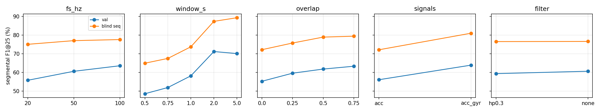

# E2 — Gesture classifier with daily-life negatives (G5)

Mean ± std over replicates, in %, except events per hour. Selection uses `val` only (mean val.timeline.seg_f1_25); every other column is blind.

## Stage A — signal configuration (CNN-BiLSTM, default hyperparameters, seed 0)

### fs_hz

| fs_hz | val segF1@25 | val win F1 | seq win F1 | seq win acc | seq G3 recall | seq segF1@25 | seq Order EM | wild win F1 | wild segF1@25 | ext gestures/h | n |
|---|---|---|---|---|---|---|---|---|---|---|---|
| 20 | 55.8 ± 13.9 | 66.7 ± 9.6 | 72.6 ± 7.3 | 73.4 ± 6.7 | 74.8 ± 11.5 | 75.1 ± 12.7 | 35.7 ± 21.7 | 67.6 ± 10.1 | 60.9 ± 17.2 | 165.3 ± 103.8 | 240 |
| 50 | 60.6 ± 12.4 | 69.6 ± 7.5 | 74.2 ± 5.7 | 75.3 ± 4.7 | 77.8 ± 10.3 | 77.0 ± 11.7 | 36.0 ± 23.5 | 71.3 ± 8.3 | 66.0 ± 15.3 | 132.5 ± 77.3 | 240 |
| 100 | 63.6 ± 10.9 | 70.5 ± 6.1 | 73.5 ± 5.7 | 74.4 ± 4.6 | 78.4 ± 10.4 | 77.6 ± 12.6 | 39.6 ± 24.3 | 73.5 ± 6.8 | 70.5 ± 13.1 | 82.4 ± 43.5 | 240 |

### window_s

| window_s | val segF1@25 | val win F1 | seq win F1 | seq win acc | seq G3 recall | seq segF1@25 | seq Order EM | wild win F1 | wild segF1@25 | ext gestures/h | n |
|---|---|---|---|---|---|---|---|---|---|---|---|
| 0.5 | 48.6 ± 9.2 | 60.2 ± 6.2 | 67.0 ± 4.9 | 69.2 ± 4.4 | 65.2 ± 8.0 | 65.0 ± 8.8 | 20.6 ± 10.8 | 61.1 ± 5.9 | 51.3 ± 9.3 | 198.6 ± 82.4 | 144 |
| 0.75 | 52.0 ± 10.3 | 65.5 ± 6.0 | 70.0 ± 4.4 | 71.6 ± 4.0 | 70.8 ± 7.0 | 67.5 ± 8.7 | 20.1 ± 10.9 | 65.8 ± 6.0 | 54.0 ± 10.3 | 183.5 ± 83.1 | 144 |
| 1.0 | 58.2 ± 8.9 | 68.8 ± 5.6 | 72.2 ± 4.2 | 73.3 ± 3.9 | 74.8 ± 6.5 | 73.7 ± 7.1 | 26.3 ± 11.7 | 69.0 ± 5.6 | 60.7 ± 9.1 | 141.4 ± 55.8 | 144 |
| 2.0 | 71.2 ± 6.8 | 75.3 ± 4.9 | 79.6 ± 3.3 | 79.7 ± 3.1 | 85.0 ± 4.7 | 87.3 ± 4.3 | 54.2 ± 11.1 | 77.9 ± 4.6 | 77.5 ± 6.7 | 72.9 ± 22.3 | 144 |
| 5.0 | 70.1 ± 9.4 | 74.9 ± 5.4 | 78.3 ± 3.1 | 78.0 ± 3.7 | 89.2 ± 3.8 | 89.3 ± 6.4 | 64.2 ± 22.4 | 80.2 ± 2.5 | 85.6 ± 4.8 | 37.3 ± 7.5 | 144 |

### overlap

| overlap | val segF1@25 | val win F1 | seq win F1 | seq win acc | seq G3 recall | seq segF1@25 | seq Order EM | wild win F1 | wild segF1@25 | ext gestures/h | n |
|---|---|---|---|---|---|---|---|---|---|---|---|
| 0.0 | 55.3 ± 13.1 | 68.9 ± 8.1 | 73.7 ± 6.5 | 74.9 ± 5.8 | 77.7 ± 11.7 | 72.2 ± 12.4 | 25.3 ± 17.8 | 70.8 ± 8.8 | 61.1 ± 16.3 | 150.9 ± 106.5 | 180 |
| 0.25 | 59.6 ± 11.5 | 69.0 ± 8.1 | 73.0 ± 6.1 | 74.0 ± 5.3 | 76.3 ± 10.0 | 75.7 ± 10.6 | 35.6 ± 19.0 | 70.7 ± 8.8 | 65.1 ± 14.2 | 125.1 ± 75.1 | 180 |
| 0.5 | 61.8 ± 12.1 | 69.0 ± 8.1 | 73.6 ± 6.5 | 74.5 ± 5.5 | 77.1 ± 10.9 | 78.9 ± 12.0 | 42.4 ± 24.1 | 70.9 ± 8.9 | 67.9 ± 15.2 | 118.0 ± 76.7 | 180 |
| 0.75 | 63.3 ± 13.2 | 68.8 ± 7.9 | 73.3 ± 6.2 | 74.1 ± 5.3 | 77.0 ± 10.9 | 79.4 ± 13.0 | 44.9 ± 26.1 | 70.9 ± 8.9 | 69.2 ± 16.4 | 112.8 ± 76.2 | 180 |

### signals

| signals | val segF1@25 | val win F1 | seq win F1 | seq win acc | seq G3 recall | seq segF1@25 | seq Order EM | wild win F1 | wild segF1@25 | ext gestures/h | n |
|---|---|---|---|---|---|---|---|---|---|---|---|
| acc | 56.1 ± 13.0 | 65.3 ± 7.7 | 70.3 ± 6.5 | 71.8 ± 5.7 | 72.9 ± 11.8 | 72.1 ± 12.9 | 31.6 ± 21.1 | 67.1 ± 9.0 | 61.7 ± 16.4 | 135.1 ± 97.8 | 360 |
| acc_gyr | 63.9 ± 11.5 | 72.5 ± 6.6 | 76.6 ± 4.2 | 76.9 ± 3.8 | 81.1 ± 8.0 | 81.0 ± 10.0 | 42.5 ± 24.0 | 74.5 ± 6.9 | 69.9 ± 14.1 | 118.3 ± 70.9 | 360 |

### filter

| filter | val segF1@25 | val win F1 | seq win F1 | seq win acc | seq G3 recall | seq segF1@25 | seq Order EM | wild win F1 | wild segF1@25 | ext gestures/h | n |
|---|---|---|---|---|---|---|---|---|---|---|---|
| hp0.3 | 59.4 ± 13.6 | 68.6 ± 8.3 | 73.3 ± 6.2 | 73.5 ± 5.7 | 78.9 ± 9.0 | 76.5 ± 12.6 | 36.7 ± 23.9 | 71.7 ± 8.9 | 66.2 ± 16.5 | 124.2 ± 94.3 | 360 |
| none | 60.7 ± 12.0 | 69.3 ± 7.7 | 73.6 ± 6.4 | 75.2 ± 5.1 | 75.1 ± 12.2 | 76.6 ± 12.2 | 37.4 ± 22.5 | 69.9 ± 8.6 | 65.4 ± 15.1 | 129.2 ± 76.4 | 360 |

### Top 10 signal configurations

| config_key | val segF1@25 | val win F1 | seq win F1 | seq win acc | seq G3 recall | seq segF1@25 | seq Order EM | wild win F1 | wild segF1@25 | ext gestures/h | n |
|---|---|---|---|---|---|---|---|---|---|---|---|
| cnn_bilstm__fs100_w200_ov75_accgyr_hp03__hpdef | 81.0 ± 5.9 | 78.7 ± 4.4 | 81.9 ± 0.6 | 81.3 ± 0.5 | 89.5 ± 1.3 | 94.0 ± 0.7 | 73.8 ± 4.1 | 84.0 ± 0.7 | 89.4 ± 0.6 | 45.0 ± 3.2 | 3 |
| cnn_bilstm__fs50_w200_ov75_accgyr_hp03__hpdef | 81.0 ± 5.7 | 79.4 ± 4.5 | 81.6 ± 0.8 | 81.2 ± 0.7 | 88.9 ± 1.5 | 93.4 ± 1.7 | 72.3 ± 6.1 | 82.7 ± 0.7 | 87.6 ± 1.5 | 49.0 ± 3.0 | 3 |
| cnn_bilstm__fs50_w200_ov75_accgyr_raw__hpdef | 79.7 ± 6.8 | 78.8 ± 5.8 | 82.1 ± 1.0 | 81.9 ± 1.0 | 87.3 ± 1.9 | 91.7 ± 0.6 | 64.8 ± 2.5 | 81.1 ± 1.9 | 84.9 ± 1.8 | 57.2 ± 10.1 | 3 |
| cnn_bilstm__fs100_w200_ov75_accgyr_raw__hpdef | 79.2 ± 7.3 | 78.2 ± 5.9 | 81.5 ± 0.8 | 81.2 ± 0.9 | 89.1 ± 0.8 | 93.0 ± 1.4 | 69.4 ± 4.2 | 80.9 ± 1.1 | 85.7 ± 2.1 | 56.0 ± 3.9 | 3 |
| cnn_bilstm__fs20_w200_ov75_accgyr_hp03__hpdef | 78.9 ± 6.0 | 77.6 ± 5.0 | 80.8 ± 1.1 | 80.0 ± 1.2 | 86.8 ± 3.1 | 92.8 ± 1.5 | 70.1 ± 4.8 | 80.6 ± 1.2 | 85.4 ± 1.4 | 54.4 ± 6.7 | 3 |
| cnn_bilstm__fs20_w200_ov75_accgyr_raw__hpdef | 77.9 ± 5.5 | 77.6 ± 5.3 | 81.9 ± 0.9 | 81.4 ± 0.8 | 86.1 ± 1.8 | 92.9 ± 1.2 | 71.1 ± 6.3 | 79.7 ± 0.2 | 83.7 ± 0.0 | 62.7 ± 5.0 | 3 |
| cnn_bilstm__fs50_w500_ov75_accgyr_hp03__hpdef | 77.3 ± 10.3 | 76.6 ± 5.4 | 80.0 ± 0.5 | 79.2 ± 0.8 | 92.1 ± 1.2 | 97.8 ± 0.2 | 93.1 ± 1.0 | 83.9 ± 0.7 | 93.0 ± 0.7 | 32.8 ± 2.9 | 3 |
| cnn_bilstm__fs50_w500_ov75_accgyr_raw__hpdef | 77.2 ± 9.9 | 76.6 ± 5.9 | 80.8 ± 1.0 | 80.2 ± 1.1 | 91.8 ± 1.1 | 96.9 ± 0.6 | 90.0 ± 2.2 | 82.4 ± 0.7 | 91.3 ± 0.8 | 38.8 ± 2.7 | 3 |
| cnn_bilstm__fs100_w500_ov75_accgyr_raw__hpdef | 76.7 ± 11.6 | 73.5 ± 8.9 | 77.3 ± 0.3 | 76.5 ± 0.4 | 92.2 ± 1.6 | 97.8 ± 0.3 | 91.8 ± 1.2 | 81.0 ± 0.6 | 91.6 ± 0.5 | 39.5 ± 1.7 | 3 |
| cnn_bilstm__fs100_w200_ov50_accgyr_hp03__hpdef | 76.5 ± 5.7 | 79.0 ± 4.7 | 82.9 ± 0.9 | 82.4 ± 0.8 | 89.2 ± 0.8 | 92.7 ± 0.5 | 70.9 ± 3.3 | 83.9 ± 1.6 | 85.0 ± 1.0 | 59.2 ± 7.2 | 3 |

## Stage B — model (3 folds × 3 seeds)

Advanced: `cnn__fs100_w200_ov75_accgyr_hp03__hpdef`, `cnn__fs100_w200_ov75_accgyr_raw__hpdef`, `cnn_bilstm__fs100_w200_ov75_accgyr_hp03__hpdef`

| config_key | val segF1@25 | val win F1 | seq win F1 | seq win acc | seq G3 recall | seq segF1@25 | seq Order EM | wild win F1 | wild segF1@25 | ext gestures/h | n |
|---|---|---|---|---|---|---|---|---|---|---|---|
| cnn__fs100_w200_ov75_accgyr_hp03__hpdef | 81.7 ± 5.5 | 79.6 ± 3.9 | 82.3 ± 1.0 | 82.0 ± 1.0 | 84.0 ± 2.0 | 92.3 ± 1.6 | 69.5 ± 7.6 | 83.3 ± 0.8 | 88.9 ± 1.3 | 26.2 ± 2.9 | 9 |
| cnn__fs100_w200_ov75_accgyr_raw__hpdef | 81.1 ± 5.4 | 79.6 ± 4.7 | 81.1 ± 1.2 | 81.0 ± 1.2 | 87.9 ± 2.5 | 89.7 ± 2.3 | 55.1 ± 10.0 | 80.6 ± 1.1 | 84.5 ± 2.7 | 47.2 ± 7.4 | 9 |
| cnn_bilstm__fs100_w200_ov75_accgyr_hp03__hpdef | 81.0 ± 5.1 | 78.8 ± 4.1 | 81.5 ± 0.7 | 81.0 ± 0.7 | 89.0 ± 1.8 | 93.4 ± 1.3 | 71.9 ± 5.6 | 83.3 ± 0.8 | 88.8 ± 1.1 | 44.9 ± 3.0 | 9 |
| cnn_lstm__fs100_w200_ov75_accgyr_hp03__hpdef | 80.6 ± 6.3 | 78.5 ± 4.8 | 81.6 ± 0.9 | 81.3 ± 1.0 | 87.8 ± 1.3 | 93.2 ± 1.7 | 70.8 ± 6.9 | 83.0 ± 0.7 | 87.9 ± 1.6 | 46.0 ± 2.4 | 9 |
| cnn_bilstm__fs50_w200_ov75_accgyr_hp03__hpdef | 80.1 ± 5.2 | 79.1 ± 4.3 | 81.5 ± 0.6 | 81.1 ± 0.5 | 89.3 ± 1.6 | 93.1 ± 1.2 | 69.8 ± 4.5 | 82.7 ± 0.6 | 87.8 ± 1.1 | 47.8 ± 2.8 | 9 |
| cnn__fs50_w200_ov75_accgyr_hp03__hpdef | 80.1 ± 5.3 | 78.8 ± 4.2 | 80.4 ± 0.8 | 79.9 ± 0.8 | 86.5 ± 2.0 | 91.1 ± 1.3 | 60.9 ± 5.2 | 81.7 ± 0.9 | 86.7 ± 1.4 | 41.6 ± 3.0 | 9 |
| cnn__fs50_w200_ov75_accgyr_raw__hpdef | 79.6 ± 5.4 | 79.8 ± 4.9 | 80.8 ± 0.6 | 80.6 ± 0.5 | 86.9 ± 2.4 | 90.3 ± 0.8 | 56.0 ± 3.2 | 80.0 ± 0.8 | 83.6 ± 1.0 | 56.0 ± 5.2 | 9 |
| cnn_bilstm__fs100_w200_ov75_accgyr_raw__hpdef | 79.2 ± 6.0 | 78.4 ± 5.0 | 81.5 ± 0.6 | 81.3 ± 0.6 | 88.5 ± 0.9 | 93.1 ± 0.9 | 69.2 ± 3.5 | 80.9 ± 0.9 | 85.7 ± 1.3 | 57.0 ± 3.0 | 9 |
| cnn_lstm__fs50_w200_ov75_accgyr_hp03__hpdef | 79.1 ± 5.6 | 78.3 ± 4.3 | 80.7 ± 0.8 | 80.3 ± 1.0 | 89.0 ± 1.3 | 92.5 ± 1.4 | 67.4 ± 6.0 | 81.9 ± 0.7 | 86.4 ± 0.9 | 51.9 ± 1.5 | 9 |
| cnn_bilstm__fs50_w200_ov75_accgyr_raw__hpdef | 79.0 ± 5.7 | 79.0 ± 5.1 | 82.0 ± 1.1 | 81.8 ± 1.1 | 87.9 ± 1.5 | 92.2 ± 1.2 | 65.4 ± 5.8 | 81.2 ± 1.4 | 85.3 ± 1.4 | 56.3 ± 7.9 | 9 |
| cnn_bilstm__fs20_w200_ov75_accgyr_hp03__hpdef | 78.7 ± 5.3 | 77.4 ± 4.6 | 80.6 ± 1.3 | 79.8 ± 1.4 | 87.8 ± 2.6 | 92.4 ± 1.6 | 68.9 ± 5.7 | 80.6 ± 1.3 | 85.1 ± 1.2 | 53.5 ± 4.7 | 9 |
| cnn__fs20_w200_ov75_accgyr_hp03__hpdef | 78.5 ± 5.2 | 78.0 ± 4.7 | 79.2 ± 1.9 | 78.4 ± 1.8 | 85.5 ± 1.9 | 89.8 ± 2.6 | 57.6 ± 10.5 | 79.6 ± 1.0 | 83.3 ± 1.4 | 52.5 ± 2.6 | 9 |
| cnn_lstm__fs100_w200_ov75_accgyr_raw__hpdef | 77.7 ± 6.0 | 77.2 ± 4.7 | 81.4 ± 1.2 | 81.0 ± 1.3 | 88.9 ± 1.9 | 92.2 ± 1.7 | 65.8 ± 5.7 | 80.4 ± 1.1 | 84.0 ± 1.4 | 64.2 ± 3.9 | 9 |
| cnn_lstm__fs50_w200_ov75_accgyr_raw__hpdef | 77.5 ± 5.5 | 78.2 ± 4.9 | 80.8 ± 0.8 | 80.5 ± 0.8 | 89.1 ± 2.4 | 91.7 ± 1.2 | 63.4 ± 4.7 | 79.7 ± 0.9 | 83.0 ± 1.4 | 65.6 ± 6.1 | 9 |
| cnn_lstm__fs20_w200_ov75_accgyr_hp03__hpdef | 75.8 ± 5.1 | 75.7 ± 4.2 | 80.2 ± 2.0 | 79.5 ± 2.1 | 88.2 ± 2.5 | 91.5 ± 2.6 | 66.1 ± 10.3 | 79.1 ± 0.6 | 82.5 ± 0.8 | 62.6 ± 6.3 | 9 |

## Stage C — hyperparameters (seed 0), top 10

Advanced: `cnn_bilstm__fs100_w200_ov75_accgyr_hp03__hp05`, `cnn_bilstm__fs100_w200_ov75_accgyr_hp03__hp15`, `cnn_bilstm__fs100_w200_ov75_accgyr_hp03__hp31`

| config_key | val segF1@25 | val win F1 | seq win F1 | seq win acc | seq G3 recall | seq segF1@25 | seq Order EM | wild win F1 | wild segF1@25 | ext gestures/h | n |
|---|---|---|---|---|---|---|---|---|---|---|---|
| cnn_bilstm__fs100_w200_ov75_accgyr_hp03__hp05 | 83.0 ± 5.6 | 80.2 ± 5.2 | 82.5 ± 0.4 | 82.0 ± 0.5 | 85.9 ± 3.2 | 94.5 ± 0.3 | 77.1 ± 3.0 | 84.2 ± 0.5 | 89.7 ± 0.9 | 40.4 ± 4.4 | 3 |
| cnn_bilstm__fs100_w200_ov75_accgyr_hp03__hp15 | 82.8 ± 6.8 | 80.9 ± 5.5 | 81.4 ± 0.6 | 81.0 ± 0.6 | 85.6 ± 3.0 | 93.6 ± 1.3 | 72.0 ± 5.8 | 83.6 ± 0.8 | 88.9 ± 1.0 | 41.5 ± 2.8 | 3 |
| cnn_bilstm__fs100_w200_ov75_accgyr_hp03__hp31 | 82.3 ± 7.3 | 80.7 ± 5.9 | 81.1 ± 0.7 | 80.7 ± 0.8 | 86.7 ± 0.9 | 93.6 ± 1.4 | 71.3 ± 5.3 | 83.0 ± 0.7 | 89.0 ± 1.1 | 42.9 ± 3.4 | 3 |
| cnn_bilstm__fs100_w200_ov75_accgyr_hp03__hp13 | 82.1 ± 6.7 | 79.8 ± 5.1 | 81.4 ± 1.4 | 81.0 ± 1.2 | 86.9 ± 3.8 | 92.9 ± 2.0 | 68.9 ± 8.7 | 83.5 ± 1.2 | 89.0 ± 1.4 | 40.1 ± 2.1 | 3 |
| cnn_bilstm__fs100_w200_ov75_accgyr_hp03__hp29 | 81.8 ± 7.4 | 79.9 ± 5.8 | 81.5 ± 0.7 | 81.1 ± 0.5 | 84.8 ± 2.2 | 93.8 ± 1.4 | 73.1 ± 6.2 | 83.7 ± 0.6 | 89.0 ± 0.4 | 41.6 ± 2.2 | 3 |
| cnn__fs100_w200_ov75_accgyr_hp03__hpdef | 81.7 ± 6.1 | 79.5 ± 4.3 | 82.8 ± 1.5 | 82.5 ± 1.6 | 85.7 ± 0.7 | 93.0 ± 2.6 | 72.2 ± 11.4 | 83.7 ± 1.1 | 89.7 ± 2.0 | 28.1 ± 0.6 | 3 |
| cnn_bilstm__fs100_w200_ov75_accgyr_hp03__hp28 | 81.2 ± 5.5 | 79.2 ± 5.1 | 81.1 ± 1.2 | 80.6 ± 1.1 | 88.3 ± 1.7 | 92.5 ± 2.1 | 68.5 ± 8.5 | 82.8 ± 1.2 | 86.9 ± 1.7 | 47.6 ± 2.1 | 3 |
| cnn_bilstm__fs100_w200_ov75_accgyr_hp03__hp21 | 81.0 ± 5.9 | 79.2 ± 5.1 | 80.9 ± 0.6 | 80.4 ± 0.6 | 85.4 ± 4.3 | 93.2 ± 0.8 | 70.2 ± 3.6 | 82.9 ± 0.9 | 88.9 ± 0.9 | 43.0 ± 1.7 | 3 |
| cnn_bilstm__fs100_w200_ov75_accgyr_hp03__hpdef | 81.0 ± 5.9 | 78.7 ± 4.4 | 81.9 ± 0.6 | 81.3 ± 0.5 | 89.5 ± 1.3 | 94.0 ± 0.7 | 73.8 ± 4.1 | 84.0 ± 0.7 | 89.4 ± 0.6 | 45.0 ± 3.2 | 3 |
| cnn_bilstm__fs100_w200_ov75_accgyr_hp03__hp14 | 80.9 ± 6.8 | 79.0 ± 5.4 | 81.1 ± 0.6 | 80.7 ± 0.6 | 86.9 ± 1.4 | 93.4 ± 2.0 | 72.8 ± 7.1 | 82.4 ± 0.6 | 87.6 ± 0.4 | 48.9 ± 4.5 | 3 |

## Stage F — finalists (3 folds × 3 seeds)

Advanced: `cnn_bilstm__fs100_w200_ov75_accgyr_hp03__hp05`, `cnn_bilstm__fs100_w200_ov75_accgyr_hp03__hp15`, `cnn_bilstm__fs100_w200_ov75_accgyr_hp03__hp31`

| config_key | val segF1@25 | val win F1 | seq win F1 | seq win acc | seq G3 recall | seq segF1@25 | seq Order EM | wild win F1 | wild segF1@25 | ext gestures/h | n |
|---|---|---|---|---|---|---|---|---|---|---|---|
| cnn_bilstm__fs100_w200_ov75_accgyr_hp03__hp05 | 82.5 ± 6.2 | 80.1 ± 4.9 | 81.9 ± 0.8 | 81.5 ± 0.8 | 86.5 ± 2.2 | 93.8 ± 1.1 | 73.8 ± 4.9 | 84.0 ± 0.7 | 89.7 ± 0.9 | 39.0 ± 2.9 | 9 |
| cnn_bilstm__fs100_w200_ov75_accgyr_hp03__hp15 | 82.2 ± 6.5 | 80.5 ± 5.3 | 81.5 ± 0.5 | 81.1 ± 0.5 | 86.2 ± 3.4 | 93.6 ± 1.3 | 72.1 ± 4.9 | 83.6 ± 0.6 | 89.1 ± 0.8 | 42.0 ± 2.2 | 9 |
| cnn_bilstm__fs100_w200_ov75_accgyr_hp03__hp31 | 81.6 ± 6.5 | 80.4 ± 5.5 | 81.2 ± 0.8 | 80.8 ± 0.7 | 86.1 ± 4.4 | 93.4 ± 1.3 | 72.1 ± 4.7 | 83.3 ± 0.7 | 88.7 ± 0.7 | 43.6 ± 3.4 | 9 |

### Stage B by model (all 5 signals)

| model | val segF1@25 | val win F1 | seq win F1 | seq win acc | seq G3 recall | seq segF1@25 | seq Order EM | wild win F1 | wild segF1@25 | ext gestures/h | n |
|---|---|---|---|---|---|---|---|---|---|---|---|
| cnn | 80.2 ± 5.2 | 79.1 ± 4.3 | 80.8 ± 1.5 | 80.4 ± 1.6 | 86.2 ± 2.5 | 90.7 ± 2.0 | 59.8 ± 9.1 | 81.0 ± 1.6 | 85.4 ± 2.7 | 44.7 ± 11.5 | 45 |
| cnn_bilstm | 79.6 ± 5.3 | 78.5 ± 4.5 | 81.4 ± 1.0 | 81.0 ± 1.1 | 88.5 ± 1.8 | 92.8 ± 1.3 | 69.0 ± 5.3 | 81.8 ± 1.5 | 86.5 ± 1.9 | 51.9 ± 6.6 | 45 |
| cnn_lstm | 78.1 ± 5.7 | 77.6 ± 4.5 | 80.9 ± 1.3 | 80.5 ± 1.4 | 88.6 ± 1.9 | 92.2 ± 1.8 | 66.7 ± 7.1 | 80.8 ± 1.6 | 84.8 ± 2.4 | 58.1 ± 8.9 | 45 |

