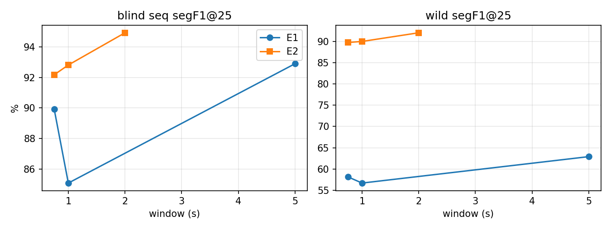

# E3 — Temporal post-processing and intake decision

Each configuration with the grid point selected on validation for every decoder (index/selection/E3_grid.json). `none` = E1/E2 timeline rule. Mean ± std over 3 folds × 3 seeds, in %, except events per hour. LLR thresholds: ≤ 1 false event/h on the external calibration participants.

**Selected on validation:** E1: `cnn_bilstm__fs50_w500_ov75_acc_raw__hp14` + `hmm__ov75_st080_md070_t100`; E2: `cnn_bilstm__fs100_w200_ov75_accgyr_hp03__hp05` + `hmm__ov75_st095_md030_t200`

## Stage-F finalists

|  | val segF1@25 | seq win F1 | seq win acc | seq segF1@25 | seq Order EM | wild segF1@25 | wild Order EM | wild intake bacc (G3) | wild intake bacc (G2→G3) | wild intake bacc (LLR ≤1/h) | wild intake sens (LLR ≤1/h) | ext G3 events/h | ext LLR FA/h | n |
|---|---|---|---|---|---|---|---|---|---|---|---|---|---|---|
| E1 / cnn_bilstm__fs50_w500_ov75_acc_raw__hp14 / hmm | 45.0 ± 12.0 | 70.1 ± 0.9 | 69.3 ± 0.9 | 93.4 ± 1.2 | 74.7 ± 4.9 | 62.2 ± 4.9 | 15.7 ± 5.7 | 76.1 ± 6.5 | 79.9 ± 3.8 | 68.3 ± 5.7 | 39.9 ± 12.1 | 26.1 ± 11.6 | 0.9 ± 0.3 | 9 |
| E1 / cnn_bilstm__fs50_w500_ov75_acc_raw__hp14 / hsmm | 44.8 ± 11.8 | 69.0 ± 1.1 | 68.1 ± 1.0 | 92.5 ± 1.7 | 69.1 ± 6.3 | 62.7 ± 4.5 | 15.9 ± 4.7 | 75.5 ± 6.3 | 77.8 ± 3.5 | 68.3 ± 5.7 | 39.9 ± 12.1 | 23.3 ± 11.1 | 0.9 ± 0.3 | 9 |
| E1 / cnn_bilstm__fs50_w500_ov75_acc_raw__hp14 / none | 39.8 ± 10.7 | 71.2 ± 0.9 | 70.8 ± 0.8 | 92.9 ± 1.5 | 81.2 ± 3.4 | 53.5 ± 5.2 | 9.5 ± 4.4 | 71.3 ± 5.6 | 77.7 ± 4.4 | 68.3 ± 5.7 | 39.9 ± 12.1 | 50.2 ± 16.5 | 0.9 ± 0.3 | 9 |
| E1 / cnn_bilstm__fs50_w500_ov75_acc_raw__hp21 / hmm | 43.7 ± 10.7 | 70.0 ± 1.1 | 69.1 ± 1.0 | 92.2 ± 1.9 | 70.5 ± 6.5 | 62.4 ± 2.8 | 16.5 ± 3.3 | 72.8 ± 6.3 | 78.8 ± 3.0 | 67.0 ± 8.9 | 38.8 ± 19.0 | 28.0 ± 9.6 | 0.9 ± 0.7 | 9 |
| E1 / cnn_bilstm__fs50_w500_ov75_acc_raw__hp21 / hsmm | 42.9 ± 10.4 | 70.5 ± 1.1 | 69.5 ± 1.1 | 92.7 ± 1.7 | 71.2 ± 6.7 | 61.6 ± 2.9 | 15.2 ± 3.0 | 72.5 ± 6.0 | 78.6 ± 2.9 | 67.0 ± 8.9 | 38.8 ± 19.0 | 32.1 ± 11.2 | 0.9 ± 0.7 | 9 |
| E1 / cnn_bilstm__fs50_w500_ov75_acc_raw__hp21 / none | 38.2 ± 9.2 | 70.8 ± 1.5 | 70.2 ± 1.4 | 91.2 ± 2.5 | 79.1 ± 5.9 | 53.0 ± 2.8 | 8.8 ± 2.1 | 69.4 ± 4.4 | 77.4 ± 3.4 | 67.0 ± 8.9 | 38.8 ± 19.0 | 53.2 ± 17.5 | 0.9 ± 0.7 | 9 |
| E1 / cnn_bilstm__fs50_w500_ov75_acc_raw__hp30 / hmm | 44.9 ± 10.9 | 69.9 ± 1.7 | 69.0 ± 1.6 | 93.1 ± 1.8 | 73.4 ± 6.3 | 64.2 ± 3.7 | 19.3 ± 4.7 | 76.4 ± 3.1 | 78.6 ± 2.6 | 70.5 ± 4.2 | 45.8 ± 9.1 | 22.3 ± 7.5 | 1.2 ± 0.6 | 9 |
| E1 / cnn_bilstm__fs50_w500_ov75_acc_raw__hp30 / hsmm | 44.3 ± 10.9 | 70.6 ± 1.7 | 69.7 ± 1.5 | 93.5 ± 1.8 | 74.5 ± 6.7 | 63.2 ± 3.8 | 18.0 ± 4.7 | 75.2 ± 2.7 | 78.8 ± 2.4 | 70.5 ± 4.2 | 45.8 ± 9.1 | 27.3 ± 8.8 | 1.2 ± 0.6 | 9 |
| E1 / cnn_bilstm__fs50_w500_ov75_acc_raw__hp30 / none | 38.3 ± 8.8 | 71.4 ± 1.7 | 70.9 ± 1.6 | 92.9 ± 2.0 | 81.0 ± 6.4 | 53.8 ± 4.0 | 10.1 ± 2.7 | 71.4 ± 2.8 | 77.6 ± 3.1 | 70.5 ± 4.2 | 45.8 ± 9.1 | 49.9 ± 12.1 | 1.2 ± 0.6 | 9 |
| E2 / cnn_bilstm__fs100_w200_ov75_accgyr_hp03__hp05 / hmm | 84.5 ± 7.1 | 74.3 ± 0.8 | 73.9 ± 0.7 | 95.0 ± 0.7 | 75.9 ± 3.5 | 92.5 ± 0.6 | 72.8 ± 2.9 | 98.3 ± 0.6 | 96.9 ± 0.3 | 98.4 ± 0.9 | 99.1 ± 0.5 | 1.6 ± 0.6 | 0.8 ± 0.3 | 9 |
| E2 / cnn_bilstm__fs100_w200_ov75_accgyr_hp03__hp05 / hsmm | 84.0 ± 7.4 | 73.7 ± 0.6 | 73.4 ± 0.5 | 96.3 ± 0.4 | 83.5 ± 1.8 | 93.6 ± 0.5 | 79.3 ± 1.8 | 98.6 ± 0.6 | 96.8 ± 0.4 | 98.4 ± 0.9 | 99.1 ± 0.5 | 1.3 ± 0.5 | 0.8 ± 0.3 | 9 |
| E2 / cnn_bilstm__fs100_w200_ov75_accgyr_hp03__hp05 / none | 82.5 ± 6.2 | 82.0 ± 0.7 | 81.2 ± 0.7 | 93.8 ± 1.1 | 73.8 ± 4.9 | 89.7 ± 0.9 | 66.6 ± 4.3 | 97.6 ± 1.0 | 96.8 ± 0.5 | 98.4 ± 0.9 | 99.1 ± 0.5 | 2.4 ± 1.1 | 0.8 ± 0.3 | 9 |
| E2 / cnn_bilstm__fs100_w200_ov75_accgyr_hp03__hp15 / hmm | 84.3 ± 6.9 | 73.8 ± 0.3 | 73.4 ± 0.4 | 94.8 ± 0.8 | 74.7 ± 3.7 | 91.8 ± 0.4 | 68.9 ± 3.4 | 98.4 ± 0.5 | 96.9 ± 0.3 | 98.2 ± 0.6 | 99.0 ± 0.6 | 2.1 ± 0.5 | 1.0 ± 0.3 | 9 |
| E2 / cnn_bilstm__fs100_w200_ov75_accgyr_hp03__hp15 / hsmm | 84.3 ± 7.5 | 72.9 ± 0.2 | 72.7 ± 0.3 | 96.2 ± 0.5 | 82.0 ± 2.2 | 93.4 ± 0.3 | 77.4 ± 1.4 | 98.3 ± 0.6 | 96.7 ± 0.4 | 98.2 ± 0.6 | 99.0 ± 0.6 | 1.5 ± 0.4 | 1.0 ± 0.3 | 9 |
| E2 / cnn_bilstm__fs100_w200_ov75_accgyr_hp03__hp15 / none | 82.2 ± 6.5 | 81.4 ± 0.4 | 80.7 ± 0.3 | 93.6 ± 1.3 | 72.1 ± 4.9 | 89.1 ± 0.8 | 64.0 ± 4.3 | 97.3 ± 0.9 | 96.7 ± 0.4 | 98.2 ± 0.6 | 99.0 ± 0.6 | 2.8 ± 0.5 | 1.0 ± 0.3 | 9 |
| E2 / cnn_bilstm__fs100_w200_ov75_accgyr_hp03__hp31 / hmm | 83.9 ± 6.9 | 73.5 ± 0.5 | 73.2 ± 0.6 | 95.0 ± 0.9 | 75.2 ± 4.5 | 91.9 ± 0.3 | 69.9 ± 2.6 | 97.9 ± 0.8 | 96.7 ± 0.5 | 98.0 ± 0.8 | 98.8 ± 0.5 | 1.9 ± 0.5 | 1.0 ± 0.4 | 9 |
| E2 / cnn_bilstm__fs100_w200_ov75_accgyr_hp03__hp31 / hsmm | 83.4 ± 7.5 | 72.8 ± 0.3 | 72.6 ± 0.4 | 96.3 ± 0.5 | 82.1 ± 2.9 | 93.0 ± 0.3 | 76.7 ± 0.8 | 98.1 ± 0.7 | 96.5 ± 0.6 | 98.0 ± 0.8 | 98.8 ± 0.5 | 1.5 ± 0.6 | 1.0 ± 0.4 | 9 |
| E2 / cnn_bilstm__fs100_w200_ov75_accgyr_hp03__hp31 / none | 81.6 ± 6.5 | 81.4 ± 0.4 | 80.7 ± 0.4 | 93.4 ± 1.3 | 72.1 ± 4.7 | 88.7 ± 0.7 | 64.4 ± 3.7 | 96.5 ± 1.3 | 96.4 ± 0.6 | 98.0 ± 0.8 | 98.8 ± 0.5 | 2.6 ± 0.5 | 1.0 ± 0.4 | 9 |

## Short-window references (0.75 s, 1 s)

|  | val segF1@25 | seq win F1 | seq win acc | seq segF1@25 | seq Order EM | wild segF1@25 | wild Order EM | wild intake bacc (G3) | wild intake bacc (G2→G3) | wild intake bacc (LLR ≤1/h) | wild intake sens (LLR ≤1/h) | ext G3 events/h | ext LLR FA/h | n |
|---|---|---|---|---|---|---|---|---|---|---|---|---|---|---|
| E1 / cnn__fs100_w100_ov50_acc_raw__hp03 / hmm | 41.7 ± 6.2 | 69.6 ± 5.0 | 70.7 ± 3.7 | 85.1 ± 4.7 | 46.0 ± 14.3 | 56.7 ± 5.5 | 7.4 ± 3.3 | 59.7 ± 2.1 | 67.0 ± 7.5 | 53.9 ± 2.7 | 10.9 ± 7.8 | 65.1 ± 7.3 | 0.6 ± 0.5 | 9 |
| E1 / cnn__fs100_w100_ov50_acc_raw__hp03 / hsmm | 39.9 ± 5.6 | 70.4 ± 5.2 | 71.2 ± 3.9 | 85.3 ± 4.9 | 47.0 ± 14.2 | 52.6 ± 4.9 | 6.5 ± 2.7 | 58.7 ± 1.8 | 66.3 ± 6.9 | 53.9 ± 2.7 | 10.9 ± 7.8 | 96.0 ± 6.8 | 0.6 ± 0.5 | 9 |
| E1 / cnn__fs100_w100_ov50_acc_raw__hp03 / none | 27.6 ± 2.8 | 73.8 ± 4.7 | 75.6 ± 3.6 | 72.0 ± 7.1 | 29.3 ± 12.3 | 34.1 ± 4.8 | 1.1 ± 0.9 | 52.4 ± 1.1 | 63.6 ± 2.9 | 53.9 ± 2.7 | 10.9 ± 7.8 | 238.9 ± 34.8 | 0.6 ± 0.5 | 9 |
| E1 / cnn_bilstm__fs100_w075_ov75_acc_raw__hp25 / hmm | 46.9 ± 6.6 | 76.3 ± 2.6 | 76.7 ± 2.4 | 89.9 ± 2.5 | 63.6 ± 8.1 | 58.2 ± 3.2 | 8.2 ± 2.4 | 59.6 ± 1.8 | 70.2 ± 4.5 | 53.4 ± 3.1 | 9.0 ± 7.6 | 61.3 ± 4.5 | 0.6 ± 0.5 | 9 |
| E1 / cnn_bilstm__fs100_w075_ov75_acc_raw__hp25 / hsmm | 44.1 ± 6.7 | 77.4 ± 2.8 | 77.7 ± 2.5 | 90.4 ± 2.5 | 66.1 ± 7.8 | 53.2 ± 2.7 | 6.3 ± 2.2 | 58.3 ± 1.7 | 68.6 ± 4.1 | 53.4 ± 3.1 | 9.0 ± 7.6 | 98.7 ± 5.1 | 0.6 ± 0.5 | 9 |
| E1 / cnn_bilstm__fs100_w075_ov75_acc_raw__hp25 / none | 25.1 ± 3.9 | 76.5 ± 1.6 | 78.4 ± 1.5 | 70.2 ± 3.8 | 26.6 ± 11.5 | 29.1 ± 3.7 | 1.2 ± 0.9 | 52.5 ± 0.7 | 62.3 ± 2.3 | 53.4 ± 3.1 | 9.0 ± 7.6 | 300.5 ± 29.4 | 0.6 ± 0.5 | 9 |
| E2 / cnn__fs100_w075_ov75_accgyr_hp03__hpdef / hmm | 82.9 ± 6.3 | 78.6 ± 1.6 | 77.4 ± 1.9 | 91.9 ± 1.8 | 64.6 ± 7.6 | 89.7 ± 1.3 | 61.4 ± 5.6 | 97.1 ± 0.6 | 96.5 ± 0.5 | 97.1 ± 0.8 | 99.3 ± 0.3 | 0.6 ± 0.2 | 0.6 ± 0.3 | 9 |
| E2 / cnn__fs100_w075_ov75_accgyr_hp03__hpdef / hsmm | 83.1 ± 6.3 | 78.4 ± 1.3 | 77.2 ± 1.6 | 92.2 ± 1.3 | 66.0 ± 4.7 | 89.8 ± 1.2 | 63.7 ± 4.9 | 96.3 ± 1.1 | 96.1 ± 0.6 | 97.1 ± 0.8 | 99.3 ± 0.3 | 1.5 ± 0.4 | 0.6 ± 0.3 | 9 |
| E2 / cnn__fs100_w075_ov75_accgyr_hp03__hpdef / none | 67.7 ± 10.1 | 80.5 ± 2.2 | 80.7 ± 2.0 | 77.1 ± 4.8 | 31.8 ± 11.1 | 71.5 ± 4.7 | 27.0 ± 9.3 | 81.5 ± 6.2 | 92.5 ± 2.9 | 97.1 ± 0.8 | 99.3 ± 0.3 | 8.2 ± 2.7 | 0.6 ± 0.3 | 9 |
| E2 / cnn__fs100_w100_ov50_accgyr_hp03__hpdef / hmm | 83.1 ± 5.9 | 78.6 ± 1.5 | 77.7 ± 1.6 | 91.1 ± 1.4 | 59.1 ± 5.2 | 88.6 ± 1.1 | 54.8 ± 4.0 | 94.9 ± 1.4 | 96.2 ± 0.6 | 96.0 ± 0.7 | 98.5 ± 1.1 | 1.1 ± 0.4 | 0.7 ± 0.3 | 9 |
| E2 / cnn__fs100_w100_ov50_accgyr_hp03__hpdef / hsmm | 83.2 ± 5.7 | 77.9 ± 1.0 | 76.7 ± 1.1 | 92.8 ± 1.1 | 67.6 ± 4.4 | 90.0 ± 0.9 | 62.7 ± 4.0 | 96.4 ± 1.1 | 96.2 ± 0.6 | 96.0 ± 0.7 | 98.5 ± 1.1 | 1.5 ± 0.4 | 0.7 ± 0.3 | 9 |
| E2 / cnn__fs100_w100_ov50_accgyr_hp03__hpdef / none | 74.2 ± 6.8 | 82.3 ± 1.1 | 82.1 ± 1.1 | 83.1 ± 2.9 | 42.3 ± 7.0 | 77.6 ± 2.7 | 36.1 ± 7.4 | 85.1 ± 7.0 | 94.6 ± 1.9 | 96.0 ± 0.7 | 98.5 ± 1.1 | 6.7 ± 3.1 | 0.7 ± 0.3 | 9 |

## By decoder (mean over configurations)

|  | val segF1@25 | seq win F1 | seq win acc | seq segF1@25 | seq Order EM | wild segF1@25 | wild Order EM | wild intake bacc (G3) | wild intake bacc (G2→G3) | wild intake bacc (LLR ≤1/h) | wild intake sens (LLR ≤1/h) | ext G3 events/h | ext LLR FA/h | n |
|---|---|---|---|---|---|---|---|---|---|---|---|---|---|---|
| E1 / finalist / hmm | 44.5 ± 10.8 | 70.0 ± 1.2 | 69.1 ± 1.2 | 92.9 ± 1.7 | 72.8 ± 6.0 | 62.9 ± 3.9 | 17.2 ± 4.8 | 75.1 ± 5.5 | 79.1 ± 3.1 | 68.6 ± 6.5 | 41.5 ± 13.8 | 25.5 ± 9.6 | 1.0 ± 0.6 | 27 |
| E1 / finalist / hsmm | 44.0 ± 10.7 | 70.0 ± 1.5 | 69.1 ± 1.4 | 92.9 ± 1.7 | 71.6 ± 6.7 | 62.5 ± 3.7 | 16.4 ± 4.2 | 74.4 ± 5.3 | 78.4 ± 2.9 | 68.6 ± 6.5 | 41.5 ± 13.8 | 27.6 ± 10.7 | 1.0 ± 0.6 | 27 |
| E1 / finalist / none | 38.8 ± 9.3 | 71.1 ± 1.4 | 70.6 ± 1.3 | 92.3 ± 2.1 | 80.4 ± 5.3 | 53.4 ± 4.0 | 9.4 ± 3.1 | 70.7 ± 4.4 | 77.6 ± 3.5 | 68.6 ± 6.5 | 41.5 ± 13.8 | 51.1 ± 15.0 | 1.0 ± 0.6 | 27 |
| E1 / window_ref / hmm | 44.3 ± 6.8 | 72.9 ± 5.2 | 73.7 ± 4.3 | 87.5 ± 4.4 | 54.8 ± 14.5 | 57.4 ± 4.4 | 7.8 ± 2.8 | 59.7 ± 1.9 | 68.6 ± 6.2 | 53.6 ± 2.8 | 9.9 ± 7.5 | 63.2 ± 6.2 | 0.6 ± 0.5 | 18 |
| E1 / window_ref / hsmm | 42.0 ± 6.4 | 73.9 ± 5.5 | 74.4 ± 4.6 | 87.8 ± 4.6 | 56.6 ± 14.8 | 52.9 ± 3.8 | 6.4 ± 2.4 | 58.5 ± 1.7 | 67.5 ± 5.6 | 53.6 ± 2.8 | 9.9 ± 7.5 | 97.4 ± 6.0 | 0.6 ± 0.5 | 18 |
| E1 / window_ref / none | 26.4 ± 3.5 | 75.1 ± 3.7 | 77.0 ± 3.1 | 71.1 ± 5.6 | 28.0 ± 11.6 | 31.6 ± 4.9 | 1.2 ± 0.9 | 52.5 ± 0.9 | 63.0 ± 2.6 | 53.6 ± 2.8 | 9.9 ± 7.5 | 269.7 ± 44.5 | 0.6 ± 0.5 | 18 |
| E2 / finalist / hmm | 84.2 ± 6.7 | 73.9 ± 0.6 | 73.5 ± 0.7 | 94.9 ± 0.8 | 75.2 ± 3.8 | 92.0 ± 0.5 | 70.6 ± 3.3 | 98.2 ± 0.7 | 96.8 ± 0.4 | 98.2 ± 0.8 | 98.9 ± 0.5 | 1.9 ± 0.6 | 0.9 ± 0.4 | 27 |
| E2 / finalist / hsmm | 83.9 ± 7.2 | 73.1 ± 0.6 | 72.9 ± 0.5 | 96.3 ± 0.4 | 82.5 ± 2.3 | 93.3 ± 0.4 | 77.8 ± 1.8 | 98.3 ± 0.6 | 96.7 ± 0.5 | 98.2 ± 0.8 | 98.9 ± 0.5 | 1.4 ± 0.5 | 0.9 ± 0.4 | 27 |
| E2 / finalist / none | 82.1 ± 6.2 | 81.6 ± 0.6 | 80.8 ± 0.5 | 93.6 ± 1.2 | 72.7 ± 4.7 | 89.2 ± 0.8 | 65.0 ± 4.1 | 97.1 ± 1.2 | 96.6 ± 0.5 | 98.2 ± 0.8 | 98.9 ± 0.5 | 2.6 ± 0.7 | 0.9 ± 0.4 | 27 |
| E2 / window_ref / hmm | 83.0 ± 5.9 | 78.6 ± 1.5 | 77.5 ± 1.7 | 91.5 ± 1.6 | 61.9 ± 7.0 | 89.2 ± 1.3 | 58.1 ± 5.8 | 96.0 ± 1.5 | 96.3 ± 0.6 | 96.5 ± 1.0 | 98.9 ± 0.9 | 0.9 ± 0.4 | 0.6 ± 0.3 | 18 |
| E2 / window_ref / hsmm | 83.2 ± 5.9 | 78.1 ± 1.2 | 77.0 ± 1.3 | 92.5 ± 1.3 | 66.8 ± 4.5 | 89.9 ± 1.0 | 63.2 ± 4.3 | 96.3 ± 1.1 | 96.2 ± 0.6 | 96.5 ± 1.0 | 98.9 ± 0.9 | 1.5 ± 0.4 | 0.6 ± 0.3 | 18 |
| E2 / window_ref / none | 71.0 ± 9.0 | 81.4 ± 1.9 | 81.4 ± 1.7 | 80.1 ± 4.9 | 37.0 ± 10.5 | 74.6 ± 4.9 | 31.5 ± 9.4 | 83.3 ± 6.6 | 93.5 ± 2.6 | 96.5 ± 1.0 | 98.9 ± 0.9 | 7.5 ± 2.9 | 0.6 ± 0.3 | 18 |

## Window length after decoding (best decoder of each configuration)

|  | val segF1@25 | seq win F1 | seq win acc | seq segF1@25 | seq Order EM | wild segF1@25 | wild Order EM | wild intake bacc (G3) | wild intake bacc (G2→G3) | wild intake bacc (LLR ≤1/h) | wild intake sens (LLR ≤1/h) | ext G3 events/h | ext LLR FA/h | n |
|---|---|---|---|---|---|---|---|---|---|---|---|---|---|---|
| E1 / 0.75 / cnn_bilstm__fs100_w075_ov75_acc_raw__hp25 | 46.9 ± 6.6 | 76.3 ± 2.6 | 76.7 ± 2.4 | 89.9 ± 2.5 | 63.6 ± 8.1 | 58.2 ± 3.2 | 8.2 ± 2.4 | 59.6 ± 1.8 | 70.2 ± 4.5 | 53.4 ± 3.1 | 9.0 ± 7.6 | 61.3 ± 4.5 | 0.6 ± 0.5 | 9 |
| E1 / 1.0 / cnn__fs100_w100_ov50_acc_raw__hp03 | 41.7 ± 6.2 | 69.6 ± 5.0 | 70.7 ± 3.7 | 85.1 ± 4.7 | 46.0 ± 14.3 | 56.7 ± 5.5 | 7.4 ± 3.3 | 59.7 ± 2.1 | 67.0 ± 7.5 | 53.9 ± 2.7 | 10.9 ± 7.8 | 65.1 ± 7.3 | 0.6 ± 0.5 | 9 |
| E1 / 5.0 / cnn_bilstm__fs50_w500_ov75_acc_raw__hp14 | 45.0 ± 12.0 | 70.1 ± 0.9 | 69.3 ± 0.9 | 93.4 ± 1.2 | 74.7 ± 4.9 | 62.2 ± 4.9 | 15.7 ± 5.7 | 76.1 ± 6.5 | 79.9 ± 3.8 | 68.3 ± 5.7 | 39.9 ± 12.1 | 26.1 ± 11.6 | 0.9 ± 0.3 | 9 |
| E1 / 5.0 / cnn_bilstm__fs50_w500_ov75_acc_raw__hp21 | 43.7 ± 10.7 | 70.0 ± 1.1 | 69.1 ± 1.0 | 92.2 ± 1.9 | 70.5 ± 6.5 | 62.4 ± 2.8 | 16.5 ± 3.3 | 72.8 ± 6.3 | 78.8 ± 3.0 | 67.0 ± 8.9 | 38.8 ± 19.0 | 28.0 ± 9.6 | 0.9 ± 0.7 | 9 |
| E1 / 5.0 / cnn_bilstm__fs50_w500_ov75_acc_raw__hp30 | 44.9 ± 10.9 | 69.9 ± 1.7 | 69.0 ± 1.6 | 93.1 ± 1.8 | 73.4 ± 6.3 | 64.2 ± 3.7 | 19.3 ± 4.7 | 76.4 ± 3.1 | 78.6 ± 2.6 | 70.5 ± 4.2 | 45.8 ± 9.1 | 22.3 ± 7.5 | 1.2 ± 0.6 | 9 |
| E2 / 0.75 / cnn__fs100_w075_ov75_accgyr_hp03__hpdef | 83.1 ± 6.3 | 78.4 ± 1.3 | 77.2 ± 1.6 | 92.2 ± 1.3 | 66.0 ± 4.7 | 89.8 ± 1.2 | 63.7 ± 4.9 | 96.3 ± 1.1 | 96.1 ± 0.6 | 97.1 ± 0.8 | 99.3 ± 0.3 | 1.5 ± 0.4 | 0.6 ± 0.3 | 9 |
| E2 / 1.0 / cnn__fs100_w100_ov50_accgyr_hp03__hpdef | 83.2 ± 5.7 | 77.9 ± 1.0 | 76.7 ± 1.1 | 92.8 ± 1.1 | 67.6 ± 4.4 | 90.0 ± 0.9 | 62.7 ± 4.0 | 96.4 ± 1.1 | 96.2 ± 0.6 | 96.0 ± 0.7 | 98.5 ± 1.1 | 1.5 ± 0.4 | 0.7 ± 0.3 | 9 |
| E2 / 2.0 / cnn_bilstm__fs100_w200_ov75_accgyr_hp03__hp05 | 84.5 ± 7.1 | 74.3 ± 0.8 | 73.9 ± 0.7 | 95.0 ± 0.7 | 75.9 ± 3.5 | 92.5 ± 0.6 | 72.8 ± 2.9 | 98.3 ± 0.6 | 96.9 ± 0.3 | 98.4 ± 0.9 | 99.1 ± 0.5 | 1.6 ± 0.6 | 0.8 ± 0.3 | 9 |
| E2 / 2.0 / cnn_bilstm__fs100_w200_ov75_accgyr_hp03__hp15 | 84.3 ± 6.9 | 73.8 ± 0.3 | 73.4 ± 0.4 | 94.8 ± 0.8 | 74.7 ± 3.7 | 91.8 ± 0.4 | 68.9 ± 3.4 | 98.4 ± 0.5 | 96.9 ± 0.3 | 98.2 ± 0.6 | 99.0 ± 0.6 | 2.1 ± 0.5 | 1.0 ± 0.3 | 9 |
| E2 / 2.0 / cnn_bilstm__fs100_w200_ov75_accgyr_hp03__hp31 | 83.9 ± 6.9 | 73.5 ± 0.5 | 73.2 ± 0.6 | 95.0 ± 0.9 | 75.2 ± 4.5 | 91.9 ± 0.3 | 69.9 ± 2.6 | 97.9 ± 0.8 | 96.7 ± 0.5 | 98.0 ± 0.8 | 98.8 ± 0.5 | 1.9 ± 0.5 | 1.0 ± 0.4 | 9 |

## Exported models (models/registry.csv)

| model_name                                |   version | role       | experiment   | config_key                                    | decoder_key                | deployment_status   |   test_sequences.window.macro_f1 |   test_sequences.timeline.seg_f1_25 |   test_sequences.order.exact_match |   test_wild.timeline.seg_f1_25 |   test_wild.intake_llr_fa10.balanced_accuracy |   test_external.llr_fa10_events_per_hour | path                                                | created             |
|:------------------------------------------|----------:|:-----------|:-------------|:----------------------------------------------|:---------------------------|:--------------------|---------------------------------:|------------------------------------:|-----------------------------------:|-------------------------------:|----------------------------------------------:|-----------------------------------------:|:----------------------------------------------------|:--------------------|
| e1-cnn_bilstm-fs50-w500-ov75-acc-raw      |         1 | finalist   | E1           | cnn_bilstm__fs50_w500_ov75_acc_raw__hp14      | hmm__ov75_st080_md070_t100 | candidate           |                         0.700862 |                            0.93436  |                           0.747038 |                       0.621711 |                                      0.68277  |                                 0.921196 | models/e1-cnn_bilstm-fs50-w500-ov75-acc-raw/v1      | 2026-10-19T05:36:30 |
| e2-cnn_bilstm-fs100-w200-ov75-accgyr-hp03 |         1 | finalist   | E2           | cnn_bilstm__fs100_w200_ov75_accgyr_hp03__hp05 | hmm__ov75_st095_md030_t200 | candidate           |                         0.743287 |                            0.950148 |                           0.758886 |                       0.924658 |                                      0.983853 |                                 0.79699  | models/e2-cnn_bilstm-fs100-w200-ov75-accgyr-hp03/v1 | 2026-10-19T05:39:45 |
| e1-cnn_bilstm-fs100-w075-ov75-acc-raw     |         1 | window_ref | E1           | cnn_bilstm__fs100_w075_ov75_acc_raw__hp25     | hmm__ov50_st090_md070_t400 | candidate           |                         0.763172 |                            0.899388 |                           0.636247 |                       0.581586 |                                      0.533692 |                                 0.60033  | models/e1-cnn_bilstm-fs100-w075-ov75-acc-raw/v1     | 2026-10-19T05:40:14 |
| e1-cnn-fs100-w100-ov50-acc-raw            |         1 | window_ref | E1           | cnn__fs100_w100_ov50_acc_raw__hp03            | hmm__ov50_st080_md070_t400 | candidate           |                         0.695584 |                            0.85074  |                           0.459814 |                       0.566952 |                                      0.53872  |                                 0.569279 | models/e1-cnn-fs100-w100-ov50-acc-raw/v1            | 2026-10-19T05:40:31 |
| e2-cnn-fs100-w075-ov75-accgyr-hp03        |         1 | window_ref | E2           | cnn__fs100_w075_ov75_accgyr_hp03__hpdef       | hsmm__ov50_md030_t400      | candidate           |                         0.783731 |                            0.921796 |                           0.659942 |                       0.89764  |                                      0.971031 |                                 0.58998  | models/e2-cnn-fs100-w075-ov75-accgyr-hp03/v1        | 2026-10-19T05:41:22 |
| e2-cnn-fs100-w100-ov50-accgyr-hp03        |         1 | window_ref | E2           | cnn__fs100_w100_ov50_accgyr_hp03__hpdef       | hsmm__ov50_md030_t400      | candidate           |                         0.778676 |                            0.928223 |                           0.675953 |                       0.900045 |                                      0.95967  |                                 0.683134 | models/e2-cnn-fs100-w100-ov50-accgyr-hp03/v1        | 2026-10-19T05:42:01 |

