# Results chapter — data

Generated by src/thesis/results_chapter.py. Mean ± std over replicates in %, except per-hour rates. Sets: validation = held-out gesture subjects composed into daily activity of external calibration participants (the only set used for selection); blind sequences = annotated lab protocol sessions (different people); sequences in daily activity = the same blind sessions embedded in daily activity of unseen external participants; external = unseen external participants, daily activity only.

## E1 — window level: signal factors (stage A, CNN-BiLSTM, default hyperparameters)

Marginal means over the other four factors (240 configurations × 3 folds, seed 0). The tests use one value per configuration (mean over folds), blocked by the other factors.

### E1 — window (s)

| window (s) | val macro F1 | seq macro F1 | wild macro F1 | seq accuracy | ext gestures/h | ext G3/h | n |
|---|---|---|---|---|---|---|---|
| 0.5 | 27.0 ± 2.8 | 67.3 ± 3.5 | 29.4 ± 1.8 | 69.3 ± 3.6 | 1149.8 ± 260.3 | 417.1 ± 94.1 | 144 |
| 0.75 | 28.9 ± 2.9 | 70.7 ± 4.9 | 31.3 ± 1.9 | 72.5 ± 4.2 | 1081.2 ± 273.7 | 376.1 ± 67.1 | 144 |
| 1.0 | 30.1 ± 3.1 | 74.0 ± 4.0 | 32.9 ± 2.0 | 75.4 ± 3.7 | 902.6 ± 197.2 | 305.1 ± 53.6 | 144 |
| 2.0 | 33.7 ± 4.2 | 83.3 ± 3.0 | 38.0 ± 2.5 | 83.8 ± 2.9 | 547.8 ± 84.3 | 178.7 ± 22.7 | 144 |
| 5.0 | 37.2 ± 5.6 | 85.4 ± 3.6 | 44.2 ± 3.4 | 85.9 ± 3.7 | 236.4 ± 44.7 | 62.9 ± 20.9 | 144 |

### E1 — overlap

| overlap | val macro F1 | seq macro F1 | wild macro F1 | seq accuracy | ext gestures/h | ext G3/h | n |
|---|---|---|---|---|---|---|---|
| 0 % | 31.3 ± 5.4 | 76.5 ± 8.3 | 35.2 ± 5.9 | 78.0 ± 7.8 | 845.0 ± 476.1 | 284.9 ± 170.6 | 180 |
| 25 % | 31.4 ± 5.3 | 75.8 ± 7.6 | 35.1 ± 5.8 | 77.1 ± 7.0 | 795.0 ± 360.8 | 277.2 ± 136.5 | 180 |
| 50 % | 31.4 ± 5.4 | 76.3 ± 8.2 | 35.2 ± 5.8 | 77.5 ± 7.5 | 751.6 ± 363.0 | 257.9 ± 132.8 | 180 |
| 75 % | 31.4 ± 5.3 | 76.0 ± 8.0 | 35.2 ± 5.9 | 77.0 ± 7.2 | 742.7 ± 365.1 | 252.0 ± 127.5 | 180 |

### E1 — filter

| filter | val macro F1 | seq macro F1 | wild macro F1 | seq accuracy | ext gestures/h | ext G3/h | n |
|---|---|---|---|---|---|---|---|
| high-pass 0.3 Hz | 30.2 ± 4.9 | 75.4 ± 7.5 | 34.9 ± 5.1 | 75.8 ± 7.3 | 878.7 ± 435.8 | 268.9 ± 148.0 | 360 |
| raw | 32.6 ± 5.5 | 76.9 ± 8.5 | 35.5 ± 6.5 | 79.0 ± 7.1 | 688.4 ± 324.5 | 267.1 ± 138.5 | 360 |

### E1 — fs (Hz)

| fs (Hz) | val macro F1 | seq macro F1 | wild macro F1 | seq accuracy | ext gestures/h | ext G3/h | n |
|---|---|---|---|---|---|---|---|
| 20 | 31.1 ± 5.8 | 76.5 ± 8.2 | 34.3 ± 6.1 | 77.7 ± 7.8 | 813.7 ± 394.9 | 267.1 ± 144.0 | 240 |
| 50 | 31.3 ± 5.0 | 76.4 ± 7.8 | 35.1 ± 5.6 | 77.6 ± 7.2 | 794.6 ± 404.0 | 271.8 ± 146.0 | 240 |
| 100 | 31.8 ± 5.1 | 75.5 ± 8.1 | 36.2 ± 5.7 | 76.8 ± 7.1 | 742.4 ± 385.8 | 265.0 ± 140.0 | 240 |

### E1 — signals

| signals | val macro F1 | seq macro F1 | wild macro F1 | seq accuracy | ext gestures/h | ext G3/h | n |
|---|---|---|---|---|---|---|---|
| acc | 30.7 ± 5.2 | 73.4 ± 8.4 | 34.7 ± 6.2 | 75.2 ± 7.6 | 766.6 ± 395.1 | 266.9 ± 142.8 | 360 |
| acc+gyr | 32.1 ± 5.4 | 78.9 ± 6.7 | 35.6 ± 5.5 | 79.5 ± 6.4 | 800.6 ± 395.9 | 269.1 ± 143.8 | 360 |

### E1 — factor tests on blind sequences (test_sequences.window.macro_f1)

| factor | test | blocks | effect | p |
|---|---|---|---|---|
| window_s | Friedman | 48 | Kendall W = 0.96; best mean rank (highest): 5.0 | 1.2e-38 |
| overlap | Friedman | 60 | Kendall W = 0.26; best mean rank (highest): 0 % | 3.1e-10 |
| filter | Wilcoxon | 120 | raw − high-pass 0.3 Hz: +1.4 pts (wins 83 %) | 7.6e-12 |
| fs_hz | Friedman | 80 | Kendall W = 0.01; best mean rank (highest): 20 | 4.5e-01 |
| signals | Wilcoxon | 120 | acc+gyr − acc: +5.4 pts (wins 98 %) | 2.1e-21 |

### E1 — factor tests on daily activity (test_wild.window.macro_f1)

| factor | test | blocks | effect | p |
|---|---|---|---|---|
| window_s | Friedman | 48 | Kendall W = 1.00; best mean rank (highest): 5.0 | 2.0e-40 |
| overlap | Friedman | 60 | Kendall W = 0.02; best mean rank (highest): 75 % | 4.1e-01 |
| filter | Wilcoxon | 120 | raw − high-pass 0.3 Hz: +0.6 pts (wins 47 %) | 2.6e-01 |
| fs_hz | Friedman | 80 | Kendall W = 0.61; best mean rank (highest): 100 | 5.3e-22 |
| signals | Wilcoxon | 120 | acc+gyr − acc: +0.9 pts (wins 67 %) | 1.9e-05 |

### E1 — factor tests on ext G3 events/h (test_external.external.g3_events_per_hour)

| factor | test | blocks | effect | p |
|---|---|---|---|---|
| window_s | Friedman | 48 | Kendall W = 0.98; best mean rank (lowest): 5.0 | 1.8e-39 |
| overlap | Friedman | 60 | Kendall W = 0.27; best mean rank (lowest): 75 % | 1.5e-10 |
| filter | Wilcoxon | 120 | raw − high-pass 0.3 Hz: -1.8 /h (lower in 54 %) | 3.2e-01 |
| fs_hz | Friedman | 80 | Kendall W = 0.02; best mean rank (lowest): 100 | 1.5e-01 |
| signals | Wilcoxon | 120 | acc+gyr − acc: +2.1 /h (lower in 47 %) | 1.9e-01 |

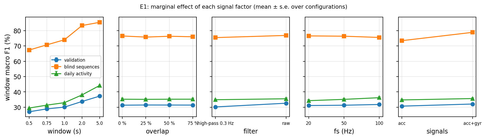

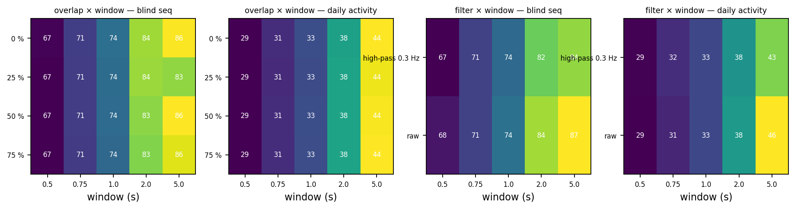

## E1 — window level: per-class metrics by window length (blind sequences)

### E1 — precision per class by window (blind sequences)

| window (s) | G1 | G2 | G3 | G4 | G5 | n |
|---|---|---|---|---|---|---|
| 0.5 | 65.1 ± 6.3 | 57.4 ± 4.6 | 57.8 ± 8.1 | 68.0 ± 9.7 | 92.5 ± 5.2 | 144 |
| 0.75 | 69.9 ± 6.4 | 61.6 ± 5.9 | 62.7 ± 9.8 | 71.5 ± 9.0 | 92.0 ± 6.3 | 144 |
| 1.0 | 71.8 ± 6.6 | 64.3 ± 5.7 | 67.3 ± 7.7 | 76.9 ± 8.5 | 92.1 ± 6.0 | 144 |
| 2.0 | 81.4 ± 5.9 | 74.3 ± 7.3 | 80.9 ± 4.4 | 86.9 ± 7.7 | 93.1 ± 3.4 | 144 |
| 5.0 | 77.4 ± 9.2 | 78.7 ± 6.6 | 80.0 ± 6.3 | 91.4 ± 6.4 | 92.9 ± 3.6 | 144 |

### E1 — recall per class by window (blind sequences)

| window (s) | G1 | G2 | G3 | G4 | G5 | n |
|---|---|---|---|---|---|---|
| 0.5 | 66.0 ± 7.8 | 63.2 ± 12.0 | 66.6 ± 7.8 | 72.4 ± 3.3 | 73.9 ± 15.1 | 144 |
| 0.75 | 70.7 ± 8.7 | 64.8 ± 15.8 | 72.1 ± 6.8 | 75.6 ± 4.1 | 76.3 ± 13.6 | 144 |
| 1.0 | 75.4 ± 6.0 | 70.1 ± 13.6 | 75.7 ± 6.5 | 76.7 ± 4.5 | 77.5 ± 12.4 | 144 |
| 2.0 | 87.7 ± 5.6 | 81.4 ± 10.4 | 86.4 ± 4.0 | 85.3 ± 2.8 | 81.1 ± 8.3 | 144 |
| 5.0 | 94.0 ± 4.3 | 87.6 ± 8.1 | 87.5 ± 4.3 | 91.4 ± 3.5 | 79.1 ± 7.4 | 144 |

### E1 — f1 per class by window (blind sequences)

| window (s) | G1 | G2 | G3 | G4 | G5 | macro F1 | n |
|---|---|---|---|---|---|---|---|
| 0.5 | 65.1 ± 4.6 | 59.4 ± 5.6 | 61.6 ± 7.1 | 69.6 ± 4.9 | 80.8 ± 8.0 | 67.3 ± 3.5 | 144 |
| 0.75 | 69.8 ± 5.3 | 61.7 ± 9.6 | 66.7 ± 8.1 | 73.0 ± 4.6 | 82.2 ± 6.6 | 70.7 ± 4.9 | 144 |
| 1.0 | 73.2 ± 4.0 | 66.0 ± 6.4 | 71.1 ± 6.6 | 76.4 ± 4.2 | 83.2 ± 5.9 | 74.0 ± 4.0 | 144 |
| 2.0 | 84.1 ± 3.4 | 76.9 ± 4.9 | 83.5 ± 3.4 | 85.8 ± 3.8 | 86.3 ± 3.7 | 83.3 ± 3.0 | 144 |
| 5.0 | 84.5 ± 6.2 | 82.6 ± 5.6 | 83.4 ± 4.2 | 91.2 ± 3.5 | 85.3 ± 5.0 | 85.4 ± 3.6 | 144 |

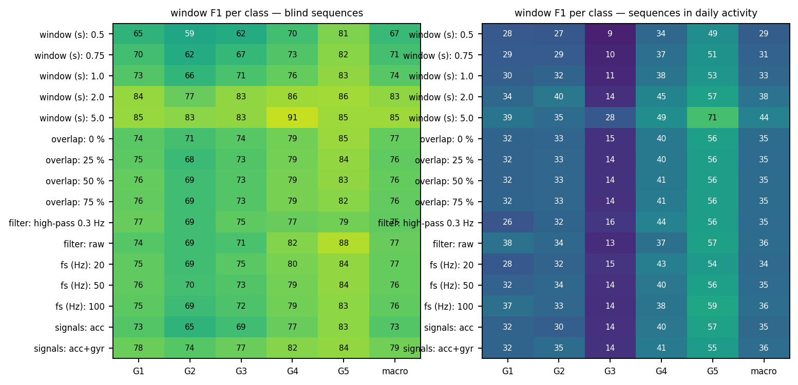

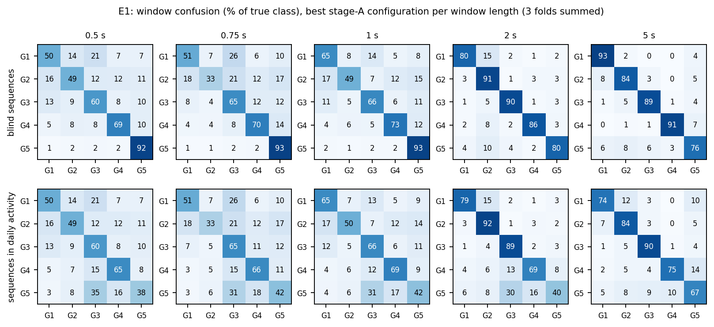

### E1 — best stage-A configuration per window length (selected on validation)

| window / configuration | val macro | seq F1 G1 | seq F1 G2 | seq F1 G3 | seq F1 G4 | seq F1 G5 | seq macro | wild macro | n |
|---|---|---|---|---|---|---|---|---|---|
| 0.5 s / cnn_bilstm__fs100_w050_ov50_acc_raw__hpdef | 30.7 ± 1.1 | 56.1 ± 0.6 | 53.1 ± 3.5 | 50.0 ± 2.0 | 71.0 ± 0.9 | 86.8 ± 1.2 | 63.4 ± 0.5 | 31.7 ± 2.5 | 3 |
| 0.75 s / cnn_bilstm__fs100_w075_ov75_acc_raw__hpdef | 30.6 ± 1.6 | 57.8 ± 5.2 | 41.0 ± 20.9 | 49.1 ± 7.9 | 70.5 ± 2.5 | 84.4 ± 4.8 | 60.6 ± 7.2 | 32.3 ± 2.0 | 3 |
| 1 s / cnn_bilstm__fs100_w100_ov50_acc_raw__hpdef | 32.6 ± 2.5 | 67.2 ± 2.7 | 57.2 ± 11.1 | 60.9 ± 5.2 | 74.5 ± 3.1 | 85.9 ± 5.8 | 69.1 ± 5.3 | 35.1 ± 2.5 | 3 |
| 2 s / cnn_bilstm__fs100_w200_ov75_accgyr_raw__hpdef | 37.1 ± 6.2 | 83.2 ± 5.9 | 77.2 ± 5.4 | 85.2 ± 0.3 | 89.1 ± 1.8 | 86.1 ± 2.6 | 84.2 ± 2.7 | 39.5 ± 1.7 | 3 |
| 5 s / cnn_bilstm__fs100_w500_ov75_acc_raw__hpdef | 39.7 ± 4.1 | 88.0 ± 2.0 | 81.3 ± 2.8 | 82.2 ± 3.9 | 92.2 ± 0.2 | 81.6 ± 2.6 | 85.1 ± 2.0 | 49.6 ± 1.6 | 3 |

## E1 — window level: selected model `cnn_bilstm__fs50_w500_ov75_acc_raw__hp14` (3 folds × 3 seeds)

### E1 — selection path

| stage | advanced (first) | val seg F1@25 (selection score) |
|---|---|---|
| A | `cnn_bilstm__fs100_w500_ov75_acc_raw__hpdef` | 40.2 ± 7.2 |
| B | `cnn__fs50_w500_ov75_acc_raw__hpdef` | 39.4 ± 7.2 |
| C | `cnn_bilstm__fs50_w500_ov75_acc_raw__hp14` | 40.5 ± 10.5 |
| F | `cnn_bilstm__fs50_w500_ov75_acc_raw__hp14` | 39.8 ± 10.7 |

### E1 — selected model, window metrics per class

| set | class | precision | recall | F1 |
|---|---|---|---|---|
| validation | G1 open | 13.1 ± 8.7 | 57.1 ± 11.2 | 20.6 ± 11.6 |
| validation | G2 pick | 16.3 ± 8.9 | 74.3 ± 7.9 | 25.8 ± 10.9 |
| validation | G3 to mouth | 15.9 ± 6.6 | 69.7 ± 12.2 | 25.6 ± 9.5 |
| validation | G4 drink | 40.1 ± 8.2 | 78.0 ± 9.1 | 52.2 ± 7.5 |
| validation | G5 rest/other | 97.8 ± 0.7 | 60.2 ± 7.6 | 74.3 ± 5.7 |
| validation | macro | — | — | 39.7 ± 7.6 |
| blind sequences | G1 open | 80.1 ± 4.8 | 95.6 ± 2.8 | 87.0 ± 1.9 |
| blind sequences | G2 pick | 80.1 ± 2.9 | 82.4 ± 3.8 | 81.2 ± 2.1 |
| blind sequences | G3 to mouth | 85.3 ± 5.2 | 87.9 ± 2.8 | 86.4 ± 2.0 |
| blind sequences | G4 drink | 95.0 ± 1.0 | 94.6 ± 1.5 | 94.8 ± 0.8 |
| blind sequences | G5 rest/other | 93.0 ± 3.0 | 80.0 ± 5.0 | 85.9 ± 2.6 |
| blind sequences | macro | — | — | 87.1 ± 1.2 |
| sequences in daily activity | G1 open | 26.7 ± 9.0 | 87.8 ± 3.7 | 40.2 ± 9.7 |
| sequences in daily activity | G2 pick | 23.4 ± 6.6 | 83.0 ± 3.8 | 36.1 ± 7.5 |
| sequences in daily activity | G3 to mouth | 19.5 ± 6.0 | 88.2 ± 3.2 | 31.5 ± 8.2 |
| sequences in daily activity | G4 drink | 34.7 ± 2.5 | 78.2 ± 4.7 | 47.9 ± 1.6 |
| sequences in daily activity | G5 rest/other | 98.1 ± 0.4 | 58.2 ± 6.6 | 72.9 ± 5.1 |
| sequences in daily activity | macro | — | — | 45.7 ± 4.3 |
| validation | accuracy | | | 62.0 ± 7.5 |
| blind sequences | accuracy | | | 87.0 ± 1.3 |
| sequences in daily activity | accuracy | | | 62.0 ± 5.7 |

External participants (daily activity only, no protocol gestures): 220.4 ± 29.9 gesture events/h, 50.2 ± 16.5 G3 events/h (timeline rule, no decoder).

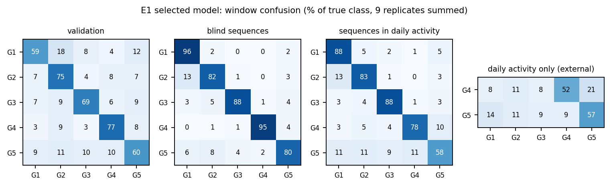

## E1 — sequence level: Gesture Timeline and Gesture Order, before and after decoding

Configurations: the selected model and the best 0.75 s and 1 s models, each with its decoder parameters chosen on validation (E3 grid). `no decoder` = averaged 10 Hz timeline + minimum-duration rule.

### E1 — validation

| window / decoder | frame macro F1 | seg F1@10 | seg F1@25 | seg F1@50 | Order EM | Order edit dist. | n |
|---|---|---|---|---|---|---|---|
| 0.75 s / no decoder | 36.7 ± 2.9 | 27.8 ± 3.7 | 25.1 ± 3.9 | 20.1 ± 4.0 | 3.1 ± 1.8 | 4.95 ± 1.41 | 9 |
| 0.75 s / HMM | 40.6 ± 4.7 | 51.4 ± 6.1 | 46.9 ± 6.6 | 40.1 ± 6.3 | 13.0 ± 2.6 | 1.28 ± 0.17 | 9 |
| 0.75 s / HSMM | 40.5 ± 4.8 | 48.3 ± 6.4 | 44.1 ± 6.7 | 37.2 ± 6.5 | 10.6 ± 3.1 | 1.57 ± 0.24 | 9 |
| 1 s / no decoder | 36.2 ± 2.8 | 30.8 ± 2.6 | 27.6 ± 2.8 | 20.8 ± 3.4 | 3.4 ± 1.4 | 3.66 ± 0.88 | 9 |
| 1 s / HMM | 38.8 ± 5.6 | 46.2 ± 5.5 | 41.7 ± 6.2 | 34.6 ± 6.1 | 12.2 ± 1.8 | 1.05 ± 0.14 | 9 |
| 1 s / HSMM | 39.5 ± 5.6 | 44.3 ± 4.5 | 39.9 ± 5.6 | 32.9 ± 5.7 | 10.7 ± 2.4 | 1.27 ± 0.18 | 9 |
| 5 s / no decoder | 40.6 ± 8.5 | 43.8 ± 10.0 | 39.8 ± 10.7 | 29.2 ± 10.7 | 10.9 ± 6.9 | 1.37 ± 0.34 | 9 |
| 5 s / HMM | 42.5 ± 8.1 | 49.5 ± 10.8 | 45.0 ± 12.0 | 35.1 ± 12.4 | 13.1 ± 5.8 | 0.94 ± 0.20 | 9 |
| 5 s / HSMM | 42.8 ± 8.0 | 49.0 ± 10.7 | 44.8 ± 11.8 | 34.7 ± 12.7 | 13.6 ± 5.8 | 0.89 ± 0.18 | 9 |

### E1 — blind sequences

| window / decoder | frame macro F1 | seg F1@10 | seg F1@25 | seg F1@50 | Order EM | Order edit dist. | n |
|---|---|---|---|---|---|---|---|
| 0.75 s / no decoder | 76.4 ± 1.6 | 71.5 ± 3.6 | 70.2 ± 3.8 | 62.4 ± 4.3 | 26.6 ± 11.5 | 0.61 ± 0.12 | 9 |
| 0.75 s / HMM | 76.3 ± 2.6 | 90.3 ± 2.3 | 89.9 ± 2.5 | 83.9 ± 4.1 | 63.6 ± 8.1 | 0.14 ± 0.03 | 9 |
| 0.75 s / HSMM | 77.4 ± 2.8 | 90.7 ± 2.3 | 90.4 ± 2.5 | 85.6 ± 3.9 | 66.1 ± 7.8 | 0.13 ± 0.04 | 9 |
| 1 s / no decoder | 73.0 ± 4.8 | 73.7 ± 6.2 | 72.0 ± 7.1 | 63.3 ± 9.5 | 29.3 ± 12.3 | 0.52 ± 0.15 | 9 |
| 1 s / HMM | 70.5 ± 5.1 | 85.5 ± 4.5 | 85.1 ± 4.7 | 75.9 ± 7.8 | 46.0 ± 14.3 | 0.22 ± 0.06 | 9 |
| 1 s / HSMM | 71.2 ± 5.3 | 85.6 ± 4.7 | 85.3 ± 4.9 | 77.8 ± 7.9 | 47.0 ± 14.2 | 0.21 ± 0.07 | 9 |
| 5 s / no decoder | 73.8 ± 1.3 | 93.8 ± 1.2 | 92.9 ± 1.5 | 83.9 ± 3.1 | 81.2 ± 3.4 | 0.07 ± 0.01 | 9 |
| 5 s / HMM | 71.8 ± 1.0 | 94.1 ± 0.9 | 93.4 ± 1.2 | 83.0 ± 1.9 | 74.7 ± 4.9 | 0.09 ± 0.02 | 9 |
| 5 s / HSMM | 70.3 ± 1.1 | 92.8 ± 1.6 | 92.5 ± 1.7 | 83.0 ± 2.2 | 69.1 ± 6.3 | 0.11 ± 0.03 | 9 |

### E1 — sequences in daily activity

| window / decoder | frame macro F1 | seg F1@10 | seg F1@25 | seg F1@50 | Order EM | Order edit dist. | n |
|---|---|---|---|---|---|---|---|
| 0.75 s / no decoder | 38.7 ± 3.2 | 30.0 ± 3.8 | 29.1 ± 3.7 | 25.0 ± 3.5 | 1.2 ± 0.9 | 3.98 ± 0.86 | 9 |
| 0.75 s / HMM | 41.6 ± 3.3 | 60.2 ± 3.4 | 58.2 ± 3.2 | 52.6 ± 3.7 | 8.2 ± 2.4 | 0.98 ± 0.11 | 9 |
| 0.75 s / HSMM | 41.6 ± 3.3 | 54.7 ± 2.8 | 53.2 ± 2.7 | 48.6 ± 2.9 | 6.3 ± 2.2 | 1.25 ± 0.11 | 9 |
| 1 s / no decoder | 43.2 ± 4.3 | 35.4 ± 4.4 | 34.1 ± 4.8 | 29.0 ± 5.8 | 1.1 ± 0.9 | 2.84 ± 0.55 | 9 |
| 1 s / HMM | 44.5 ± 5.3 | 58.2 ± 5.2 | 56.7 ± 5.5 | 49.5 ± 7.1 | 7.4 ± 3.3 | 0.77 ± 0.09 | 9 |
| 1 s / HSMM | 44.7 ± 5.5 | 53.9 ± 4.6 | 52.6 ± 4.9 | 46.6 ± 6.5 | 6.5 ± 2.7 | 1.00 ± 0.11 | 9 |
| 5 s / no decoder | 47.1 ± 4.9 | 55.6 ± 4.9 | 53.5 ± 5.2 | 45.0 ± 5.0 | 9.5 ± 4.4 | 1.00 ± 0.20 | 9 |
| 5 s / HMM | 48.9 ± 4.5 | 64.7 ± 4.7 | 62.2 ± 4.9 | 52.6 ± 5.1 | 15.7 ± 5.7 | 0.64 ± 0.11 | 9 |
| 5 s / HSMM | 49.4 ± 4.5 | 65.0 ± 4.2 | 62.7 ± 4.5 | 53.4 ± 5.4 | 15.9 ± 4.7 | 0.60 ± 0.10 | 9 |

### E1 — paired differences vs. no decoder (Wilcoxon, 9 replicates; smallest attainable p = 0.004)

| window | set | metric | HMM − none | p | HSMM − none | p |
|---|---|---|---|---|---|---|
| 0.75 s | blind sequences | seg F1@25 | +19.7 | 0.004 | +20.2 | 0.004 |
| 0.75 s | blind sequences | Order EM | +37.0 | 0.004 | +39.4 | 0.004 |
| 0.75 s | blind sequences | frame macro F1 | -0.2 | 0.910 | +0.9 | 0.250 |
| 0.75 s | sequences in daily activity | seg F1@25 | +29.1 | 0.004 | +24.1 | 0.004 |
| 0.75 s | sequences in daily activity | Order EM | +7.0 | 0.004 | +5.0 | 0.004 |
| 0.75 s | sequences in daily activity | frame macro F1 | +2.9 | 0.004 | +2.9 | 0.004 |
| 1 s | blind sequences | seg F1@25 | +13.0 | 0.004 | +13.2 | 0.004 |
| 1 s | blind sequences | Order EM | +16.7 | 0.004 | +17.7 | 0.004 |
| 1 s | blind sequences | frame macro F1 | -2.5 | 0.004 | -1.7 | 0.027 |
| 1 s | sequences in daily activity | seg F1@25 | +22.6 | 0.004 | +18.6 | 0.004 |
| 1 s | sequences in daily activity | Order EM | +6.3 | 0.004 | +5.3 | 0.004 |
| 1 s | sequences in daily activity | frame macro F1 | +1.3 | 0.027 | +1.5 | 0.027 |
| 5 s | blind sequences | seg F1@25 | +0.5 | 0.020 | -0.4 | 0.055 |
| 5 s | blind sequences | Order EM | -6.5 | 0.004 | -12.1 | 0.004 |
| 5 s | blind sequences | frame macro F1 | -1.9 | 0.004 | -3.5 | 0.004 |
| 5 s | sequences in daily activity | seg F1@25 | +8.7 | 0.004 | +9.2 | 0.004 |
| 5 s | sequences in daily activity | Order EM | +6.2 | 0.004 | +6.4 | 0.004 |
| 5 s | sequences in daily activity | frame macro F1 | +1.8 | 0.004 | +2.3 | 0.004 |

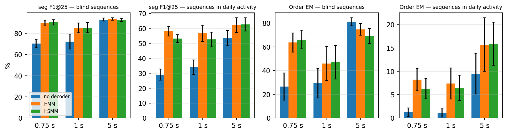

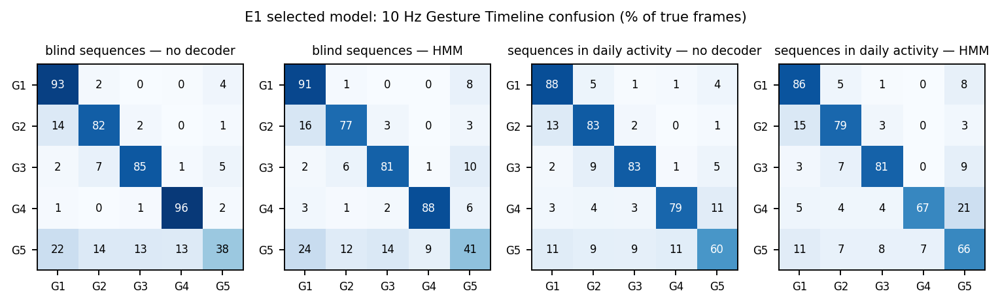

## E1 — intake decision per session

Sensitivity = sessions with an annotated intake detected; specificity = sessions without intake left undetected. False alarms per hour: intake events on the external test participants (daily activity only, never trained on). Rules on the decoded Gesture Timeline: `G3 present` (any G3 segment) and `G2 → G3` (a G3 segment preceded by G2). The LLR detector scores 40 s episodes from the timeline probabilities (independent of the decoder); its threshold is set per replicate on validation + external calibration participants for ≤ 0.5 and ≤ 1 false alarm/h, so the rate on the test participants checks that calibration.

### E1 — intake from the Gesture Timeline (rules)

| window / decoder | seq G3 present sens | seq G3 present spec | seq G3 present bacc | seq G2 → G3 sens | seq G2 → G3 spec | seq G2 → G3 bacc | wild G3 present sens | wild G3 present spec | wild G3 present bacc | wild G2 → G3 sens | wild G2 → G3 spec | wild G2 → G3 bacc | ext G3 present FA/h | n |
|---|---|---|---|---|---|---|---|---|---|---|---|---|---|---|
| 0.75 s / no decoder | 99.9 ± 0.2 | 63.6 ± 6.9 | 81.7 ± 3.4 | 87.1 ± 3.1 | 96.2 ± 2.6 | 91.7 ± 1.5 | 100.0 ± 0.0 | 5.0 ± 1.3 | 52.5 ± 0.7 | 92.7 ± 2.3 | 32.0 ± 4.9 | 62.3 ± 2.3 | 300.5 ± 29.4 | 9 |
| 0.75 s / HMM | 91.9 ± 4.0 | 97.4 ± 2.2 | 94.6 ± 1.8 | 67.4 ± 8.2 | 100.0 ± 0.0 | 83.7 ± 4.1 | 98.9 ± 0.6 | 20.3 ± 3.7 | 59.6 ± 1.8 | 74.2 ± 6.1 | 66.2 ± 7.1 | 70.2 ± 4.5 | 61.3 ± 4.5 | 9 |
| 0.75 s / HSMM | 93.6 ± 4.5 | 97.1 ± 2.9 | 95.3 ± 2.1 | 68.5 ± 7.0 | 100.0 ± 0.0 | 84.2 ± 3.5 | 99.3 ± 0.5 | 17.3 ± 3.4 | 58.3 ± 1.7 | 75.9 ± 4.8 | 61.4 ± 7.0 | 68.6 ± 4.1 | 98.7 ± 5.1 | 9 |
| 1 s / no decoder | 99.3 ± 0.6 | 61.1 ± 12.0 | 80.2 ± 6.1 | 82.7 ± 11.5 | 91.4 ± 4.3 | 87.1 ± 6.3 | 100.0 ± 0.0 | 4.9 ± 2.3 | 52.4 ± 1.1 | 87.9 ± 8.0 | 39.3 ± 6.8 | 63.6 ± 2.9 | 238.9 ± 34.8 | 9 |
| 1 s / HMM | 89.7 ± 5.9 | 93.7 ± 4.0 | 91.7 ± 2.4 | 56.3 ± 19.8 | 99.8 ± 0.3 | 78.1 ± 9.9 | 98.7 ± 0.8 | 20.8 ± 4.0 | 59.7 ± 2.1 | 58.8 ± 18.9 | 75.1 ± 5.4 | 67.0 ± 7.5 | 65.1 ± 7.3 | 9 |
| 1 s / HSMM | 92.4 ± 5.5 | 93.3 ± 4.1 | 92.9 ± 2.2 | 57.5 ± 20.0 | 99.9 ± 0.3 | 78.7 ± 10.0 | 99.4 ± 0.4 | 18.0 ± 3.6 | 58.7 ± 1.8 | 61.9 ± 19.4 | 70.7 ± 7.0 | 66.3 ± 6.9 | 96.0 ± 6.8 | 9 |
| 5 s / no decoder | 94.4 ± 2.7 | 99.8 ± 0.5 | 97.1 ± 1.4 | 80.0 ± 4.0 | 100.0 ± 0.0 | 90.0 ± 2.0 | 96.0 ± 1.6 | 46.6 ± 11.2 | 71.3 ± 5.6 | 84.6 ± 3.0 | 70.8 ± 7.9 | 77.7 ± 4.4 | 50.2 ± 16.5 | 9 |
| 5 s / HMM | 88.7 ± 6.4 | 99.9 ± 0.3 | 94.3 ± 3.2 | 71.7 ± 4.7 | 100.0 ± 0.0 | 85.9 ± 2.3 | 92.5 ± 3.4 | 59.7 ± 14.0 | 76.1 ± 6.5 | 77.9 ± 4.8 | 82.0 ± 6.6 | 79.9 ± 3.8 | 26.1 ± 11.6 | 9 |
| 5 s / HSMM | 83.8 ± 9.0 | 99.9 ± 0.3 | 91.8 ± 4.6 | 65.6 ± 5.6 | 100.0 ± 0.0 | 82.8 ± 2.8 | 87.4 ± 6.3 | 63.7 ± 14.3 | 75.5 ± 6.3 | 71.1 ± 5.7 | 84.4 ± 6.0 | 77.8 ± 3.5 | 23.3 ± 11.1 | 9 |

### E1 — intake from the LLR detector (calibrated false-alarm budget)

| window | ≤ 0.5/h: seq sens | ≤ 0.5/h: seq spec | ≤ 0.5/h: wild sens | ≤ 0.5/h: wild spec | ≤ 0.5/h: ext FA/h | ≤ 1/h: seq sens | ≤ 1/h: seq spec | ≤ 1/h: wild sens | ≤ 1/h: wild spec | ≤ 1/h: ext FA/h | n |
|---|---|---|---|---|---|---|---|---|---|---|---|
| 0.75 s | 0.7 ± 1.2 | 100.0 ± 0.0 | 4.1 ± 2.2 | 98.7 ± 1.2 | 0.3 ± 0.2 | 7.7 ± 10.1 | 100.0 ± 0.0 | 9.0 ± 7.6 | 97.8 ± 1.6 | 0.6 ± 0.5 | 9 |
| 1 s | 4.1 ± 4.8 | 100.0 ± 0.0 | 4.7 ± 3.7 | 99.0 ± 0.9 | 0.2 ± 0.2 | 13.9 ± 12.9 | 100.0 ± 0.0 | 10.9 ± 7.8 | 96.8 ± 3.3 | 0.6 ± 0.5 | 9 |
| 5 s | 23.1 ± 18.9 | 100.0 ± 0.0 | 26.3 ± 16.0 | 97.9 ± 1.1 | 0.6 ± 0.3 | 38.6 ± 14.0 | 100.0 ± 0.0 | 39.9 ± 12.1 | 96.7 ± 1.4 | 0.9 ± 0.3 | 9 |

### E1 — events per hour on the external participants (no gestures performed)

| window / decoder | any gesture events/h | G3 events/h (= G3 present FA/h) | n |
|---|---|---|---|
| 0.75 s / no decoder | 675.4 ± 119.8 | 300.5 ± 29.4 | 9 |
| 0.75 s / HMM | 146.2 ± 11.9 | 61.3 ± 4.5 | 9 |
| 0.75 s / HSMM | 217.0 ± 12.6 | 98.7 ± 5.1 | 9 |
| 1 s / no decoder | 504.1 ± 77.7 | 238.9 ± 34.8 | 9 |
| 1 s / HMM | 124.1 ± 12.1 | 65.1 ± 7.3 | 9 |
| 1 s / HSMM | 179.2 ± 16.2 | 96.0 ± 6.8 | 9 |
| 5 s / no decoder | 220.4 ± 29.9 | 50.2 ± 16.5 | 9 |
| 5 s / HMM | 124.6 ± 17.6 | 26.1 ± 11.6 | 9 |
| 5 s / HSMM | 113.8 ± 17.4 | 23.3 ± 11.1 | 9 |

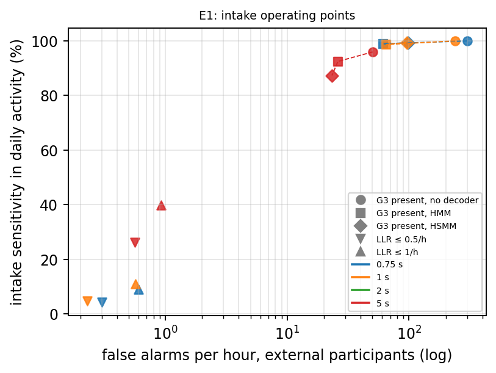

## E2 — window level: signal factors (stage A, CNN-BiLSTM, default hyperparameters)

Marginal means over the other four factors (240 configurations × 3 folds, seed 0). The tests use one value per configuration (mean over folds), blocked by the other factors.

### E2 — window (s)

| window (s) | val macro F1 | seq macro F1 | wild macro F1 | seq accuracy | ext gestures/h | ext G3/h | n |
|---|---|---|---|---|---|---|---|
| 0.5 | 60.2 ± 6.2 | 67.0 ± 4.9 | 61.1 ± 5.9 | 69.2 ± 4.4 | 198.6 ± 82.4 | 45.5 ± 27.6 | 144 |
| 0.75 | 65.5 ± 6.0 | 70.0 ± 4.4 | 65.8 ± 6.0 | 71.6 ± 4.0 | 183.5 ± 83.1 | 33.7 ± 16.8 | 144 |
| 1.0 | 68.8 ± 5.6 | 72.2 ± 4.2 | 69.0 ± 5.6 | 73.3 ± 3.9 | 141.4 ± 55.8 | 22.6 ± 11.9 | 144 |
| 2.0 | 75.3 ± 4.9 | 79.6 ± 3.3 | 77.9 ± 4.6 | 79.7 ± 3.1 | 72.9 ± 22.3 | 7.0 ± 3.1 | 144 |
| 5.0 | 74.9 ± 5.4 | 78.3 ± 3.1 | 80.2 ± 2.5 | 78.0 ± 3.7 | 37.3 ± 7.5 | 2.3 ± 1.3 | 144 |

### E2 — overlap

| overlap | val macro F1 | seq macro F1 | wild macro F1 | seq accuracy | ext gestures/h | ext G3/h | n |
|---|---|---|---|---|---|---|---|
| 0 % | 68.9 ± 8.1 | 73.7 ± 6.5 | 70.8 ± 8.8 | 74.9 ± 5.8 | 150.9 ± 106.5 | 28.6 ± 30.1 | 180 |
| 25 % | 69.0 ± 8.1 | 73.0 ± 6.1 | 70.7 ± 8.8 | 74.0 ± 5.3 | 125.1 ± 75.1 | 22.8 ± 20.0 | 180 |
| 50 % | 69.0 ± 8.1 | 73.6 ± 6.5 | 70.9 ± 8.9 | 74.5 ± 5.5 | 118.0 ± 76.7 | 19.8 ± 18.2 | 180 |
| 75 % | 68.8 ± 7.9 | 73.3 ± 6.2 | 70.9 ± 8.9 | 74.1 ± 5.3 | 112.8 ± 76.2 | 17.7 ± 17.2 | 180 |

### E2 — filter

| filter | val macro F1 | seq macro F1 | wild macro F1 | seq accuracy | ext gestures/h | ext G3/h | n |
|---|---|---|---|---|---|---|---|
| high-pass 0.3 Hz | 68.6 ± 8.3 | 73.3 ± 6.2 | 71.7 ± 8.9 | 73.5 ± 5.7 | 124.2 ± 94.3 | 21.7 ± 23.3 | 360 |
| raw | 69.3 ± 7.7 | 73.6 ± 6.4 | 69.9 ± 8.6 | 75.2 ± 5.1 | 129.2 ± 76.4 | 22.8 ± 21.4 | 360 |

### E2 — fs (Hz)

| fs (Hz) | val macro F1 | seq macro F1 | wild macro F1 | seq accuracy | ext gestures/h | ext G3/h | n |
|---|---|---|---|---|---|---|---|
| 20 | 66.7 ± 9.6 | 72.6 ± 7.3 | 67.6 ± 10.1 | 73.4 ± 6.7 | 165.3 ± 103.8 | 28.1 ± 25.3 | 240 |
| 50 | 69.6 ± 7.5 | 74.2 ± 5.7 | 71.3 ± 8.3 | 75.3 ± 4.7 | 132.5 ± 77.3 | 24.5 ± 23.7 | 240 |
| 100 | 70.5 ± 6.1 | 73.5 ± 5.7 | 73.5 ± 6.8 | 74.4 ± 4.6 | 82.4 ± 43.5 | 14.2 ± 13.8 | 240 |

### E2 — signals

| signals | val macro F1 | seq macro F1 | wild macro F1 | seq accuracy | ext gestures/h | ext G3/h | n |
|---|---|---|---|---|---|---|---|
| acc | 65.3 ± 7.7 | 70.3 ± 6.5 | 67.1 ± 9.0 | 71.8 ± 5.7 | 135.1 ± 97.8 | 25.1 ± 25.3 | 360 |
| acc+gyr | 72.5 ± 6.6 | 76.6 ± 4.2 | 74.5 ± 6.9 | 76.9 ± 3.8 | 118.3 ± 70.9 | 19.4 ± 18.5 | 360 |

### E2 — factor tests on blind sequences (test_sequences.window.macro_f1)

| factor | test | blocks | effect | p |
|---|---|---|---|---|
| window_s | Friedman | 48 | Kendall W = 0.90; best mean rank (highest): 2.0 | 2.4e-36 |
| overlap | Friedman | 60 | Kendall W = 0.19; best mean rank (highest): 0 % | 2.6e-07 |
| filter | Wilcoxon | 120 | raw − high-pass 0.3 Hz: +0.3 pts (wins 57 %) | 4.7e-02 |
| fs_hz | Friedman | 80 | Kendall W = 0.22; best mean rank (highest): 50 | 2.5e-08 |
| signals | Wilcoxon | 120 | acc+gyr − acc: +6.3 pts (wins 93 %) | 8.2e-21 |

### E2 — factor tests on daily activity (test_wild.window.macro_f1)

| factor | test | blocks | effect | p |
|---|---|---|---|---|
| window_s | Friedman | 48 | Kendall W = 0.96; best mean rank (highest): 5.0 | 5.6e-39 |
| overlap | Friedman | 60 | Kendall W = 0.07; best mean rank (highest): 75 % | 5.6e-03 |
| filter | Wilcoxon | 120 | raw − high-pass 0.3 Hz: -1.7 pts (wins 12 %) | 1.0e-14 |
| fs_hz | Friedman | 80 | Kendall W = 0.50; best mean rank (highest): 100 | 3.7e-18 |
| signals | Wilcoxon | 120 | acc+gyr − acc: +7.5 pts (wins 100 %) | 2.0e-21 |

### E2 — factor tests on ext G3 events/h (test_external.external.g3_events_per_hour)

| factor | test | blocks | effect | p |
|---|---|---|---|---|
| window_s | Friedman | 48 | Kendall W = 0.98; best mean rank (lowest): 5.0 | 8.8e-40 |
| overlap | Friedman | 60 | Kendall W = 0.58; best mean rank (lowest): 75 % | 1.7e-22 |
| filter | Wilcoxon | 120 | raw − high-pass 0.3 Hz: +1.1 /h (lower in 30 %) | 3.9e-03 |
| fs_hz | Friedman | 80 | Kendall W = 0.39; best mean rank (lowest): 100 | 1.9e-14 |
| signals | Wilcoxon | 120 | acc+gyr − acc: -5.7 /h (lower in 71 %) | 7.0e-08 |

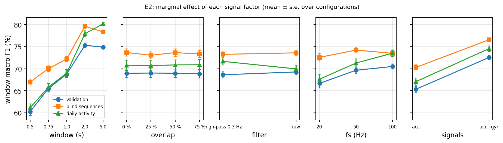

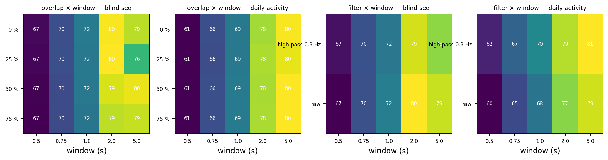

## E2 — window level: per-class metrics by window length (blind sequences)

### E2 — precision per class by window (blind sequences)

| window (s) | G1 | G2 | G3 | G4 | G5 | n |
|---|---|---|---|---|---|---|
| 0.5 | 67.1 ± 7.5 | 57.6 ± 3.6 | 58.7 ± 10.0 | 74.4 ± 10.1 | 80.9 ± 7.3 | 144 |
| 0.75 | 70.2 ± 7.1 | 60.3 ± 3.8 | 62.1 ± 8.8 | 77.7 ± 8.6 | 82.1 ± 6.8 | 144 |
| 1.0 | 72.5 ± 6.8 | 62.5 ± 4.3 | 64.6 ± 7.5 | 80.9 ± 8.4 | 82.3 ± 7.1 | 144 |
| 2.0 | 78.4 ± 5.6 | 71.7 ± 5.3 | 73.3 ± 5.0 | 88.1 ± 7.1 | 85.7 ± 7.3 | 144 |
| 5.0 | 62.8 ± 13.0 | 72.8 ± 6.6 | 67.2 ± 4.9 | 87.4 ± 4.0 | 93.4 ± 4.2 | 144 |

### E2 — recall per class by window (blind sequences)

| window (s) | G1 | G2 | G3 | G4 | G5 | n |
|---|---|---|---|---|---|---|
| 0.5 | 62.3 ± 6.6 | 63.2 ± 13.8 | 65.2 ± 8.0 | 65.9 ± 5.2 | 80.1 ± 9.8 | 144 |
| 0.75 | 65.6 ± 7.8 | 68.5 ± 12.2 | 70.8 ± 7.0 | 69.9 ± 4.8 | 78.2 ± 9.5 | 144 |
| 1.0 | 68.2 ± 8.0 | 71.9 ± 11.8 | 74.8 ± 6.5 | 72.8 ± 5.1 | 77.1 ± 9.5 | 144 |
| 2.0 | 79.8 ± 10.2 | 82.6 ± 10.6 | 85.0 ± 4.7 | 83.8 ± 4.1 | 73.9 ± 7.7 | 144 |
| 5.0 | 93.3 ± 4.9 | 89.1 ± 6.3 | 89.2 ± 3.8 | 92.7 ± 3.2 | 58.5 ± 10.3 | 144 |

### E2 — f1 per class by window (blind sequences)

| window (s) | G1 | G2 | G3 | G4 | G5 | macro F1 | n |
|---|---|---|---|---|---|---|---|
| 0.5 | 64.4 ± 6.2 | 59.4 ± 6.9 | 61.5 ± 8.4 | 69.5 ± 5.6 | 80.0 ± 6.1 | 67.0 ± 4.9 | 144 |
| 0.75 | 67.7 ± 6.7 | 63.5 ± 5.6 | 66.0 ± 7.4 | 73.3 ± 5.1 | 79.6 ± 5.6 | 70.0 ± 4.4 | 144 |
| 1.0 | 70.1 ± 6.7 | 66.3 ± 5.4 | 69.1 ± 6.3 | 76.3 ± 5.1 | 79.0 ± 5.1 | 72.2 ± 4.2 | 144 |
| 2.0 | 78.8 ± 7.0 | 76.1 ± 4.1 | 78.6 ± 3.8 | 85.7 ± 4.4 | 78.8 ± 3.5 | 79.6 ± 3.3 | 144 |
| 5.0 | 74.1 ± 9.8 | 79.8 ± 4.5 | 76.5 ± 3.7 | 89.9 ± 2.7 | 71.4 ± 7.7 | 78.3 ± 3.1 | 144 |

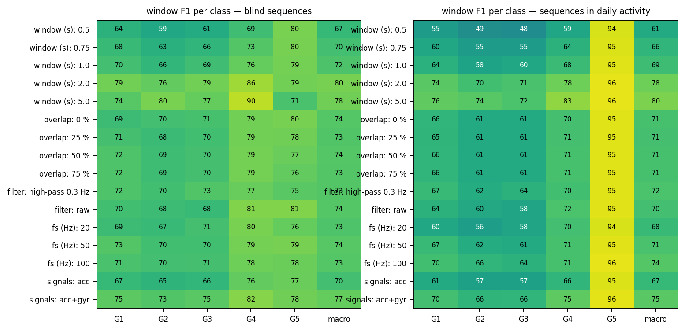

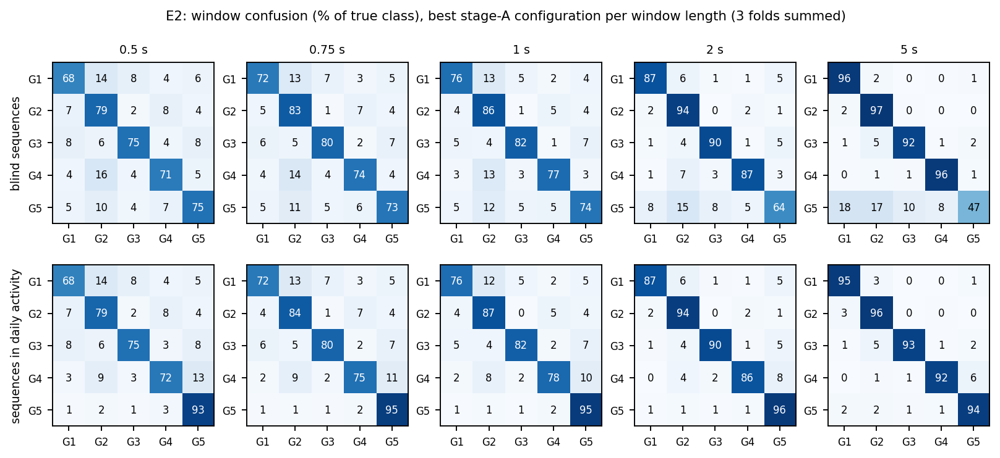

### E2 — best stage-A configuration per window length (selected on validation)

| window / configuration | val macro | seq F1 G1 | seq F1 G2 | seq F1 G3 | seq F1 G4 | seq F1 G5 | seq macro | wild macro | n |
|---|---|---|---|---|---|---|---|---|---|
| 0.5 s / cnn_bilstm__fs100_w050_ov50_accgyr_hp03__hpdef | 67.5 ± 3.8 | 71.6 ± 1.2 | 68.2 ± 1.5 | 70.7 ± 2.7 | 72.6 ± 1.1 | 80.2 ± 0.9 | 72.7 ± 0.5 | 70.0 ± 0.4 | 3 |
| 0.75 s / cnn_bilstm__fs100_w075_ov75_accgyr_hp03__hpdef | 72.1 ± 3.9 | 74.9 ± 1.2 | 70.6 ± 2.2 | 74.3 ± 1.7 | 76.1 ± 1.4 | 79.6 ± 1.2 | 75.1 ± 0.8 | 74.5 ± 0.4 | 3 |
| 1 s / cnn_bilstm__fs100_w100_ov50_accgyr_hp03__hpdef | 74.8 ± 4.8 | 79.0 ± 1.4 | 72.6 ± 2.2 | 77.0 ± 1.4 | 79.7 ± 0.4 | 80.6 ± 0.9 | 77.8 ± 0.4 | 77.7 ± 0.5 | 3 |
| 2 s / cnn_bilstm__fs100_w200_ov75_accgyr_hp03__hpdef | 78.7 ± 4.4 | 86.0 ± 1.1 | 78.9 ± 1.9 | 81.4 ± 1.6 | 87.7 ± 0.6 | 75.2 ± 1.2 | 81.9 ± 0.6 | 84.0 ± 0.7 | 3 |
| 5 s / cnn_bilstm__fs50_w500_ov75_accgyr_hp03__hpdef | 76.6 ± 5.4 | 84.2 ± 2.4 | 81.7 ± 1.3 | 80.6 ± 1.7 | 90.8 ± 1.2 | 62.9 ± 2.1 | 80.0 ± 0.5 | 83.9 ± 0.7 | 3 |

## E2 — window level: selected model `cnn_bilstm__fs100_w200_ov75_accgyr_hp03__hp05` (3 folds × 3 seeds)

### E2 — selection path

| stage | advanced (first) | val seg F1@25 (selection score) |
|---|---|---|
| A | `cnn_bilstm__fs100_w200_ov75_accgyr_hp03__hpdef` | 81.0 ± 5.9 |
| B | `cnn__fs100_w200_ov75_accgyr_hp03__hpdef` | 81.7 ± 5.5 |
| C | `cnn_bilstm__fs100_w200_ov75_accgyr_hp03__hp05` | 83.0 ± 5.6 |
| F | `cnn_bilstm__fs100_w200_ov75_accgyr_hp03__hp05` | 82.5 ± 6.2 |

### E2 — selected model, window metrics per class

| set | class | precision | recall | F1 |
|---|---|---|---|---|
| validation | G1 open | 63.6 ± 8.9 | 81.9 ± 6.4 | 71.3 ± 6.6 |
| validation | G2 pick | 68.6 ± 12.6 | 81.9 ± 5.5 | 73.7 ± 6.4 |
| validation | G3 to mouth | 71.5 ± 7.1 | 81.0 ± 13.9 | 75.3 ± 8.2 |
| validation | G4 drink | 80.1 ± 3.9 | 85.5 ± 9.4 | 82.4 ± 4.6 |
| validation | G5 rest/other | 98.6 ± 0.7 | 96.8 ± 0.6 | 97.7 ± 0.3 |
| validation | macro | — | — | 80.1 ± 4.9 |
| blind sequences | G1 open | 84.7 ± 2.7 | 81.8 ± 5.3 | 83.1 ± 2.3 |
| blind sequences | G2 pick | 70.0 ± 3.1 | 92.6 ± 1.1 | 79.7 ± 1.9 |
| blind sequences | G3 to mouth | 75.8 ± 3.7 | 86.5 ± 2.2 | 80.7 ± 1.9 |
| blind sequences | G4 drink | 90.5 ± 1.3 | 87.1 ± 2.6 | 88.7 ± 0.9 |
| blind sequences | G5 rest/other | 86.5 ± 3.0 | 70.2 ± 4.6 | 77.3 ± 1.8 |
| blind sequences | macro | — | — | 81.9 ± 0.8 |
| sequences in daily activity | G1 open | 83.2 ± 2.4 | 81.9 ± 5.3 | 82.4 ± 2.3 |
| sequences in daily activity | G2 pick | 66.8 ± 3.3 | 93.2 ± 0.9 | 77.8 ± 2.2 |
| sequences in daily activity | G3 to mouth | 71.4 ± 3.4 | 86.9 ± 2.2 | 78.3 ± 2.0 |
| sequences in daily activity | G4 drink | 82.3 ± 1.1 | 85.2 ± 1.3 | 83.7 ± 0.7 |
| sequences in daily activity | G5 rest/other | 98.7 ± 0.2 | 96.4 ± 0.3 | 97.6 ± 0.1 |
| sequences in daily activity | macro | — | — | 84.0 ± 0.7 |
| validation | accuracy | | | 94.9 ± 1.0 |
| blind sequences | accuracy | | | 81.5 ± 0.8 |
| sequences in daily activity | accuracy | | | 94.9 ± 0.2 |

External participants (daily activity only, no protocol gestures): 39.0 ± 2.9 gesture events/h, 2.4 ± 1.1 G3 events/h (timeline rule, no decoder).

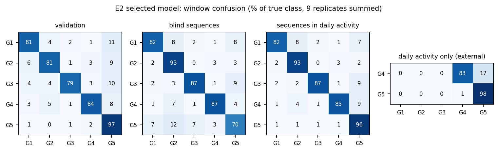

## E2 — sequence level: Gesture Timeline and Gesture Order, before and after decoding

Configurations: the selected model and the best 0.75 s and 1 s models, each with its decoder parameters chosen on validation (E3 grid). `no decoder` = averaged 10 Hz timeline + minimum-duration rule.

### E2 — validation

| window / decoder | frame macro F1 | seg F1@10 | seg F1@25 | seg F1@50 | Order EM | Order edit dist. | n |
|---|---|---|---|---|---|---|---|
| 0.75 s / no decoder | 80.3 ± 5.5 | 69.5 ± 9.4 | 67.7 ± 10.1 | 54.6 ± 10.4 | 41.8 ± 10.7 | 0.75 ± 0.42 | 9 |
| 0.75 s / HMM | 81.9 ± 5.4 | 83.3 ± 6.0 | 82.9 ± 6.3 | 78.1 ± 8.0 | 57.5 ± 10.2 | 0.29 ± 0.15 | 9 |
| 0.75 s / HSMM | 81.6 ± 5.4 | 83.3 ± 6.2 | 83.1 ± 6.3 | 78.0 ± 8.5 | 57.6 ± 11.6 | 0.28 ± 0.15 | 9 |
| 1 s / no decoder | 81.6 ± 4.4 | 75.5 ± 6.5 | 74.2 ± 6.8 | 62.4 ± 7.3 | 47.5 ± 8.3 | 0.52 ± 0.25 | 9 |
| 1 s / HMM | 80.5 ± 4.7 | 83.6 ± 5.5 | 83.1 ± 5.9 | 76.2 ± 7.6 | 55.2 ± 9.1 | 0.30 ± 0.15 | 9 |
| 1 s / HSMM | 80.8 ± 4.8 | 83.4 ± 5.6 | 83.2 ± 5.7 | 76.9 ± 8.3 | 55.4 ± 10.0 | 0.29 ± 0.14 | 9 |
| 2 s / no decoder | 83.3 ± 4.9 | 82.9 ± 6.1 | 82.5 ± 6.2 | 74.5 ± 8.1 | 61.2 ± 11.9 | 0.28 ± 0.16 | 9 |
| 2 s / HMM | 79.3 ± 5.1 | 85.2 ± 6.5 | 84.5 ± 7.1 | 71.0 ± 11.9 | 63.6 ± 14.1 | 0.24 ± 0.15 | 9 |
| 2 s / HSMM | 79.9 ± 5.4 | 84.4 ± 7.0 | 84.0 ± 7.4 | 71.2 ± 12.6 | 63.3 ± 14.8 | 0.22 ± 0.13 | 9 |

### E2 — blind sequences

| window / decoder | frame macro F1 | seg F1@10 | seg F1@25 | seg F1@50 | Order EM | Order edit dist. | n |
|---|---|---|---|---|---|---|---|
| 0.75 s / no decoder | 80.7 ± 2.2 | 77.6 ± 4.6 | 77.1 ± 4.8 | 70.0 ± 5.4 | 31.8 ± 11.1 | 0.47 ± 0.14 | 9 |
| 0.75 s / HMM | 78.8 ± 1.7 | 92.2 ± 1.8 | 91.9 ± 1.8 | 86.0 ± 3.0 | 64.6 ± 7.6 | 0.14 ± 0.03 | 9 |
| 0.75 s / HSMM | 78.6 ± 1.3 | 92.4 ± 1.4 | 92.2 ± 1.3 | 86.8 ± 2.2 | 66.0 ± 4.7 | 0.13 ± 0.02 | 9 |
| 1 s / no decoder | 81.3 ± 1.3 | 83.5 ± 2.8 | 83.1 ± 2.9 | 77.7 ± 3.9 | 42.3 ± 7.0 | 0.32 ± 0.08 | 9 |
| 1 s / HMM | 77.6 ± 1.2 | 91.3 ± 1.3 | 91.1 ± 1.4 | 84.0 ± 1.6 | 59.1 ± 5.2 | 0.16 ± 0.02 | 9 |
| 1 s / HSMM | 77.7 ± 1.0 | 93.0 ± 1.1 | 92.8 ± 1.1 | 87.4 ± 2.1 | 67.6 ± 4.4 | 0.12 ± 0.02 | 9 |
| 2 s / no decoder | 82.2 ± 0.7 | 94.0 ± 1.1 | 93.8 ± 1.1 | 91.5 ± 1.4 | 73.8 ± 4.9 | 0.10 ± 0.02 | 9 |
| 2 s / HMM | 75.0 ± 0.8 | 95.2 ± 0.7 | 95.0 ± 0.7 | 91.2 ± 1.2 | 75.9 ± 3.5 | 0.09 ± 0.01 | 9 |
| 2 s / HSMM | 74.3 ± 0.6 | 96.5 ± 0.4 | 96.3 ± 0.4 | 92.4 ± 0.8 | 83.5 ± 1.8 | 0.06 ± 0.01 | 9 |

### E2 — sequences in daily activity

| window / decoder | frame macro F1 | seg F1@10 | seg F1@25 | seg F1@50 | Order EM | Order edit dist. | n |
|---|---|---|---|---|---|---|---|
| 0.75 s / no decoder | 81.7 ± 1.9 | 72.8 ± 4.4 | 71.5 ± 4.7 | 61.1 ± 4.7 | 27.0 ± 9.3 | 0.54 ± 0.14 | 9 |
| 0.75 s / HMM | 82.6 ± 1.1 | 90.1 ± 1.3 | 89.7 ± 1.3 | 84.4 ± 2.0 | 61.4 ± 5.6 | 0.15 ± 0.03 | 9 |
| 0.75 s / HSMM | 82.7 ± 0.9 | 90.0 ± 1.1 | 89.8 ± 1.2 | 84.5 ± 1.6 | 63.7 ± 4.9 | 0.15 ± 0.02 | 9 |
| 1 s / no decoder | 82.7 ± 1.1 | 78.8 ± 2.7 | 77.6 ± 2.7 | 68.2 ± 3.1 | 36.1 ± 7.4 | 0.37 ± 0.09 | 9 |
| 1 s / HMM | 81.4 ± 0.9 | 88.9 ± 1.1 | 88.6 ± 1.1 | 81.9 ± 1.7 | 54.8 ± 4.0 | 0.18 ± 0.02 | 9 |
| 1 s / HSMM | 82.6 ± 0.8 | 90.3 ± 0.9 | 90.0 ± 0.9 | 84.9 ± 1.7 | 62.7 ± 4.0 | 0.14 ± 0.02 | 9 |
| 2 s / no decoder | 86.8 ± 0.6 | 90.1 ± 0.9 | 89.7 ± 0.9 | 86.8 ± 1.1 | 66.6 ± 4.3 | 0.14 ± 0.02 | 9 |
| 2 s / HMM | 84.1 ± 0.6 | 92.6 ± 0.6 | 92.5 ± 0.6 | 89.4 ± 1.2 | 72.8 ± 2.9 | 0.11 ± 0.01 | 9 |
| 2 s / HSMM | 84.6 ± 0.4 | 93.7 ± 0.5 | 93.6 ± 0.5 | 90.5 ± 0.8 | 79.3 ± 1.8 | 0.08 ± 0.01 | 9 |

### E2 — paired differences vs. no decoder (Wilcoxon, 9 replicates; smallest attainable p = 0.004)

| window | set | metric | HMM − none | p | HSMM − none | p |
|---|---|---|---|---|---|---|
| 0.75 s | blind sequences | seg F1@25 | +14.8 | 0.004 | +15.1 | 0.004 |
| 0.75 s | blind sequences | Order EM | +32.9 | 0.004 | +34.2 | 0.004 |
| 0.75 s | blind sequences | frame macro F1 | -2.0 | 0.004 | -2.1 | 0.004 |
| 0.75 s | sequences in daily activity | seg F1@25 | +18.2 | 0.004 | +18.2 | 0.004 |
| 0.75 s | sequences in daily activity | Order EM | +34.5 | 0.004 | +36.7 | 0.004 |
| 0.75 s | sequences in daily activity | frame macro F1 | +1.0 | 0.055 | +1.0 | 0.074 |
| 1 s | blind sequences | seg F1@25 | +8.0 | 0.004 | +9.7 | 0.004 |
| 1 s | blind sequences | Order EM | +16.8 | 0.004 | +25.3 | 0.004 |
| 1 s | blind sequences | frame macro F1 | -3.7 | 0.004 | -3.6 | 0.004 |
| 1 s | sequences in daily activity | seg F1@25 | +11.0 | 0.004 | +12.4 | 0.004 |
| 1 s | sequences in daily activity | Order EM | +18.7 | 0.004 | +26.6 | 0.004 |
| 1 s | sequences in daily activity | frame macro F1 | -1.3 | 0.004 | -0.2 | 0.734 |
| 2 s | blind sequences | seg F1@25 | +1.2 | 0.004 | +2.6 | 0.004 |
| 2 s | blind sequences | Order EM | +2.1 | 0.078 | +9.7 | 0.004 |
| 2 s | blind sequences | frame macro F1 | -7.2 | 0.004 | -8.0 | 0.004 |
| 2 s | sequences in daily activity | seg F1@25 | +2.8 | 0.004 | +3.9 | 0.004 |
| 2 s | sequences in daily activity | Order EM | +6.2 | 0.004 | +12.6 | 0.004 |
| 2 s | sequences in daily activity | frame macro F1 | -2.7 | 0.004 | -2.1 | 0.004 |

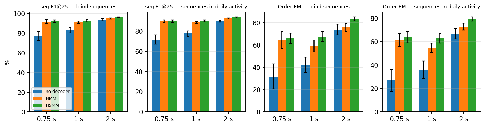

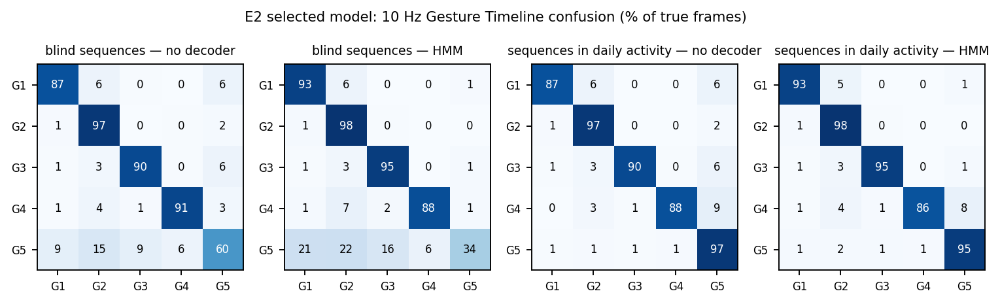

## E2 — intake decision per session

Sensitivity = sessions with an annotated intake detected; specificity = sessions without intake left undetected. False alarms per hour: intake events on the external test participants (daily activity only, never trained on). Rules on the decoded Gesture Timeline: `G3 present` (any G3 segment) and `G2 → G3` (a G3 segment preceded by G2). The LLR detector scores 40 s episodes from the timeline probabilities (independent of the decoder); its threshold is set per replicate on validation + external calibration participants for ≤ 0.5 and ≤ 1 false alarm/h, so the rate on the test participants checks that calibration.

### E2 — intake from the Gesture Timeline (rules)

| window / decoder | seq G3 present sens | seq G3 present spec | seq G3 present bacc | seq G2 → G3 sens | seq G2 → G3 spec | seq G2 → G3 bacc | wild G3 present sens | wild G3 present spec | wild G3 present bacc | wild G2 → G3 sens | wild G2 → G3 spec | wild G2 → G3 bacc | ext G3 present FA/h | n |
|---|---|---|---|---|---|---|---|---|---|---|---|---|---|---|
| 0.75 s / no decoder | 99.7 ± 0.2 | 69.7 ± 11.8 | 84.7 ± 5.8 | 96.0 ± 0.5 | 93.7 ± 4.0 | 94.8 ± 1.8 | 99.7 ± 0.2 | 63.2 ± 12.4 | 81.5 ± 6.2 | 96.2 ± 0.4 | 88.7 ± 5.9 | 92.5 ± 2.9 | 8.2 ± 2.7 | 9 |
| 0.75 s / HMM | 97.9 ± 0.8 | 98.3 ± 1.2 | 98.1 ± 0.5 | 93.8 ± 0.8 | 100.0 ± 0.0 | 96.9 ± 0.4 | 98.2 ± 0.7 | 96.0 ± 1.6 | 97.1 ± 0.6 | 94.1 ± 0.7 | 98.9 ± 0.6 | 96.5 ± 0.5 | 0.6 ± 0.2 | 9 |
| 0.75 s / HSMM | 98.2 ± 0.8 | 97.9 ± 1.9 | 98.0 ± 0.9 | 94.0 ± 0.8 | 100.0 ± 0.0 | 97.0 ± 0.4 | 98.5 ± 0.7 | 94.1 ± 2.5 | 96.3 ± 1.1 | 94.3 ± 0.7 | 98.0 ± 0.9 | 96.1 ± 0.6 | 1.5 ± 0.4 | 9 |
| 1 s / no decoder | 99.6 ± 0.3 | 76.4 ± 10.6 | 88.0 ± 5.2 | 96.0 ± 0.3 | 97.4 ± 2.0 | 96.7 ± 0.9 | 99.7 ± 0.2 | 70.6 ± 14.0 | 85.1 ± 7.0 | 96.2 ± 0.5 | 93.0 ± 3.7 | 94.6 ± 1.9 | 6.7 ± 3.1 | 9 |
| 1 s / HMM | 97.9 ± 1.1 | 95.0 ± 3.2 | 96.4 ± 1.3 | 93.7 ± 1.1 | 99.9 ± 0.3 | 96.8 ± 0.5 | 98.5 ± 1.1 | 91.3 ± 2.7 | 94.9 ± 1.4 | 94.3 ± 1.1 | 98.0 ± 0.4 | 96.2 ± 0.6 | 1.1 ± 0.4 | 9 |
| 1 s / HSMM | 98.2 ± 1.5 | 98.3 ± 1.1 | 98.2 ± 1.0 | 94.0 ± 1.5 | 99.9 ± 0.3 | 96.9 ± 0.7 | 98.1 ± 1.0 | 94.7 ± 1.7 | 96.4 ± 1.1 | 93.9 ± 1.1 | 98.6 ± 0.7 | 96.2 ± 0.6 | 1.5 ± 0.4 | 9 |
| 2 s / no decoder | 99.1 ± 0.6 | 98.2 ± 2.6 | 98.6 ± 1.3 | 94.9 ± 0.6 | 100.0 ± 0.0 | 97.5 ± 0.3 | 99.1 ± 0.5 | 96.1 ± 2.4 | 97.6 ± 1.0 | 94.9 ± 0.5 | 98.6 ± 0.9 | 96.8 ± 0.5 | 2.4 ± 1.1 | 9 |
| 2 s / HMM | 99.2 ± 0.4 | 98.8 ± 1.7 | 99.0 ± 1.0 | 95.1 ± 0.4 | 100.0 ± 0.0 | 97.5 ± 0.2 | 99.1 ± 0.4 | 97.5 ± 1.3 | 98.3 ± 0.6 | 95.0 ± 0.4 | 98.9 ± 0.6 | 96.9 ± 0.3 | 1.6 ± 0.6 | 9 |
| 2 s / HSMM | 99.0 ± 0.4 | 99.6 ± 0.8 | 99.3 ± 0.5 | 94.8 ± 0.4 | 100.0 ± 0.0 | 97.4 ± 0.2 | 98.7 ± 0.6 | 98.5 ± 0.9 | 98.6 ± 0.6 | 94.6 ± 0.6 | 99.0 ± 0.5 | 96.8 ± 0.4 | 1.3 ± 0.5 | 9 |

### E2 — intake from the LLR detector (calibrated false-alarm budget)

| window | ≤ 0.5/h: seq sens | ≤ 0.5/h: seq spec | ≤ 0.5/h: wild sens | ≤ 0.5/h: wild spec | ≤ 0.5/h: ext FA/h | ≤ 1/h: seq sens | ≤ 1/h: seq spec | ≤ 1/h: wild sens | ≤ 1/h: wild spec | ≤ 1/h: ext FA/h | n |
|---|---|---|---|---|---|---|---|---|---|---|---|
| 0.75 s | 99.1 ± 0.4 | 98.9 ± 0.9 | 99.2 ± 0.3 | 95.9 ± 1.5 | 0.3 ± 0.2 | 99.4 ± 0.3 | 98.0 ± 1.4 | 99.3 ± 0.3 | 94.9 ± 1.9 | 0.6 ± 0.3 | 9 |
| 1 s | 97.1 ± 0.8 | 98.5 ± 1.5 | 98.3 ± 1.1 | 94.5 ± 1.0 | 0.4 ± 0.2 | 97.7 ± 0.7 | 97.7 ± 1.7 | 98.5 ± 1.1 | 93.4 ± 1.6 | 0.7 ± 0.3 | 9 |
| 2 s | 98.4 ± 1.0 | 99.7 ± 0.5 | 98.8 ± 0.5 | 98.0 ± 1.4 | 0.5 ± 0.2 | 98.8 ± 0.6 | 99.4 ± 1.3 | 99.1 ± 0.5 | 97.7 ± 1.7 | 0.8 ± 0.3 | 9 |

### E2 — events per hour on the external participants (no gestures performed)

| window / decoder | any gesture events/h | G3 events/h (= G3 present FA/h) | n |
|---|---|---|---|
| 0.75 s / no decoder | 67.9 ± 9.1 | 8.2 ± 2.7 | 9 |
| 0.75 s / HMM | 15.4 ± 0.9 | 0.6 ± 0.2 | 9 |
| 0.75 s / HSMM | 21.0 ± 2.1 | 1.5 ± 0.4 | 9 |
| 1 s / no decoder | 55.6 ± 8.9 | 6.7 ± 3.1 | 9 |
| 1 s / HMM | 17.6 ± 2.3 | 1.1 ± 0.4 | 9 |
| 1 s / HSMM | 19.6 ± 3.8 | 1.5 ± 0.4 | 9 |
| 2 s / no decoder | 39.0 ± 2.9 | 2.4 ± 1.1 | 9 |
| 2 s / HMM | 29.5 ± 2.1 | 1.6 ± 0.6 | 9 |
| 2 s / HSMM | 27.1 ± 1.9 | 1.3 ± 0.5 | 9 |

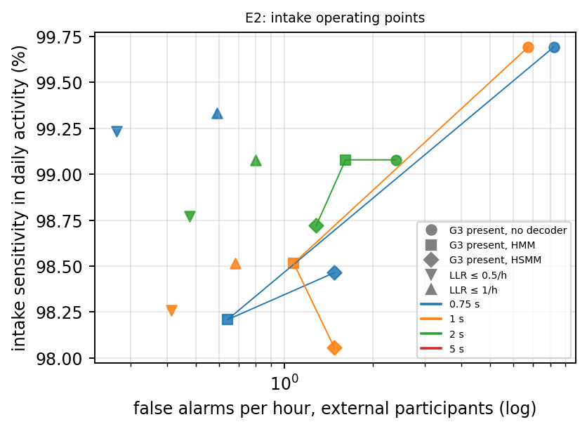

## Example Gesture Timeline

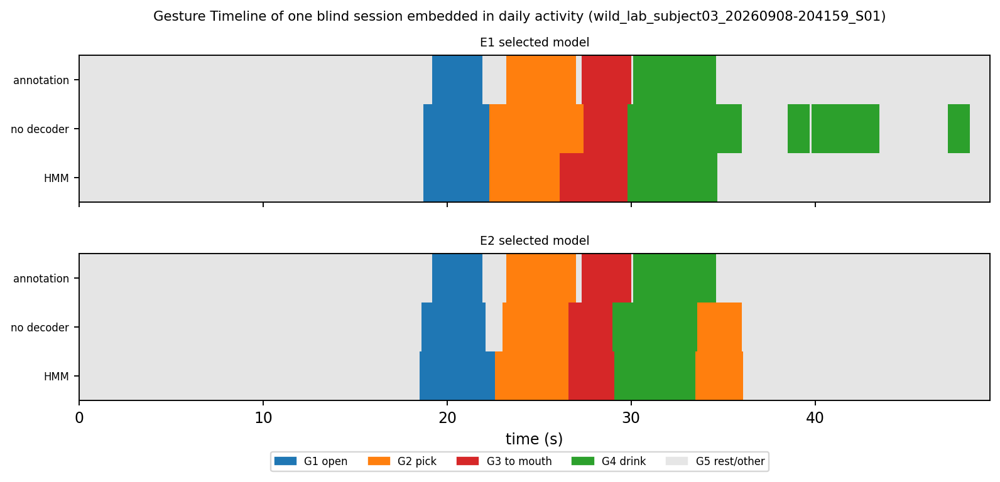

## E1 vs E2

### Same 240 signal configurations trained under E1 and under E2 (stage A, paired by configuration)

| metric | E1 mean | E2 mean | E2 − E1 | E2 better in | Wilcoxon p |
|---|---|---|---|---|---|
| val window macro F1 | 31.4 | 68.9 | +37.6 | 100 % of 240 | 4.0e-41 |
| seq window macro F1 | 76.1 | 73.4 | -2.7 | 14 % of 240 | 1.4e-26 |
| wild window macro F1 | 35.2 | 70.8 | +35.6 | 100 % of 240 | 4.0e-41 |
| seq seg F1@25 | 75.8 | 76.6 | +0.8 | 53 % of 240 | 1.5e-02 |
| wild seg F1@25 | 29.9 | 65.8 | +36.0 | 100 % of 240 | 4.0e-41 |
| seq G5 F1 | 83.6 | 77.8 | -5.8 | 16 % of 240 | 8.1e-30 |
| wild G5 F1 | 56.2 | 95.3 | +39.1 | 100 % of 240 | 4.0e-41 |
| ext gesture events/h | 783.6 | 126.7 | -656.8 | 100 % of 240 | 4.0e-41 |
| ext G3 events/h | 268.0 | 22.2 | -245.7 | 100 % of 240 | 4.0e-41 |

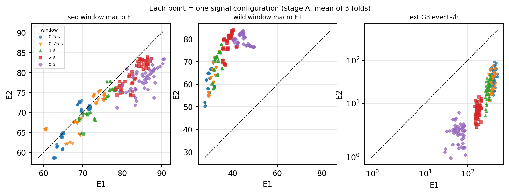

### Selected models: E1 `cnn_bilstm__fs50_w500_ov75_acc_raw__hp14` vs E2 `cnn_bilstm__fs100_w200_ov75_accgyr_hp03__hp05` (3 folds × 3 seeds)

| level | metric | E1 | E2 |
|---|---|---|---|
| window | window macro F1 — blind seq | 87.1 ± 1.2 | 81.9 ± 0.8 |
| window | window macro F1 — daily activity | 45.7 ± 4.3 | 84.0 ± 0.7 |
| window | window G5 precision — daily activity | 98.1 ± 0.4 | 98.7 ± 0.2 |
| window | window G3 precision — daily activity | 19.5 ± 6.0 | 71.4 ± 3.4 |
| sequence | seg F1@25 — blind sequences — no decoder | 92.9 ± 1.5 | 93.8 ± 1.1 |
| sequence | Order EM — blind sequences — no decoder | 81.2 ± 3.4 | 73.8 ± 4.9 |
| sequence | seg F1@25 — sequences in daily activity — no decoder | 53.5 ± 5.2 | 89.7 ± 0.9 |
| sequence | Order EM — sequences in daily activity — no decoder | 9.5 ± 4.4 | 66.6 ± 4.3 |
| sequence | seg F1@25 — blind sequences — HMM | 93.4 ± 1.2 | 95.0 ± 0.7 |
| sequence | Order EM — blind sequences — HMM | 74.7 ± 4.9 | 75.9 ± 3.5 |
| sequence | seg F1@25 — sequences in daily activity — HMM | 62.2 ± 4.9 | 92.5 ± 0.6 |
| sequence | Order EM — sequences in daily activity — HMM | 15.7 ± 5.7 | 72.8 ± 2.9 |
| intake | LLR ≤1 FA/h sensitivity — blind sequences | 38.6 ± 14.0 | 98.8 ± 0.6 |
| intake | LLR ≤1 FA/h specificity — blind sequences | 100.0 ± 0.0 | 99.4 ± 1.3 |
| intake | LLR ≤1 FA/h sensitivity — sequences in daily activity | 39.9 ± 12.1 | 99.1 ± 0.5 |
| intake | LLR ≤1 FA/h specificity — sequences in daily activity | 96.7 ± 1.4 | 97.7 ± 1.7 |
| intake | G3 rule FA/h — no decoder | 50.2 ± 16.5 | 2.4 ± 1.1 |
| intake | G3 rule FA/h — HMM | 26.1 ± 11.6 | 1.6 ± 0.6 |
| intake | LLR ≤1 FA/h — FA/h | 0.9 ± 0.3 | 0.8 ± 0.3 |

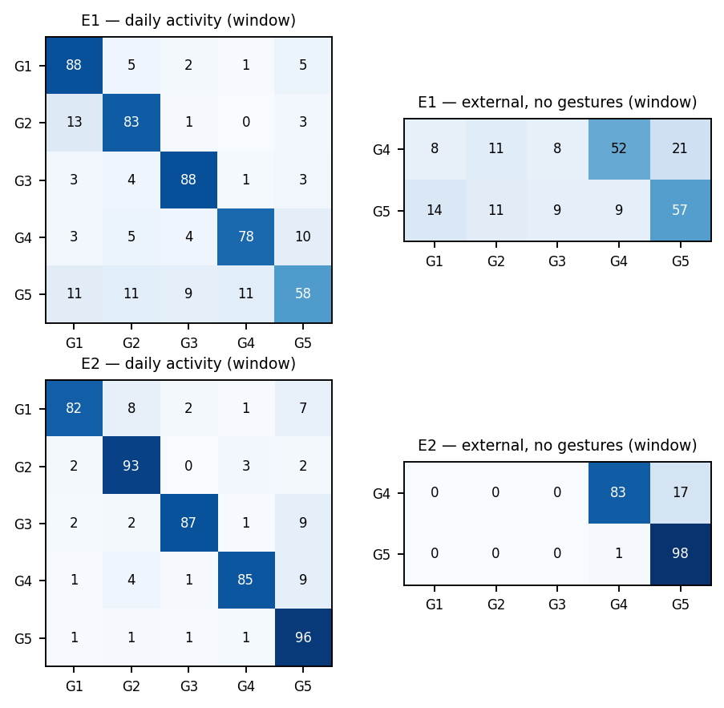

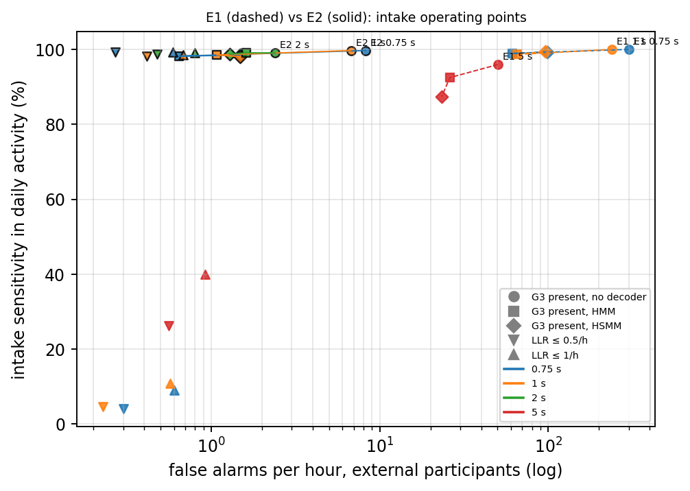

